<div align="center">


<br>

### 교육 운영 업무 자동화 포털 · 프론트엔드

과정을 등록하면 할 일과 마감이 자동으로 생기고,<br>담당자 처리부터 리더 확인까지 한 포털에서 관리합니다.

<br>


<br>

**[▶ 데모 사이트 열기](https://modo-work.lllillly.workers.dev/)**<br>
<sub>담당자 · 리더 · 관리자 중 골라 바로 로그인 · 더미 데이터로 동작해 저장은 되지 않습니다</sub>

<br>

[화면](#화면) · [시연](#시연) · [맡은 일](#맡은-일) · [주요 구현](#주요-구현) · [트러블슈팅](#트러블슈팅) · [검증과 수치](#검증과-수치) · [결과 보고서](docs/report.md) · [PR 기록](docs/pull-requests/README.md)

<br>

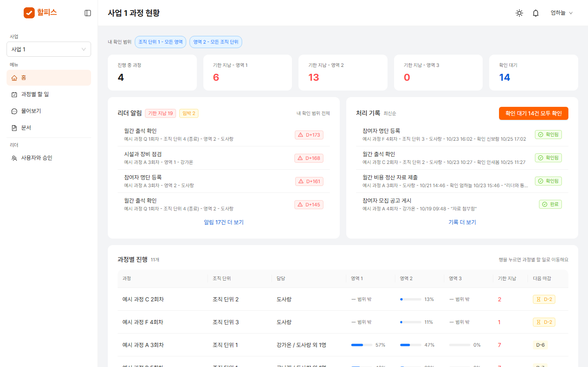

</div>

<br>

> [!NOTE]
> **인턴십의 자동화 시스템 탑재 프로젝트에서 맡은 프론트엔드와 UI/UX 파트입니다.**
> 4명이 4주 동안 만든 교육 운영 업무 자동화 포털로, 실제 서비스는 Spring Boot 백엔드, PostgreSQL, 문서 기반 질문 답변(NLP) 서버와 연동해 과정 등록, 할 일과 마감 자동 생성, 완료와 리더 확인, 기한 알림, 업무 문서 검색과 질문 답변까지 동작했습니다.
>
> **프론트엔드와 UI/UX**를 담당했습니다. 인턴십에서 안내받은 공개 범위(담당 부분) 안에서 그 부분만 이 저장소로 옮겼고, 백엔드와 NLP 코드는 포함하지 않았습니다. 커밋 기록은 원 저장소의 프론트엔드 폴더 기록 중 제가 작성한 커밋만 옮긴 것입니다.

<table align="center">
  <tr>
    <td align="center"><b>15</b><br>구현한 화면</td>
    <td align="center"><b>54</b><br>테스트 케이스 통과</td>
    <td align="center"><b>56</b><br>PC·모바일 자동 점검 화면</td>
    <td align="center"><b>3</b><br>사용자 역할</td>
  </tr>
</table>

## 한눈에 보기

| 📌 항목 | 내용 |
| --- | --- |
| **📅 기간** | 2026.10.28 ~ 2026.11.27 (4주) |
| **👥 팀** | 4명 (PM과 NLP, 백엔드, 인프라, 프론트엔드) |
| **🎯 역할** | 프론트엔드, UI/UX. 화면 설계와 디자인 기준, 전체 화면 구현, 백엔드 API 연동, 테스트 |
| **📦 규모** | 담당 커밋 168개, 화면 15개, 소스 176개 파일 약 1만 9천 줄 |
| **🔑 사용자** | 담당자, 리더, 관리자. 역할마다 첫 화면과 메뉴가 다름 |

## 화면

| 담당자 홈 | 과정별 할 일 |
| --- | --- |
| 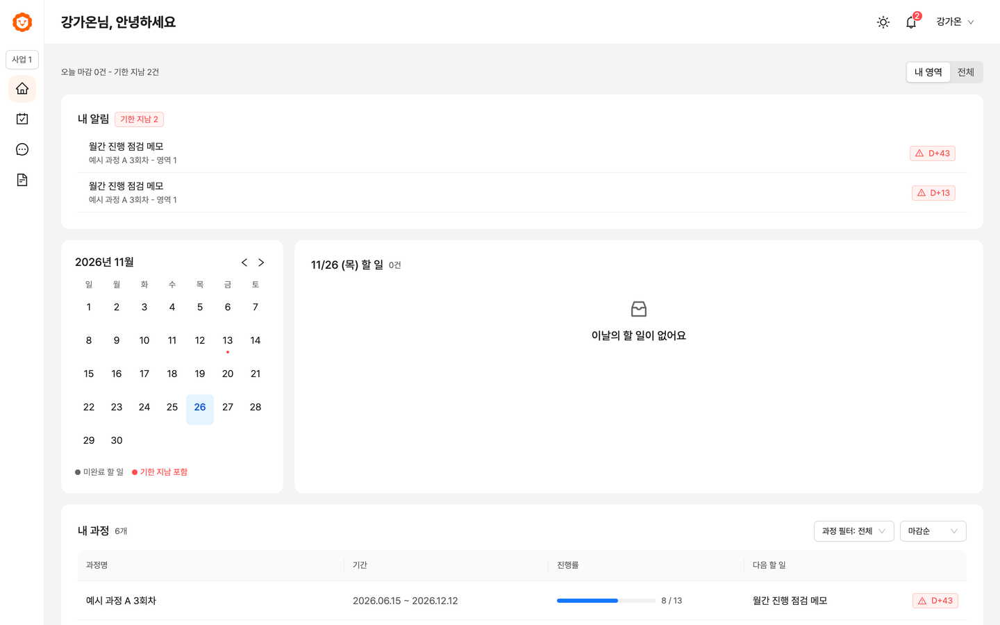 | 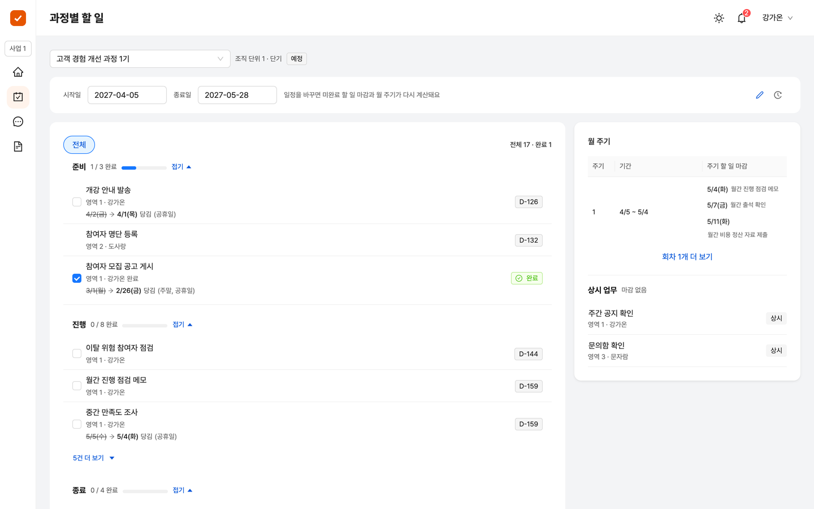 |
| 기한 지남과 임박 알림, 달력, 날짜별 할 일, 내 과정 진행률 | 템플릿대로 생긴 할 일과 마감. 쉬는 날이면 앞 영업일로 당긴 사유 표시 |
| **할 일 상세와 처리 기록** | **CSV 가져오기 미리보기** |
| 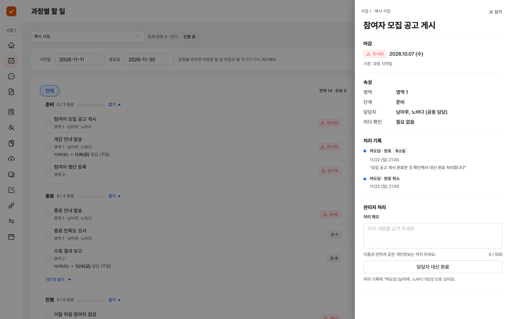 | 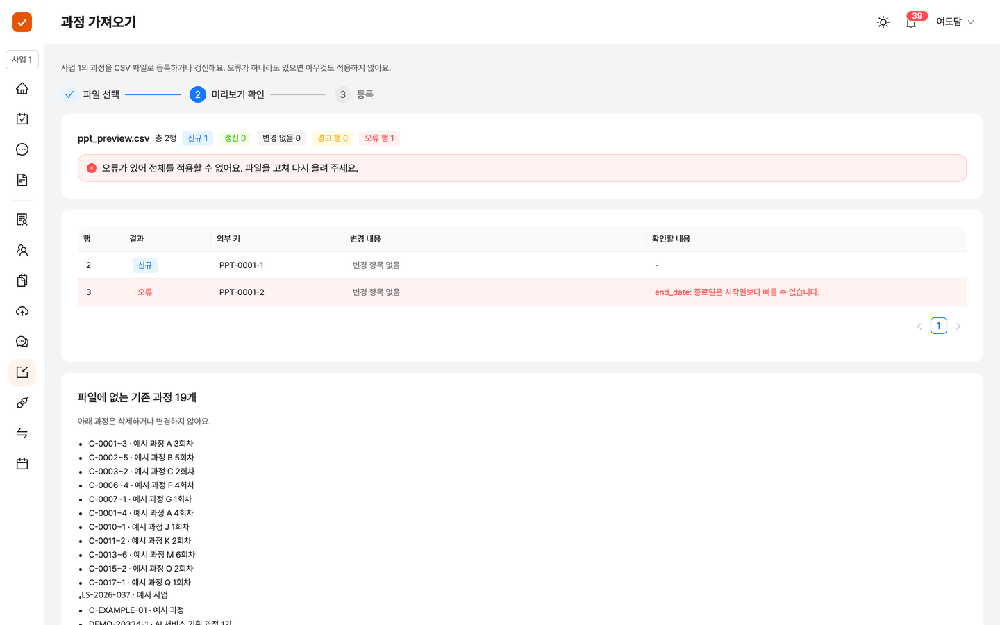 |
| 처리 기록은 지우지 않고 쌓이고, 취소도 기록으로 남음 | 오류 행이 하나라도 있으면 사유를 보여 주고 전체 적용을 막음 |
| **물어보기** | **문서 본문 검색** |
| 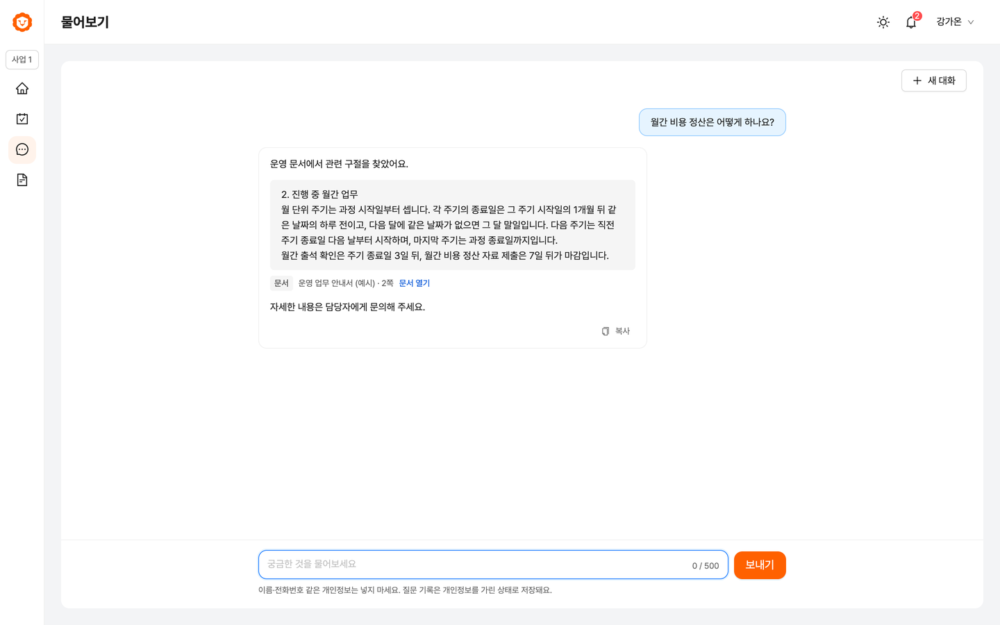 | 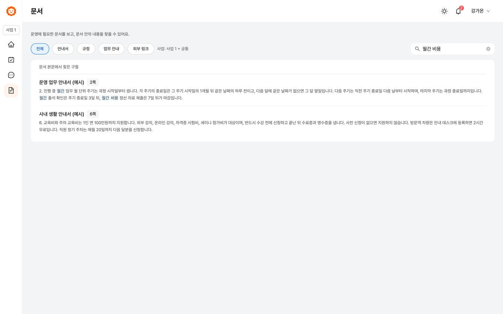 |
| 답을 지어내지 않고 근거 원문과 문서, 쪽을 함께 보여 줌 | PDF 본문에서 찾은 구절을 쪽수, 검색어 강조와 함께 보여 줌 |
| **다크 모드** | **권한 확인** |
| 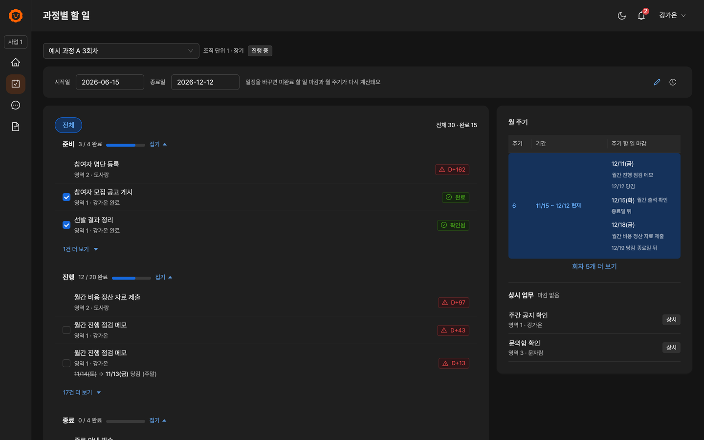 | 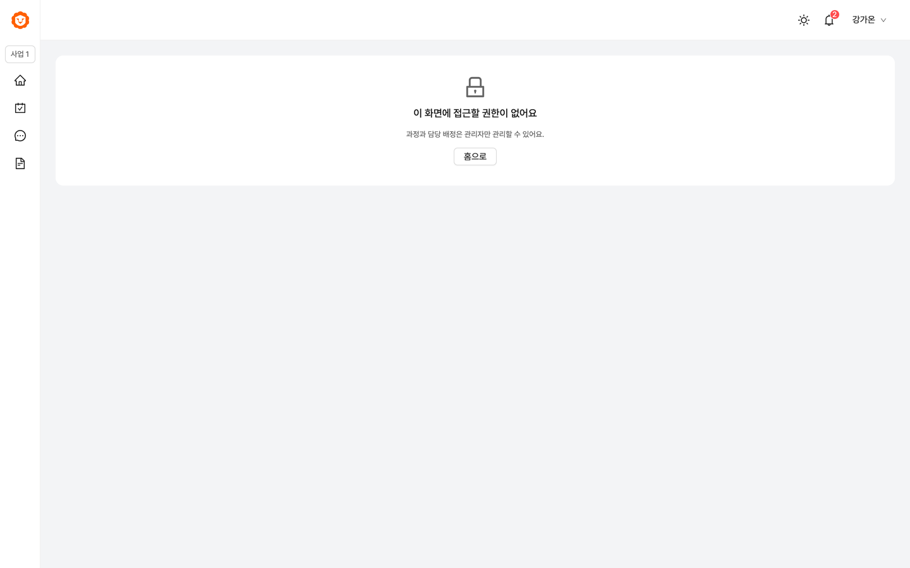 |
| 같은 디자인 토큰으로 라이트와 다크를 함께 맞춤 | 관리자 주소를 직접 열면 권한 없음 화면, 서버도 403으로 막음 |

<sub>화면 캡쳐 속 서비스 이름과 로고(멋피스)는 이 저장소의 이름(MODO WORK)과 다릅니다. 인턴 프로젝트라 회사에서 요청한 공개 가능 범위에 맞추느라 저장소의 이름과 로고만 바꿨고, 캡쳐는 실제 화면 그대로 두었습니다.</sub>

<details>
<summary>모바일 화면</summary>
<br>
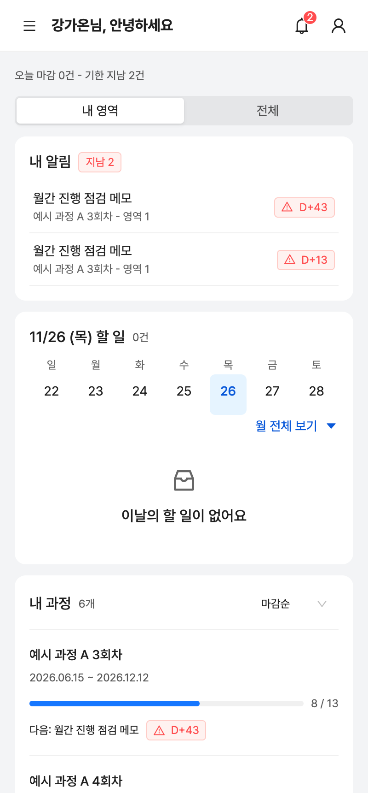

992px 아래에서는 메뉴를 서랍으로 열고, 목록은 한 번에 보이는 개수를 줄여 더 보기로 펼칩니다.
</details>

## 시연

[데모 사이트](https://modo-work.lllillly.workers.dev/)에서 역할별 화면을 직접 둘러볼 수 있습니다. 서버 없이 브라우저 안에서 공용 더미 데이터(과정 20개, 할 일 템플릿 28개, 사용자 21명, 공휴일, 처리 기록)로 할 일과 마감을 계산해 보여 주며, 저장 요청은 막혀 있습니다.

물어보기는 NLP 서버가 있어야 동작해서 데모에서는 쓸 수 없어 영상으로 대신합니다. 물어보기 화면입니다. 질문하면 답과 함께 근거가 된 문서를 보여 주고, 관리자는 물어보기 관리에서 Q&A를 직접 등록할 수 있습니다.

<p align="center">
  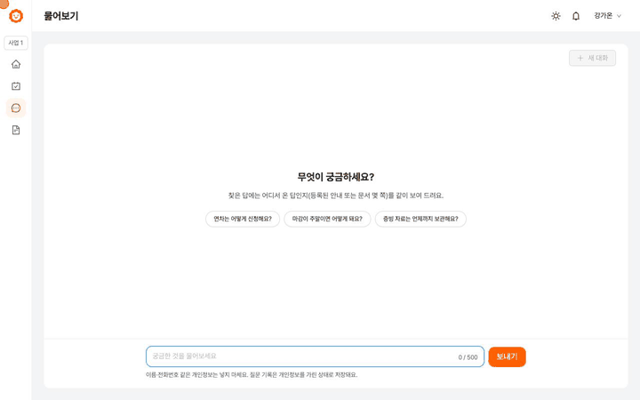
</p>

<p align="center">
  <a href="docs/videos/ask-and-documents.mp4">▶ 전체 영상 보기 (물어보기, 연결 문서, 문서 검색, 선택지)</a>
</p>

## 맡은 일

- **화면 설계와 디자인 기준**: Figma 시안을 기준으로 색, 글자, 간격 토큰을 정하고 라이트와 다크 테마, 브랜드 색을 적용했습니다. 시안에 없던 문서 버전 기록 화면은 Figma에 먼저 추가한 뒤 구현했습니다.
- **역할별 화면 15개 구현**: 로그인, 담당자 홈, 리더 홈, 과정별 할 일, 물어보기, 문서, 관리자 화면 9종(과정과 담당 배정, CSV 가져오기, 사용자와 승인, 할 일 템플릿, 문서 업로드, 물어보기 관리, 휴무일, 서비스 토큰, 설정 내보내기와 가져오기)
- **백엔드 API 연동**: 목업으로 먼저 만든 화면을 실제 API로 교체했습니다. 새 API를 붙이기 전에는 백엔드 PR의 계약서와 코드를 읽고 요청, 응답, 오류, 경계 사례를 정리한 뒤 연결했습니다.
- **품질 점검**: 테스트 케이스 54건을 만들어 점검했고, 역할 3개 56개 화면을 PC와 모바일로 자동 점검했습니다.

## 주요 구현

| ⚙️ 기술 | 내용 |
| --- | --- |
| **공용 API 요청 함수** | 쿠키 로그인, 30초 시간 제한, 화면을 나가면 요청 취소, 서버 오류를 하나의 형식(`ApiError`)으로 통일 |
| **조회 훅 `useApiQuery`** | 조건이 바뀌면 이전 요청을 취소하고 다시 불러옴. 로그인이 풀린 오류면 사용자 정보를 다시 확인 |
| **버전 충돌(409) 처리** | 수정할 때 `version`을 함께 보내 다른 사람이 먼저 고쳤으면 덮어쓰지 않고 안내. 저장하지 못한 입력은 화면에 남김 |
| **중복 처리 방지** | 완료, 확인 같은 처리마다 `requestId`를 보내고 처리 중에는 버튼을 막아 연타해도 한 번만 처리 |
| **문서 읽기 상태 폴링** | 3초마다 읽기 상태 확인. 서버가 다시 읽는 중인 실패는 끝난 것으로 보지 않고 계속 확인 |
| **주소에 상태 저장** | 선택한 과정과 할 일, 목록의 검색어와 필터, 쪽 번호를 주소에 저장해 새로고침이나 링크 공유 후에도 같은 화면 |
| **테마와 반응형** | Ant Design 토큰, CSS 변수, Tailwind를 같은 값으로 맞춰 라이트와 다크 적용. 992px 기준 모바일 메뉴 서랍 |
| **공용 컴포넌트** | 오류, 빈 화면, 권한 없음, 없는 페이지, 검색 결과 없음 표시를 컴포넌트 5개로 통일 |
| **하위 경로 배포** | `BASE_PATH` 하나로 Vite base, 라우터, API와 PDF 주소를 함께 맞춤 |

## 트러블슈팅

| 🐛 문제 | 🔎 원인 | 🔧 해결 |
| --- | --- | --- |
| **문서 읽기가 끝났는데 실패 알림이 먼저 뜸** | 서버는 일시 장애도 실패로 저장한 뒤 자동으로 다시 읽는데, 화면은 실패를 최종 결과로 봄 | 재시도 중인 실패를 "읽는 중"으로 보는 함수를 만들어 계속 감시 ([#107](docs/pull-requests/107.md)) |
| **여러 건 저장 중 충돌(409)이 나면 입력이 전부 사라짐** | 실패해도 마지막에 목록을 다시 불러와 화면 값을 덮어씀 | 못 보낸 줄을 기억해 두고 새 목록 위에 다시 얹음. 다시 저장하면 남은 줄만 보냄 ([#129](docs/pull-requests/129.md)) |
| **폴링 타이머가 검색어를 칠 때마다 다시 시작됨** | 렌더마다 바뀌는 값을 effect 의존성에 넣음 | `useEffectEvent`로 재조회를 의존성에서 빼고 삭제된 문서는 감시에서 제거 ([#107](docs/pull-requests/107.md)) |
| **긴 대화에서 입력창이 화면 밖으로 밀림** | 공통 레이아웃 본문이 내용만큼 늘어나 높이 제한이 안 먹힘 | 바깥 박스만 남은 공간을 쓰게 바꾸고 높이 값을 측정해 확인 ([#109](docs/pull-requests/109.md)) |
| **화면마다 오류와 빈 화면 모양이 제각각** | 화면을 따로 만들며 표시 방식과 오류 처리를 각자 작성 | 공용 컴포넌트 5개와 오류 처리 훅으로 통일 ([#150](docs/pull-requests/150.md)) |

나머지 사례와 자세한 내용은 [결과 보고서](docs/report.md#트러블슈팅)에 있습니다.

## 검증과 수치

<p align="center">
  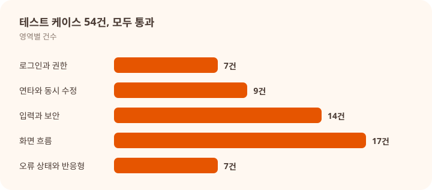
  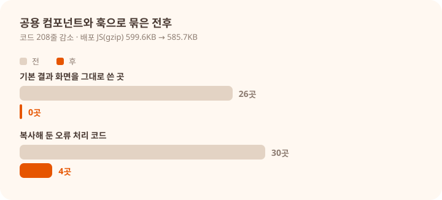
</p>

| 📋 항목 | 결과 |
| --- | --- |
| **테스트 케이스** | 54건 모두 통과 (로그인과 권한 7, 연타와 동시 수정 9, 입력과 보안 14, 화면 흐름 17, 오류 상태와 반응형 7) |
| **화면 자동 점검** | 역할 3개, 56개 화면을 PC와 모바일로 열어 화면 오류 0건, 가로 넘침 0건 |
| **공용화 전후** | 기본 결과 화면 사용 26곳 → 0곳, 복사된 오류 처리 코드 30곳 → 4곳, 코드 208줄 감소, 배포 JS(gzip) 599.6KB → 585.7KB |

연타, 두 탭 동시 수정, 서버 오류처럼 손으로 확인하기 어려운 경우는 Playwright 스크립트로 재현했습니다. 전체 목록은 [테스트 케이스](docs/qa.md)에 있습니다.

## 협업

- 기능마다 브랜치를 만들어 PR로 올리고, 팀원 리뷰를 받은 뒤 머지했습니다.
- 리뷰에서 나온 권한 범위, 데이터 재사용 조건 같은 지적은 원인을 확인한 뒤 고치고 답글로 반영 내용을 남겼습니다.
- PR 본문에는 변경 내용, 검증 결과, 화면 캡처, 리뷰 요청 사항을 적었습니다.

원 저장소는 비공개라, PR 본문과 리뷰는 [PR 기록](docs/pull-requests/README.md)에 옮겨 두었습니다.

## 실행

```bash
npm ci
npm run dev     # http://localhost:5173
npm run build   # 타입 검사 포함
npm run build:demo   # 더미 데이터로 동작하는 데모 빌드
npm run lint
```

일반 빌드의 화면 데이터는 모두 백엔드 API에서 받아서, 이 저장소만으로는 로그인 뒤 화면이 비어 보입니다. 서버 없이 보려면 `npm run build:demo` 결과를 띄웁니다(`src/demo/`). 데모 사이트는 Cloudflare Workers 정적 자산으로 배포하며 `main`에 올리면 자동으로 다시 배포됩니다. 로컬에서는 Vite가 `/api` 요청을 `http://localhost:8080`으로 넘깁니다. 하위 경로에 배포할 때는 `BASE_PATH=/portal npm run build`처럼 경로를 지정합니다.

## 문서

| 문서 | 내용 |
| --- | --- |
| [결과 보고서](docs/report.md) | 구현 범위, 화면, 검증, 트러블슈팅 |
| [PR 기록](docs/pull-requests/README.md) | PR 본문, 리뷰, 답변 기록 |
| [화면과 연동 상태](docs/screens.md) | 화면별 주소와 하는 일 |
| [폴더 구조와 공통 규칙](docs/structure.md) | 폴더 역할, 공용 컴포넌트와 함수, 스타일 규칙 |
| [테스트 케이스](docs/qa.md) | 54건의 점검 내용과 결과 |
| [AI 활용](docs/ai-usage.md) | 쓴 도구와 확인 방법, 직접 고친 사례 |
| [홈과 할 일](docs/home-tasks.md), [과정 관리](docs/courses.md), [문서와 물어보기](docs/documents-ask.md), [관리자 화면](docs/admin.md) | 화면별 구현 설명 |

## 회고

- **잘한 점**: 화면을 만들기 전에 서버의 권한, 상태, 충돌 규칙을 먼저 읽고 맞추는 습관이 생겼습니다. 반복되는 모양은 공용 컴포넌트로 묶었고, 409 충돌이나 재시도 같은 상황은 테스트 케이스로 일부러 만들어 확인했습니다.
- **아쉬운 점**: 명세가 바뀌는 중에 화면부터 만들었다가 다시 고친 일이 있었습니다. 처음부터 백엔드 개발자분과 규칙을 같이 맞췄으면 시간이 덜 들었을 것 같습니다.
