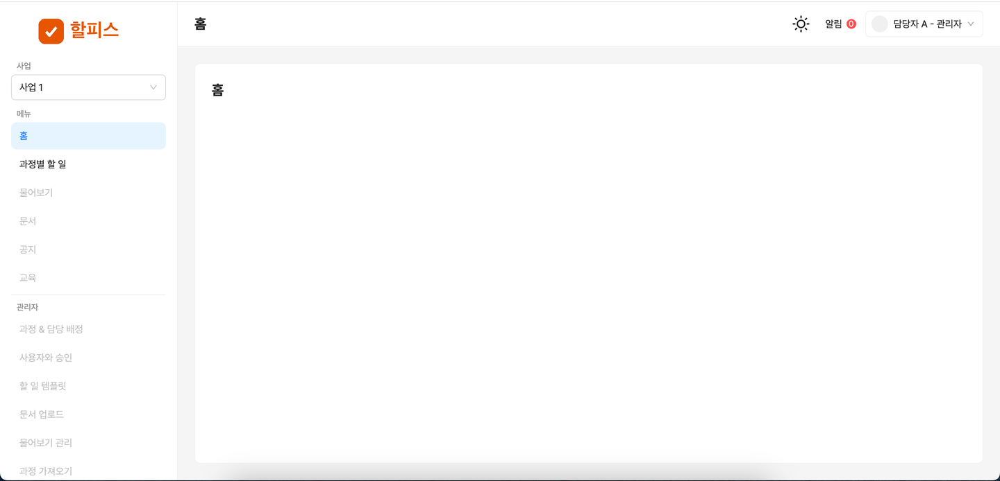
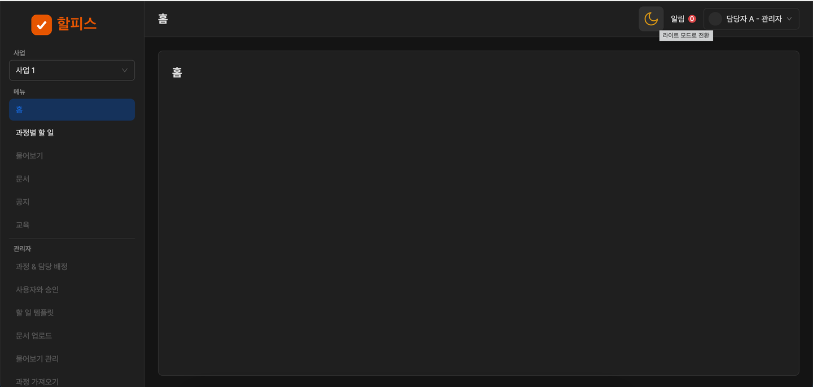
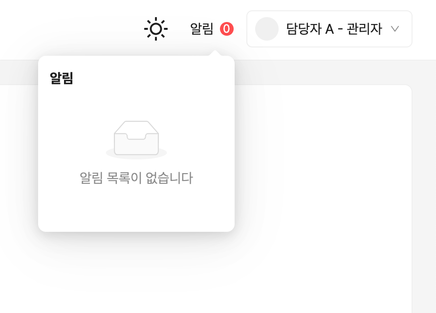
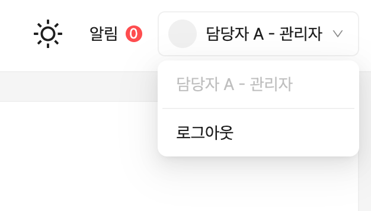
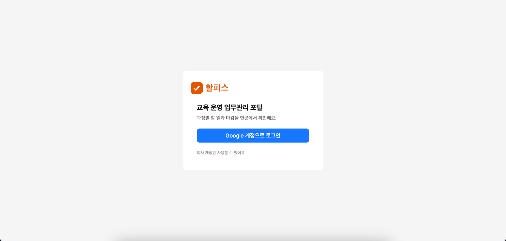
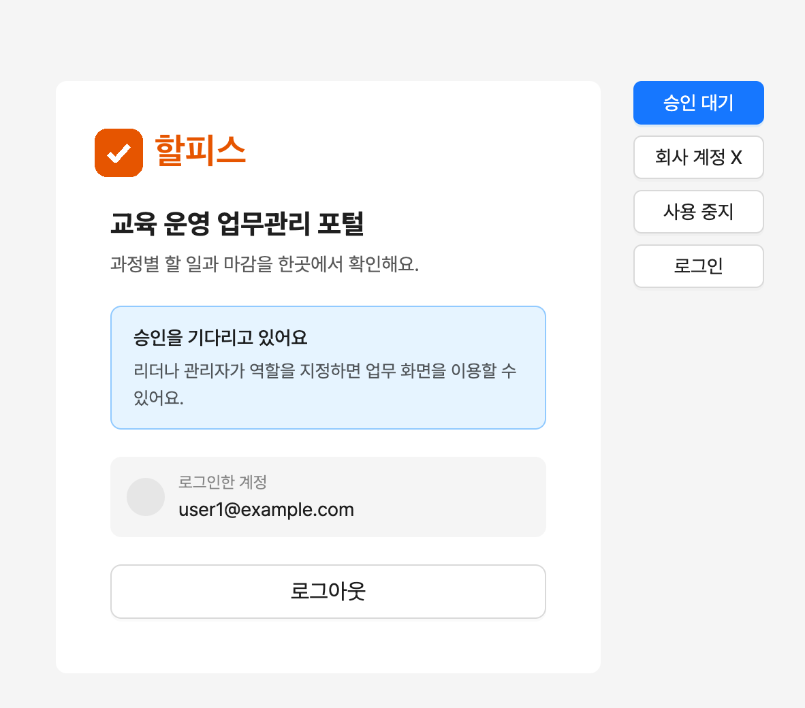
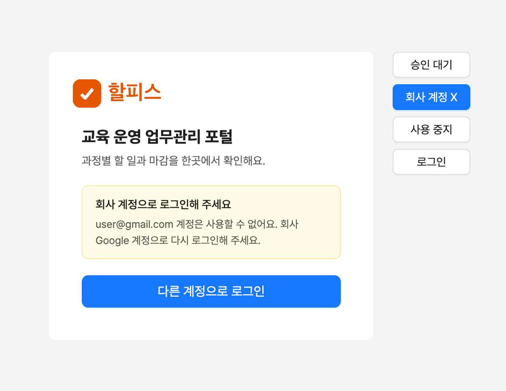
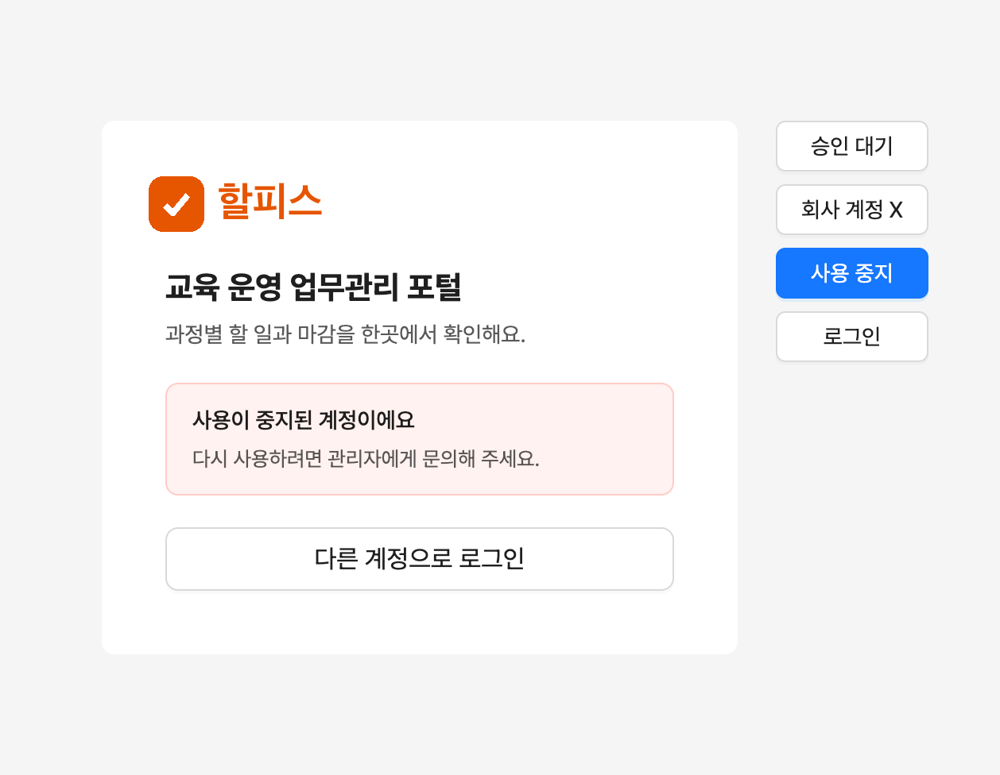

# #14 feat(front): 공통 레이아웃 및 로그인 화면 구성

- 생성 2026-11-02, 머지 2026-11-03
- 변경 +762 -24, 파일 22개, 커밋 17개

## 본문

### 변경 내용

- Figma 기준으로 헤더, 사이드바와 로그인 화면을 구성했습니다.
- 모바일에서는 사이드바를 Drawer로 열도록 반응형 작업했습니다.
- 로그인 상태별 화면을 확인할 수 있게 임시 버튼을 넣었습니다.
- 다크 모드 전환과 새로고침 유지, 임시 로고와 파비콘을 적용했습니다.

현재 인증 API가 없어서 임시 데이터로 넣었습니다. 아직 만들지 않은 메뉴는 비활성화했습니다.

### 검증 결과

- `npm run build` 통과
- `npm run lint` 통과

<table>
  <tr>
    <td width="25%"></td>
    <td width="25%"></td>
    <td width="25%"></td>
    <td width="25%"></td>
  </tr>
  <tr>
    <td align="center">홈 화면</td>
    <td align="center">다크 모드 화면</td>
    <td align="center">알림 화면</td>
    <td align="center">사용자 메뉴 화면</td>
  </tr>
  <tr>
    <td>
</td>
    <td>
</td>
    <td>
</td>
    <td>
</td>
  </tr>
  <tr>
    <td align="center">로그인 화면</td>
    <td align="center">승인 대기 화면</td>
    <td align="center">회사 계정 제한 화면</td>
    <td align="center">사용 중지 화면</td>
  </tr>
</table>

### 리뷰 요청 사항

- 사이드바와 로그인 화면 확인
- 로그인 상태별 화면 확인
- 반응형 확인 부탁드립니다

### 확인

- [x] 변경에 맞는 실행·테스트 결과 또는 미실행 이유를 작성했습니다
- [x] API·DB·환경변수 변경이 있다면 관련 문서와 적용 방법을 작성했습니다
- [x] 비밀번호·토큰 등 비밀값이 포함되지 않았습니다

## 커밋

- chore(front): 페이지 구조 및 라우터 환경 설정
- feat(front): 공통 화면 레이아웃 구성
- feat(front): 다크 모드 설정 유지 및 콘텐츠 카드 추가
- feat(front): 페이지 이동 라우터 연결
- Merge branch 'main' of (비공개 원 저장소 링크)
- Merge branch 'main' of (비공개 원 저장소 링크)
- feat(front): 헤더 레이아웃 구성
- feat(front): 사이드바 메뉴 및 사업 선택 구성
- feat(front): 알림 및 사용자 메뉴 추가
- feat(front): 다크 모드 전환 애니메이션 적용
- feat(front): 공통 레이아웃 반응형 적용
- feat(front): 과정별 할 일 화면 및 임시 로그인 이동 연결
- feat(front): 임시 로고 적용
- feat(front): SVG 로고 및 임시 아바타 추가
- feat(front): 로그인 화면 구성
- feat(front): 로그인 상태별 화면 및 확인 버튼 추가
- docs(front): 화면 구조 및 로그인 확인 방법 작성

## 리뷰

### 백엔드 팀원 · COMMENTED

고생 많으셨습니다!
현재 디자인은 Google 로그인 기준인데, 개발/시연 기간에는 운영 측 안내에 따라 시험용 로그인을 사용할 예정입니다. 그래서 실제 API 연동 시 공유한 명세에 맞춰 시험용 로그인이 가능한 화면이 필요할 것 같습니다. 이 부분은 내일 디스코드에도 다시 한 번 공유하겠습니다!
그 외에는 코드 기준으로 크게 수정 요청 드릴 부분은 없습니다.
