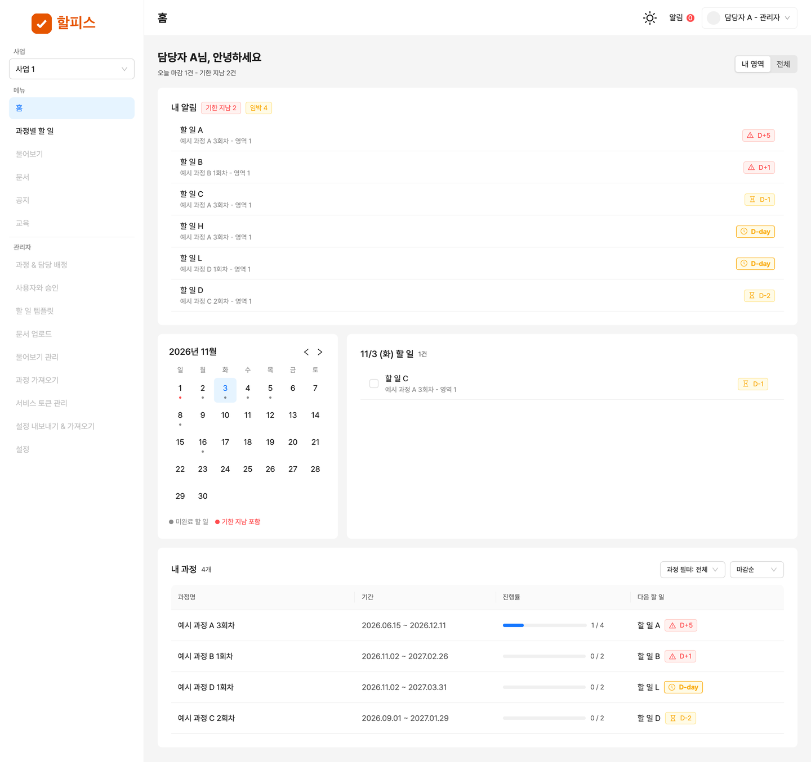
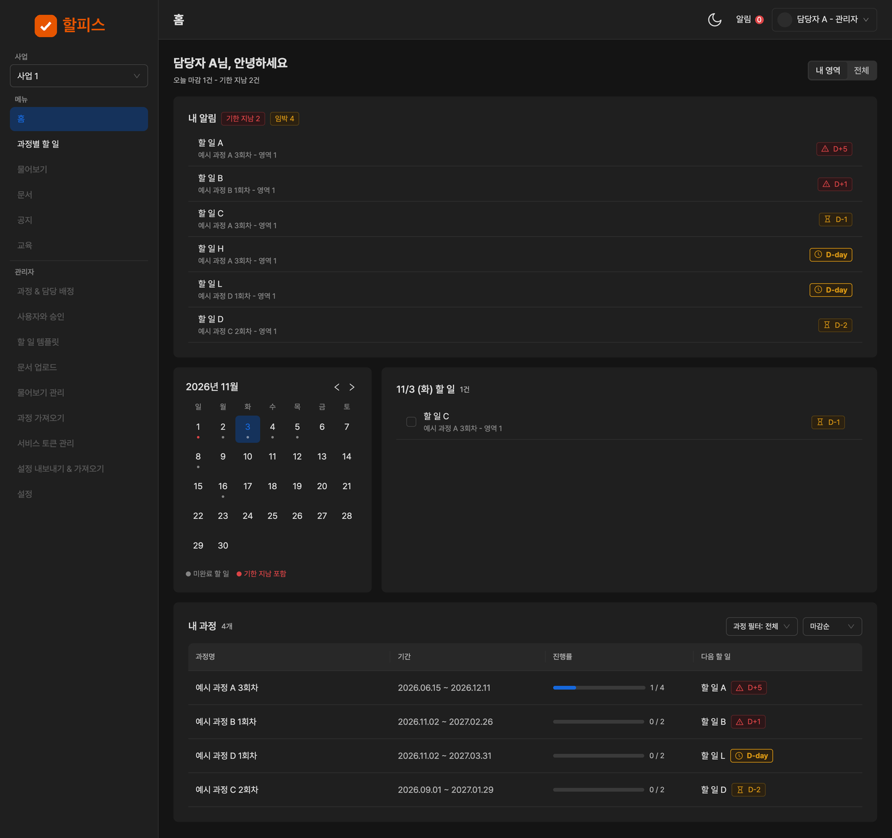
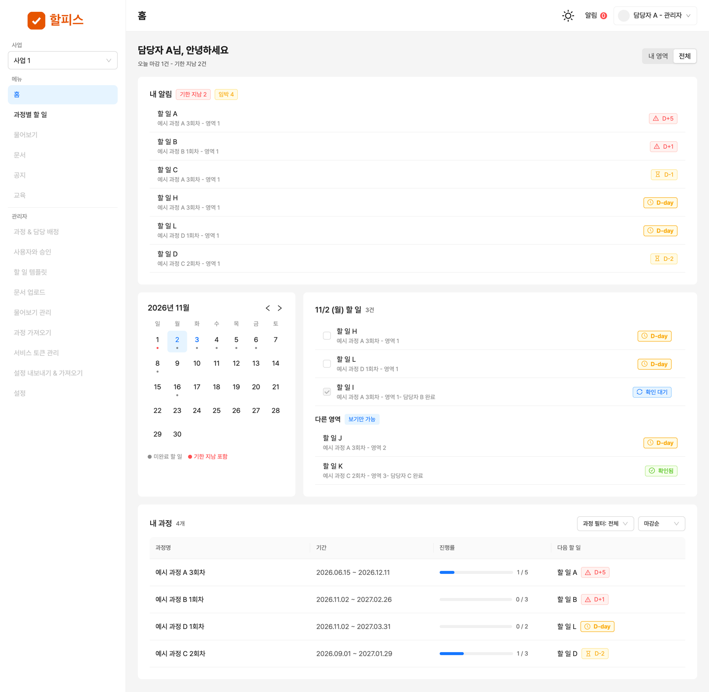
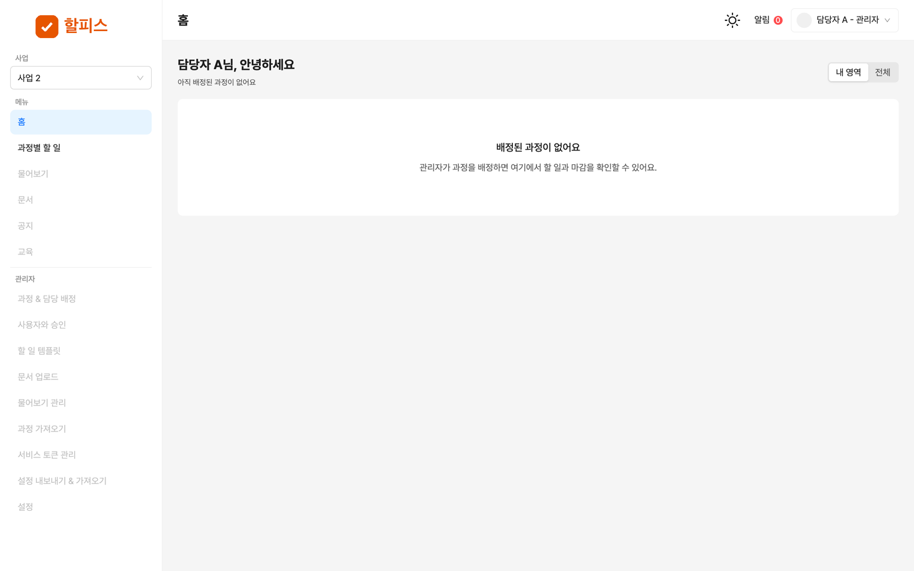
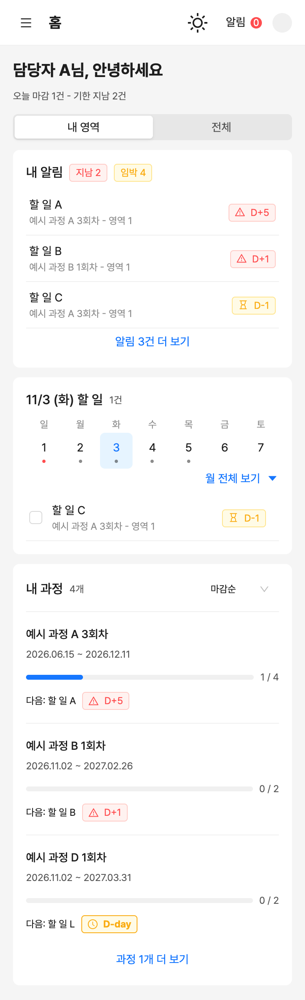
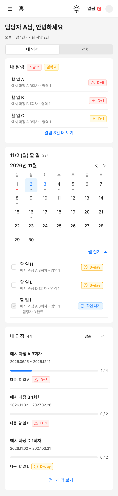
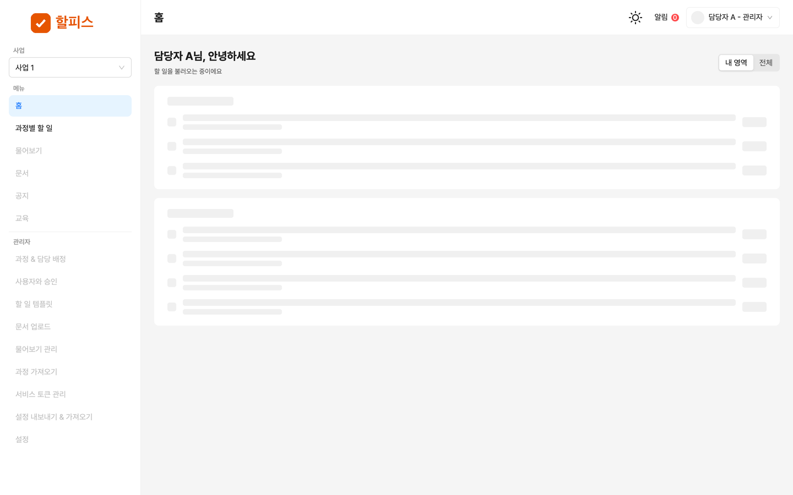
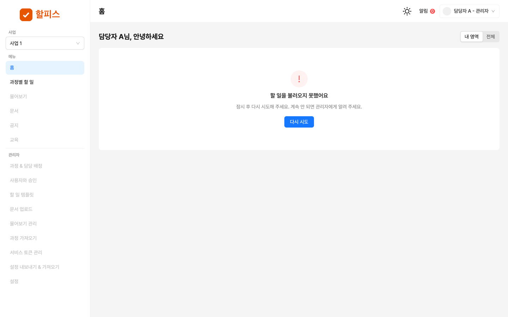

# #17 feat(front): 담당자 홈 화면 구성

- 생성 2026-11-03, 머지 2026-11-04
- 변경 +1016 -62, 파일 23개, 커밋 6개

## 본문

### 변경 내용

- 담당자 홈의 내 알림, 날짜별 할 일, 내 과정 화면 구성
- 사업과 보기 범위에 따른 목업 데이터 연결 및 할 일 완료 기능 추가
- 달력 날짜 선택, 과정 필터와 정렬, 반응형 작업
- D-day 배지, 로딩 스켈레톤과 에러 화면 추가
- 한국 날짜 기본 선택 및 전역 마우스 커서 설정
- 빌드 시 JS 청크가 500KB를 초과하는 경고를 `rollup-plugin-visualizer`로 분석하고 `React.lazy`로 공통 레이아웃과 화면별 코드 분할
- `Suspense`로 코드 로딩 중 표시를 추가하고 화면 전환 시 헤더와 사이드바 유지

### 검증 결과

- npm run build 통과
- npm run lint 통과
- 최대 JS 파일 약 1,103KB → 385KB, 로그인 초기 JS 다운로드 약 43% 감소 확인
- 사업 전환, 보기 범위, 날짜 선택, 완료 처리, 과정 필터와 정렬 확인
- 데스크탑과 모바일 화면 확인

<table>
  <tr>
    <td width="25%" align="center">

 홈 화면</td>
    <td width="25%" align="center">

 다크 모드 화면</td>
    <td width="25%" align="center">

 전체 보기 화면</td>
    <td width="25%" align="center">

 배정된 과정 없음 화면</td>
  </tr>
  <tr>
    <td width="25%" align="center">

 모바일 화면</td>
    <td width="25%" align="center">

 모바일 달력 펼침 화면</td>
    <td width="25%" align="center">

 로딩 화면</td>
    <td width="25%" align="center">

 에러 화면</td>
  </tr>
</table>

### 리뷰 요청 사항

- 홈(`/`)에서 사업 1의 기본 화면과 사업 2의 배정된 과정 없음 화면 확인 부탁드립니다.
- `/?preview=loading`, `/?preview=error`, `/?preview=no-alerts`에서 로딩, 에러, 알림 0건 화면을 확인할 수 있습니다.
- 현재 목업 데이터로 동작하며 완료 상태는 새로고침하면 초기화됩니다. API 연동 후 서버의 최종 마감일과 보정 전 날짜, 사유를 반영할 예정입니다.

### 확인

- [x] 변경에 맞는 실행, 테스트 결과 또는 미실행 이유를 작성했습니다
- [x] API, DB, 환경변수 변경이 있다면 관련 문서와 적용 방법을 작성했습니다
- [x] 비밀번호, 토큰 등 비밀값이 포함되지 않았습니다

## 커밋

- chore(front): D-day 배지 CSS 토큰 추가와 담당자 홈 파일명 & 라우터 변경
- feat(front): 과정 선택 화면 및 공통 레이아웃 home, user ts 데이터 연결
- feat(front): 담당자 홈 화면 구성 및 할 일 완료 기능 추가
- feat(front): 담당자 홈 달력 및 날짜 선택 기능 추가
- feat(front): 담당자 홈 로딩 스켈레톤 화면 & 에러 화면 추가, 리드미 작성
- refactor(front): 빌드 경고로 인한 원인 분석 후 코드 분할

## 리뷰

### 백엔드 팀원 · COMMENTED

고생 많으셨습니다!
목업 데이터 기준으로 코드 확인했고, 현재 범위에서 특별한 문제는 발견하지 못했습니다. 완료 상태가 새로고침 시 초기화되는 점도 확인했습니다. API 연동할 때 서버의 최종 마감일과 보정 전 날짜, 사유를 반영해 주시면 될 것 같습니다.

## 대화

### 팀원

고생하셨습니다! 알림 정렬, 다른 영역 보기만 가능, 완료 취소 불가, 빈·로딩·에러 상태까지 확인했습니다
D-day 토큰도 추가 확인했습니다!

아래 몇 가지만 부탁드려요!

- 담당자 화면 완료 표시: DeadlineTag가 reviewStatus가 pending이면 항상 "확인 대기"를 보여줘서, 담당자 홈에서도 확인 대기로 나옵니다
담당자 화면에서는 초록 "완료"로 보여주고, 확인 대기는 리더 화면에서만 보이게 옵션을 하나 두면 좋을 것 같아요

- 배지 글자 계산: 배지 글자(D-day, D+5 등)가 목업의 deadlineLabel을 그대로 써서, 오늘 날짜 기준으로 정렬되는 알림과 어긋나 보일 것 같은데 마감일과 오늘 날짜로 계산하면 API 연결 후에도 맞을 것 같습니다

- 줄 전체 클릭 시 완료: 지금 할 일 줄 전체가 체크박스라 제목을 눌러도 바로 완료로 되는데, 담당자는 완료를 취소할 수 없어서, 체크박스만 눌렀을 때 완료되고 제목은 나중에 할 일 상세(S06)를 여는 쪽으로 나누는 건 어떠세요?

- 알림 0건 배지: 상단 바 알림이 0건이면 빨간 배지는 숨기는게 좋을 듯 합니다!

- 테마 전환 ☀: 상단 바 위치 좋은 것 같아요.ㅎㅎㅎ 이걸로 확정해서 다른 화면에도 적용하겠습니당
