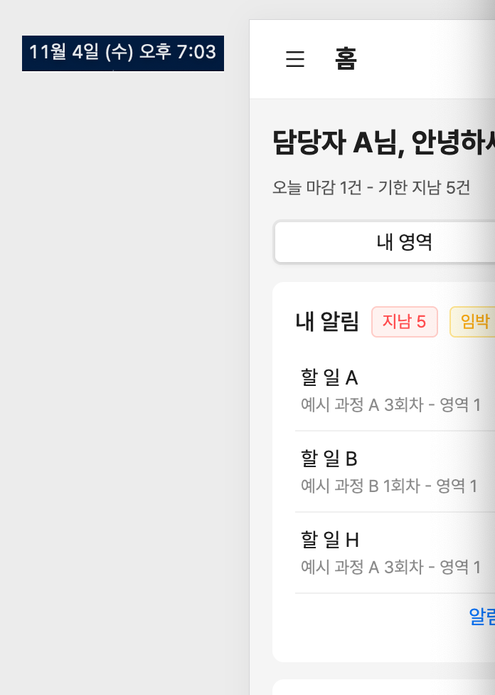
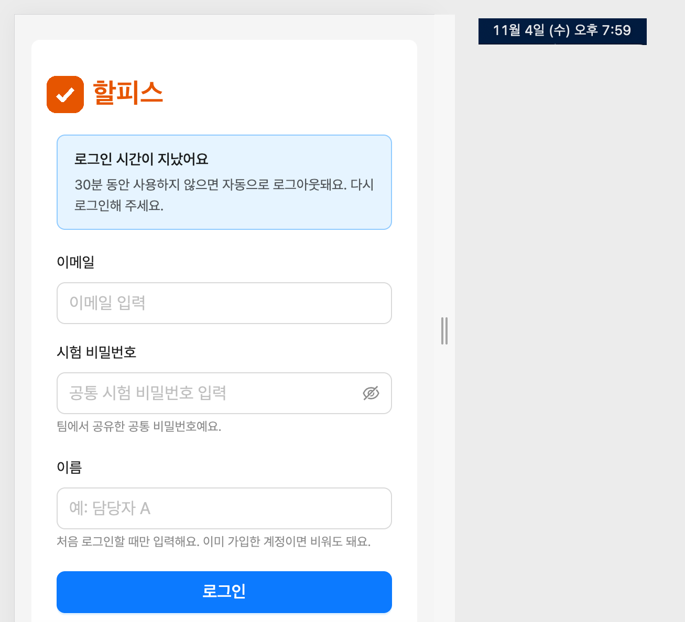

# #24 feat(front): 시험 로그인 화면 구성 및 인증 API 연동

- 생성 2026-11-05, 머지 2026-11-05
- 변경 +773 -139, 파일 14개, 커밋 5개

## 본문

### 변경 내용

- 로그인, 내 정보 조회, 로그아웃 API 연동
- 새로고침 시 로그인 유지 및 미로그인, 승인 대기 상태의 화면 접근 제한
- 승인 상태 확인, 입력 오류, 사용 중지, 세션 만료(서버에서 던져준 상태로)와 일시 오류 안내 연결
- 상태 확인용 버튼과 목업 코드 제거
- Google 로그인과 시험 로그인 화면 전환 버튼, 시연 계정 이메일 채우기(비밀번호는 직접 입력)

<table>
  <tr>
    <td width="40%" align="center">

 로그인 직후</td>
<td width="55%" align="center">

 세션 만료 후(아무 동작 x 상태에서)</td>
 </tr>
</table>

### 검증 결과

- npm run build 통과
- npm run lint 통과
- 로그인, 새로고침 유지, 승인 상태 조회, 로그아웃 확인
- 입력 오류와 상태별 안내, 로그인 화면 전환 확인
- 모바일과 데스크탑 화면 확인
- 유휴 세션 만료 확인

### 리뷰 요청 사항

- 시험 로그인과 승인 상태 확인 흐름 검토

### 확인

- [x] 변경에 맞는 실행, 테스트 결과 또는 미실행 이유를 작성했습니다
- [x] API, DB, 환경변수 변경이 있다면 관련 문서와 적용 방법을 작성했습니다
- [x] 비밀번호, 토큰 등 비밀값이 포함되지 않았습니다

## 커밋

- feat(front): 인증 API 요청 및 응답 타입 추가
- feat(front): 시험 로그인 화면 및 세션 인증 연동
- docs(front): README 작성
- feat(front): 로그인 상태 확인용 버튼 및 목업 코드 제거
- fix(front): 세션 만료 안내 및 유휴 시간 문서 수정

## 리뷰

### 백엔드 팀원 · COMMENTED

고생 많으셨습니다!
인증·승인 상태 확인 흐름은 백엔드 계약과 맞는 것으로 확인했습니다.
다만 유휴 시간이 4시간으로 확정되었으니 README는 수정 부탁드립니다.
만료 안내에서도 ‘30분’처럼 시간을 명시하는 것보다 ‘세션이 만료됐어요. 다시 로그인해 주세요.’ 정도의 안내로 충분하지 않을까 생각하는데 어떠신가요..?
나머지 부분은 수정할 부분 없는 것 같으니, 이 부분만 확인해주시면 좋을 것 같습니다!

## 대화

### 나(프론트엔드)

> 고생 많으셨습니다! 인증·승인 상태 확인 흐름은 백엔드 계약과 맞는 것으로 확인했습니다. 다만 유휴 시간이 4시간으로 확정되었으니 README는 수정 부탁드립니다. 만료 안내에서도 ‘30분’처럼 시간을 명시하는 것보다 ‘세션이 만료됐어요. 다시 로그인해 주세요.’ 정도의 안내로 충분하지 않을까 생각하는데 어떠신가요..? 나머지 부분은 수정할 부분 없는 것 같으니, 이 부분만 확인해주시면 좋을 것 같습니다!

수정하겠습니다 감사합니다
