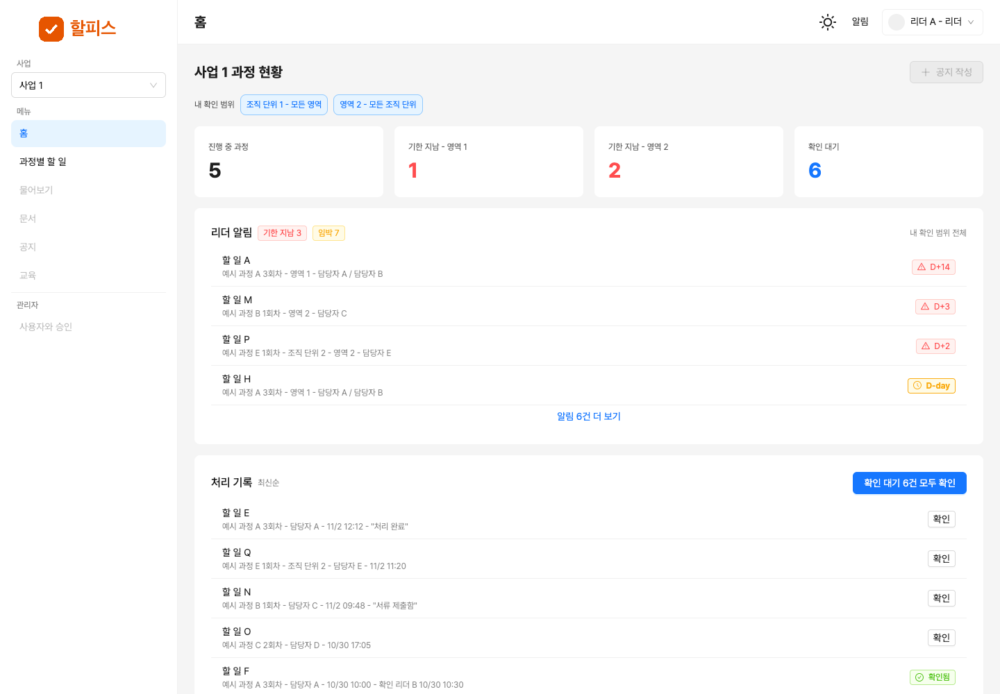
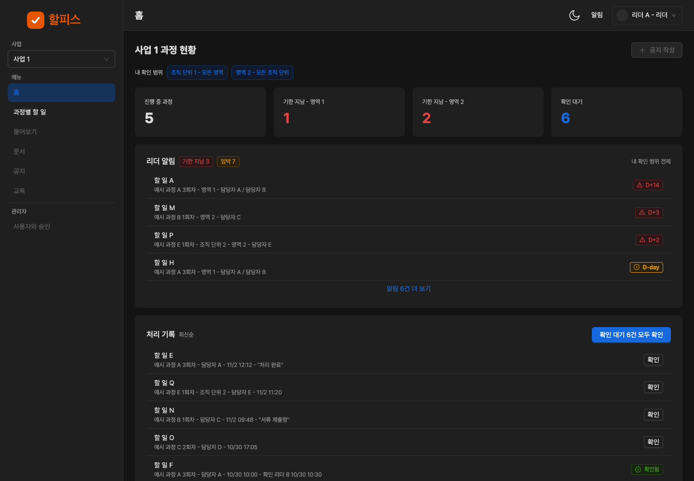
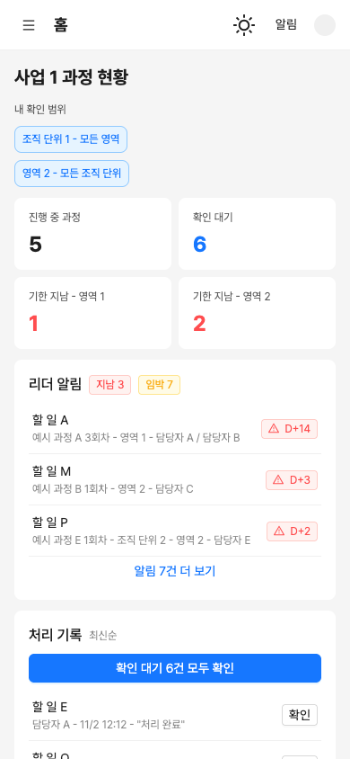
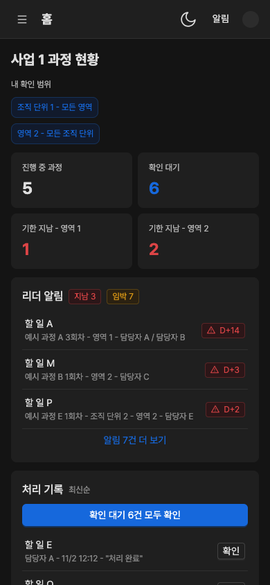

# #26 feat(front): 리더 홈 화면 구성 및 확인 기능 추가

- 생성 2026-11-05, 머지 2026-11-09
- 변경 +692 -28, 파일 15개, 커밋 8개

## 본문

### 변경 내용

- 계정 역할에 따라 담당자 홈과 리더 홈으로 이동하도록 연결
- 확인 범위와 요약, 리더 알림, 처리 기록, 과정별 진행 화면 구성
- 조직 리더와 영역 리더의 범위 합산, 다른 영역 읽기 전용과 폐쇄 조직 처리 반영
- 단건 확인과 일괄 확인, 모바일 더 보기 기능 추가
- 기존 할 일 목록과 배지, 로딩과 오류 화면 재사용

### 검증 결과

- npm run build 통과
- npm run lint 통과
- 조직과 영역별 조회 범위, 단건 확인과 일괄 확인 동작 확인
- 모바일과 데스크탑, 라이트와 다크 모드, 빈 화면과 로딩, 오류 화면 확인

|  |  |  |  |
| --- | --- | --- | --- |
| 리더 홈 라이트 화면 | 리더 홈 다크 화면 | 모바일 리더 홈 화면 | 모바일 리더 홈 다크 화면 |

### 리뷰 요청 사항

홈 데이터는 아직 목업 데이터 처리해놨습니다. API 연동 후 수정 예정입니다.
리더 계정으로 로그인한 뒤 홈에서 확인할 수 있습니다. 상태별 화면 주소는 README에 정리했습니다.

### 확인

- [x] 변경에 맞는 실행과 테스트 결과를 작성했습니다
- [x] API, DB, 환경변수 변경이 있다면 관련 문서와 적용 방법을 작성했습니다
- [x] 비밀번호와 토큰 등 비밀값이 포함되지 않았습니다

## 커밋

- feat(front): 리더 홈 데이터 및 확인 범위 계산 추가
- feat(front): 리더 홈 화면 및 역할별 홈 연결
- docs(front): 리더 홈 README 작성
- Merge branch 'main' of (비공개 원 저장소 링크)
- fix(front): 종료된 과정의 할 일 확인 허용 및 마감 알림 표시
- fix(front): 인증 API 상대 경로 및 로컬 프록시 적용
- fix(front): 영역 리더 권한을 지정 영역 기준으로 수정
- Merge branch 'main' of (비공개 원 저장소 링크)

## 리뷰

### 백엔드 팀원 · COMMENTED

그 외에는 코드상으로 추가 수정 요청드릴 부분은 없는 것 같습니다. 고생 많으셨어요!!

## 인라인 리뷰와 답변

### 백엔드 팀원 · `src/pages/home/leaderHomeData.ts`

과정 종료일 경과 조건(`course.endDate < today`)은 빼주실 수 있을까요? 디스코드에 먼저 공유드리고 백엔드 PR이 늦어 반영 전인 것 같습니다.
현재 명세상 종료 후에는 과정 정보 수정만 제한하고, 할 일 완료·확인·취소는 권한에 따라 허용합니다. 지금 조건은 단건·일괄 확인을 막고 있어, 종료된 과정의 확인 대기 업무도 처리할 수 있도록 수정 부탁드립니다. 알림의 종료일 필터도 함께 확인 부탁드립니다!

### 나(프론트엔드) · `src/pages/home/leaderHomeData.ts`

수정하겠습니다 감사합니다 !
