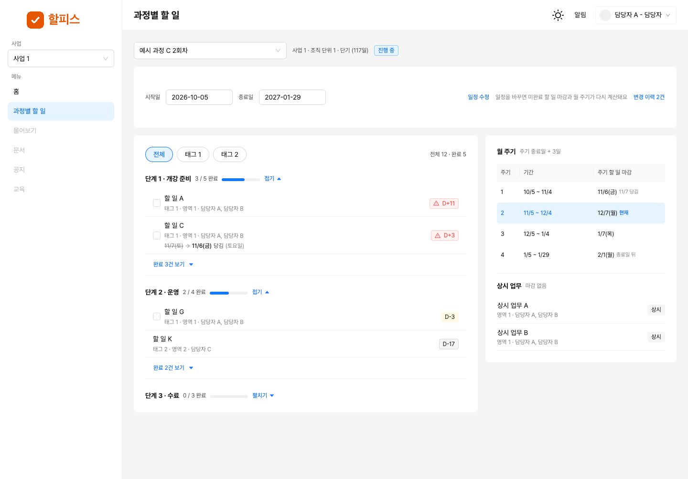
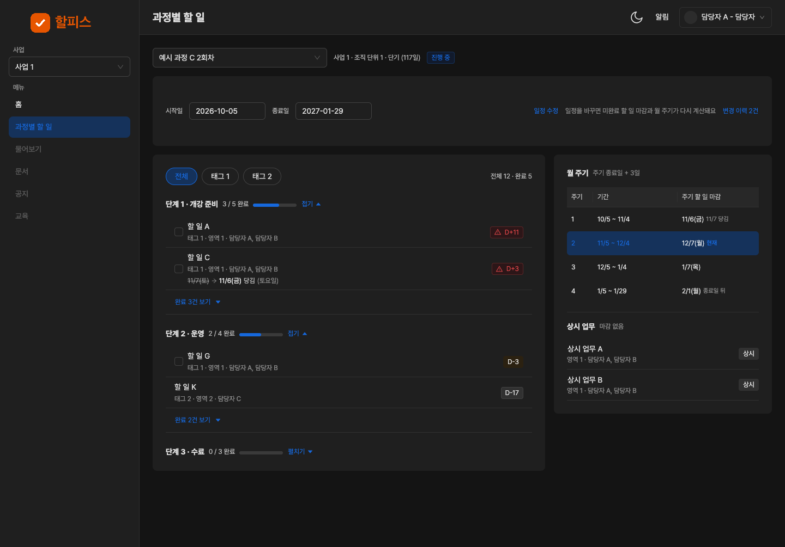
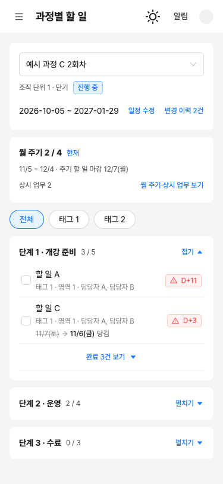
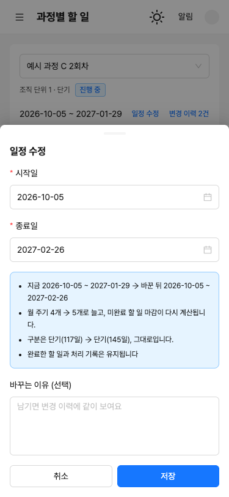
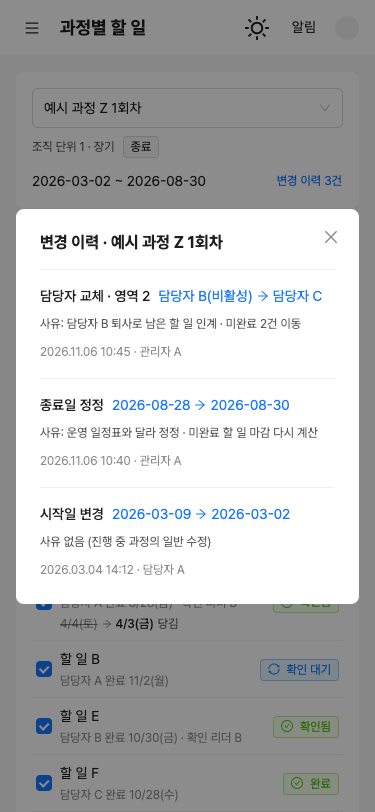
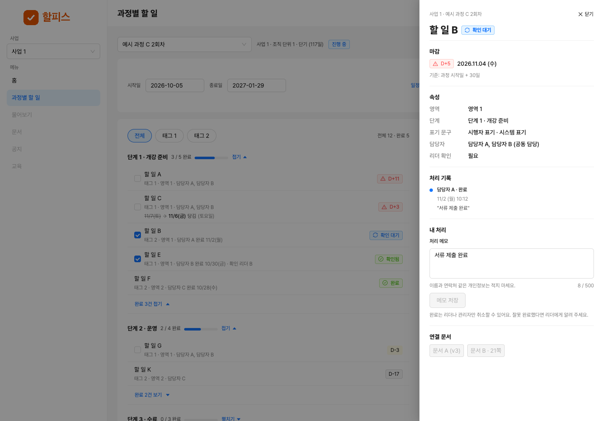
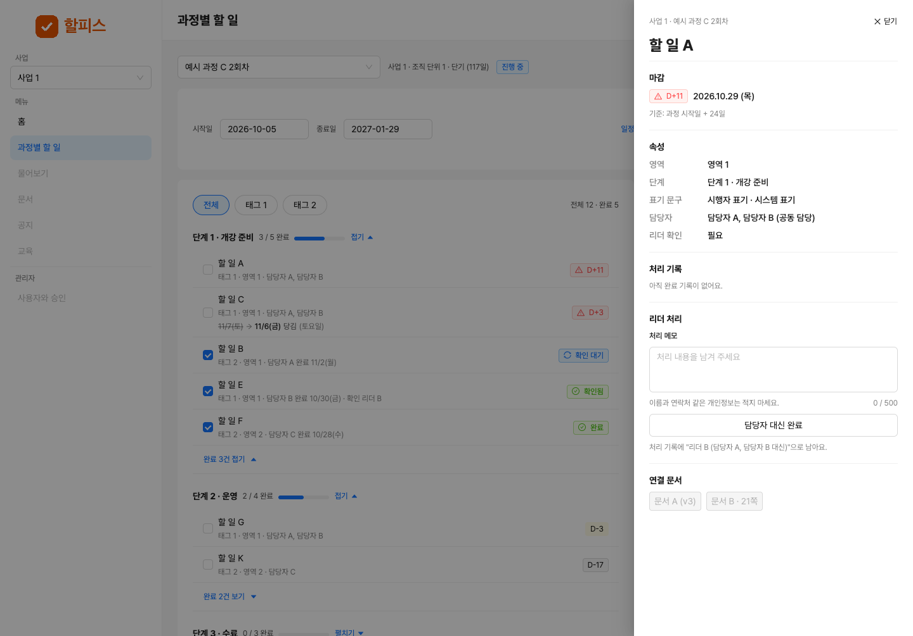
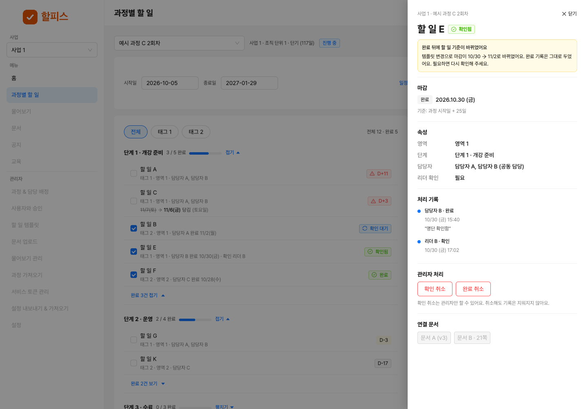

# #35 feat(front): 과정별 할 일 및 할 일 상세 화면 구성

- 생성 2026-11-09, 머지 2026-11-10
- 변경 +1370 -7, 파일 16개, 커밋 6개

## 본문

### 변경 내용

- 과정 선택과 태그 필터, 단계별 할 일 목록과 진행률 표시
- 월 주기와 상시 업무, 일정 수정과 변경 이력 화면 구성
- 할 일 상세 패널과 역할별 완료, 확인, 취소 기능 추가
- 모바일 화면과 다크모드, 빈 목록·로딩·오류 화면 적용

### 검증 결과

- `npm run build`, `npm run lint` 통과
- 담당자·조직 리더·영역 리더·관리자·열람 전용의 조회와 처리 권한 확인
- 일정 수정과 변경 이력, 메모 저장 확인
- 역할별 완료, 확인, 취소 동작 확인
- 992px 기준 반응형과 모바일 스크롤, 상태별 화면 확인

|  |  |  |  |
| --- | --- | --- | --- |
| 과정별 할 일 라이트 화면 | 과정별 할 일 다크 화면 | 모바일 과정별 할 일 화면 | 모바일 일정 수정 화면 |

|  |  |  |  |
| --- | --- | --- | --- |
| 모바일 변경 이력 화면 | 담당자 상세 화면 | 리더 상세 화면 | 관리자 상세 화면 |

### 리뷰 요청 사항

현재 데이터와 처리는 목업으로 구성했습니다. API 연동 후 수정 예정입니다.

역할별 계정으로 로그인한 뒤 사이드바의 과정별 할 일에서 확인 부탁드립니다. 일정 수정 권한과 할 일 상세의 역할별 처리 버튼 위주로 봐주시면 좋을 것 같습니다.

### 확인

- [x] 변경에 맞는 실행·테스트 결과 또는 미실행 이유를 작성했습니다
- [x] API·DB·환경변수 변경이 있다면 관련 문서와 적용 방법을 작성했습니다
- [x] 비밀번호·토큰 등 비밀값이 포함되지 않았습니다

## 커밋

- feat(front): 과정별 할 일 화면 및 목업 데이터 연결
- feat(front): 할 일 상세 화면 및 역할별 처리 기능 추가
- feat(front): 과정 일정 수정 화면 & 모바일 화면 수정
- docs(front): README 작성
- Merge remote-tracking branch 'origin/main' into feat/front/course-tasks
- fix(front): 사업 변경 시 과정 및 할 일 상세 선택 초기화

## 리뷰

### 백엔드 팀원 · COMMENTED

수고 많으셨습니다!
코드상으로 과정을 선택한 뒤 상단 사업을 변경하면, URL에 이전 `courseId`가 남아 과정 선택기 없이 빈 화면으로 들어갈 수 있어 보여 확인 부탁드립니다. 사업 변경 시 과정·상세 선택을 초기화하거나 새 사업의 기본 과정으로 전환하면 좋을 것 같습니다.
변경된 코드 기준으로 그 외의 문제는 없는 것 같습니다!
