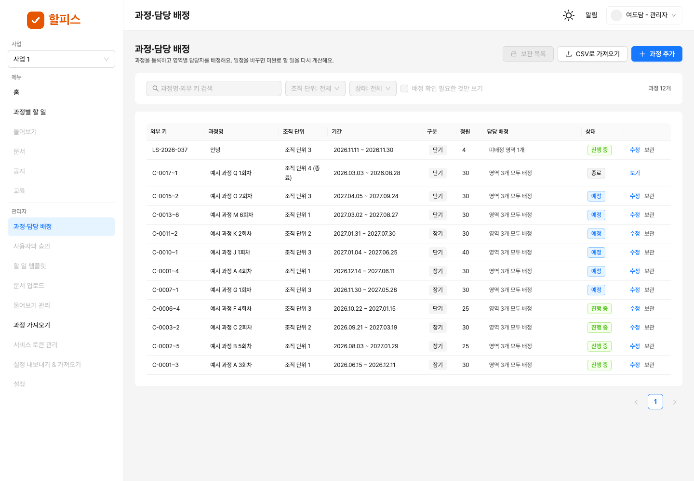
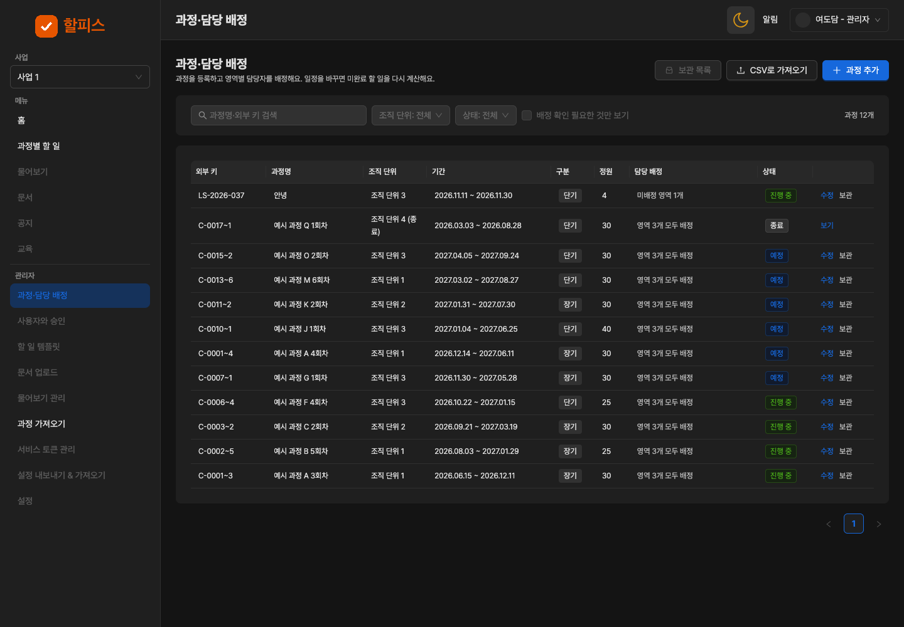
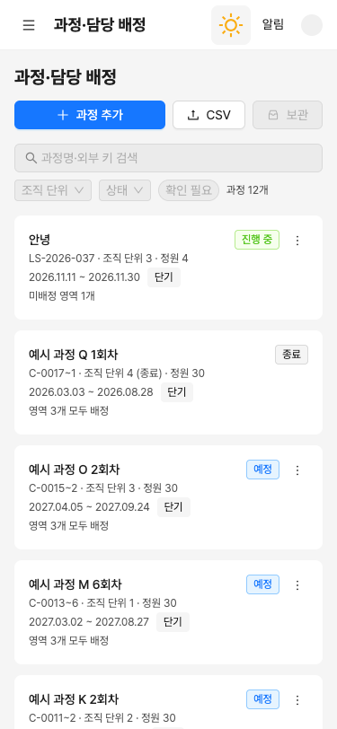
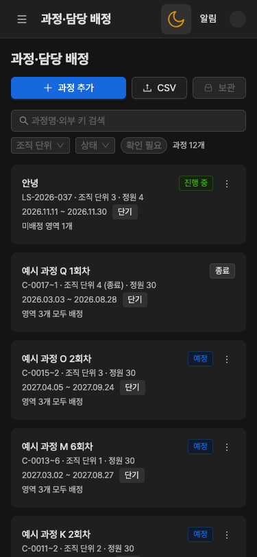
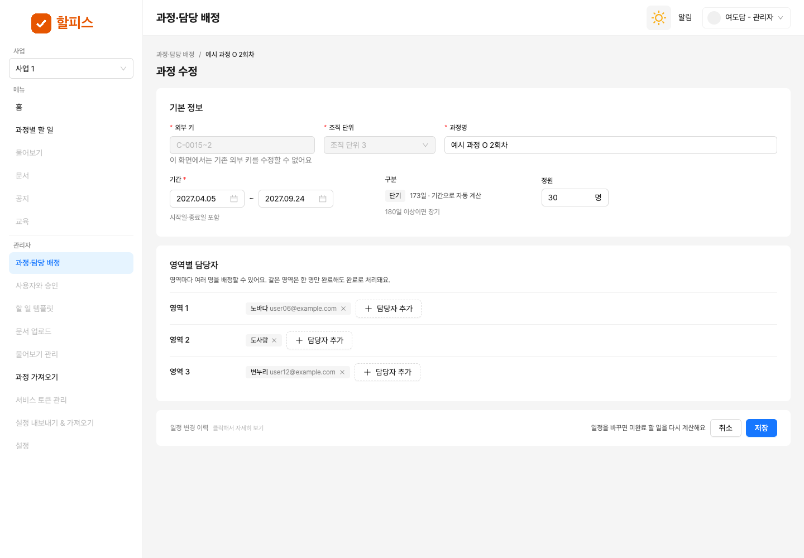
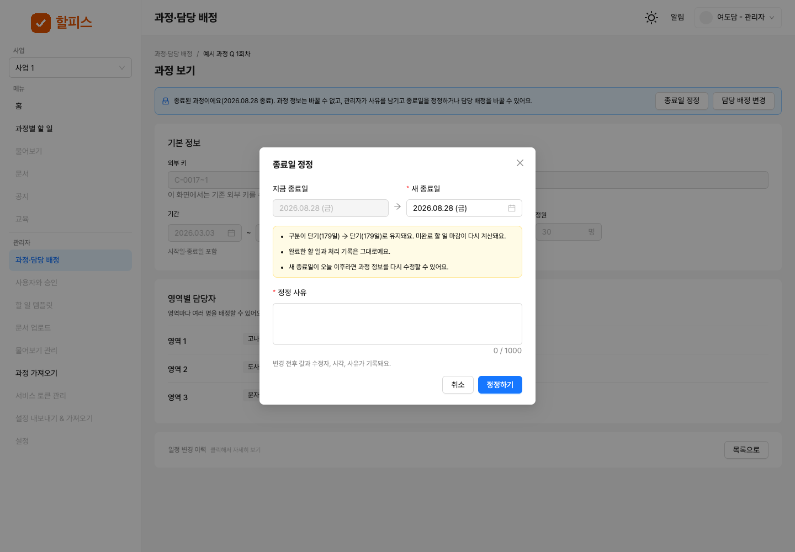
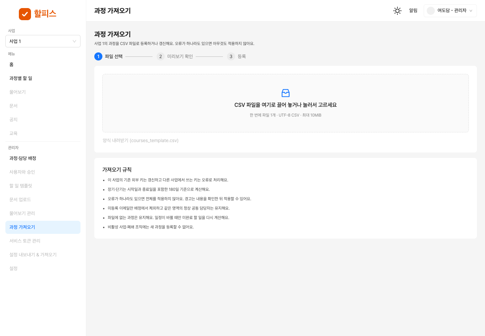
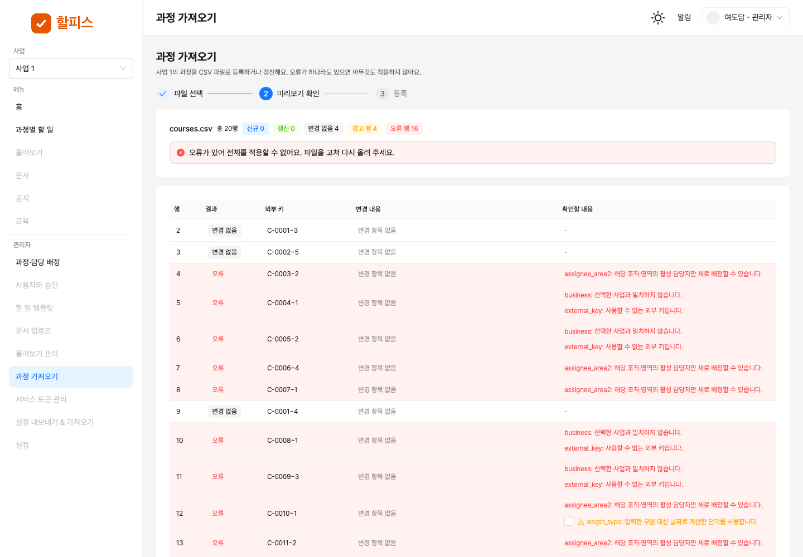

# #46 feat(front): 과정 & 담당 배정 화면 구현 및 API 연동

- 생성 2026-11-12, 머지 2026-11-13
- 변경 +4554 -235, 파일 38개, 커밋 26개

## 본문

### 변경 내용

- 관리자 과정 목록과 등록, 수정, 공동 담당 배정 화면 구성 및 API 연결
- 실제 사업 목록과 담당자 검색, 종료일 정정과 담당 배정 변경, 일정 변경 이력 연결
- CSV 업로드와 서버 미리보기, 행별 오류와 경고 확인, 전체 적용과 취소 기능 연결
- 과정 저장 후 실제 할 일 목록과 상세, 완료와 확인, 취소, 상시 업무 메모와 일정 수정 연결
- 기존 인증 요청을 공통 API 함수로 분리하고 요청 취소와 오류, 충돌 처리 적용
- PC와 모바일, 다크 모드 및 목록의 빈 상태, 로딩, 오류 화면 구성

### 검증 결과

- 9개 커밋 단계에서 `npm run build`, `npm run lint` 모두 경고 없이 통과
- 저장 순서와 서버 version 전달, 부분 저장 실패, 사업 변경 중 이전 응답 차단 확인
- CSV 페이지별 경고 확인과 응답 유실 후 동일 요청 재전송, 작업 상태 재확인 동작 확인
- 실제 할 일의 처리 권한, 완료 실패 시 입력 유지, 모바일 상시 업무와 태그 필터를 포함한 컴포넌트 테스트 10건 통과

### 화면

|  |  |  |  |
| --- | --- | --- | --- |
| PC 과정 목록 라이트 | PC 과정 목록 다크 | 모바일 과정 목록 라이트 | 모바일 과정 목록 다크 |

|  |  |  |  |
| --- | --- | --- | --- |
| 과정 수정과 담당 배정 | 종료일 정정 | CSV 업로드 | CSV 오류와 경고 미리보기 |

### 리뷰 요청 사항

관리자 계정으로 로그인한 뒤 과정 & 담당 배정에서 확인 부탁드립니다. 과정 등록과 수정, 공동 담당 배정, 종료 과정 정정과 CSV 처리 흐름 위주로 봐주시면 좋을 것 같습니다.

검색과 필터, 보관과 복원 등 아직 연결되지 않은 기능은 비활성 상태로 유지했습니다. 추가 API가 올라오면 연결하고 CSV 양식은 공식 파일을 전달받아 정적 다운로드로 제공할 예정입니다.

### 확인

- [x] 변경에 맞는 실행과 테스트 결과 또는 미실행 이유를 작성했습니다
- [x] API와 DB, 환경변수 변경이 있다면 관련 문서와 적용 방법을 작성했습니다
- [x] 비밀번호와 토큰 등 비밀값이 포함되지 않았습니다

## 커밋

- feat(front): 과정 목록 및 관리자 화면 연결
- feat(front): 과정 등록 & 수정 및 담당 배정 화면 추가
- feat(front): 과정 보관 및 복원 기능 추가
- feat(front): CSV 과정 가져오기 화면 구성
- docs(front): 과정 & 담당 배정 README 작성
- Merge branch 'main' of (비공개 원 저장소 링크)
- feat(front): 공통 API 요청과 조회 처리 추가
- feat(front): 과정 및 할 일 API 함수 추가
- feat(front): 관리자 사업 목록 API 연결
- feat(front): CSV 업로드와 미리보기 API 연결
- feat(front): CSV 경고 확인과 적용 취소 기능 연결
- feat(front): 과정 관리 및 담당 배정 API 연결
- feat(front): 실제 할 일 데이터와 비동기 처리 지원
- feat(front): 과정 저장 후 실제 할 일 화면 연결
- docs(front): API 연동 README 정리
- feat(front): 조직명과 담당자 이메일 응답 연결
- feat(front): 과정 목록 검색 및 필터 API 연결
- feat(front): 과정 변경 이력 API 연결
- feat(front): CSV 양식 다운로드 연결
- docs(front): 연동 완료 항목 README 수정
- Merge branch 'main' of (비공개 원 저장소 링크)
- fix(front): 폐쇄된 조직 이름 표시 수정
- feat(front): 과정 보기 화면과 수정 전환 추가
- fix(front): 필터 칸 너비를 글자 길이에 맞추도록 수정
- refactor(front): 과정 목록 필터 코드 정리
- docs(front): 과정 보기 화면 README 수정

## 리뷰

### 백엔드 팀원 · APPROVED

고생 많으셨습니다!
과정 저장 순서와 version 전달, 부분 실패 및 CSV 재전송 처리 확인했습니다.
확인한 범위에서는 별도로 수정할 부분 없는 것 같습니다! 검색·필터와 통합 변경 이력, 표시 정보 및 CSV 다운로드는 백엔드 보완 PR 머지 후 연결 부탁드립니다.
