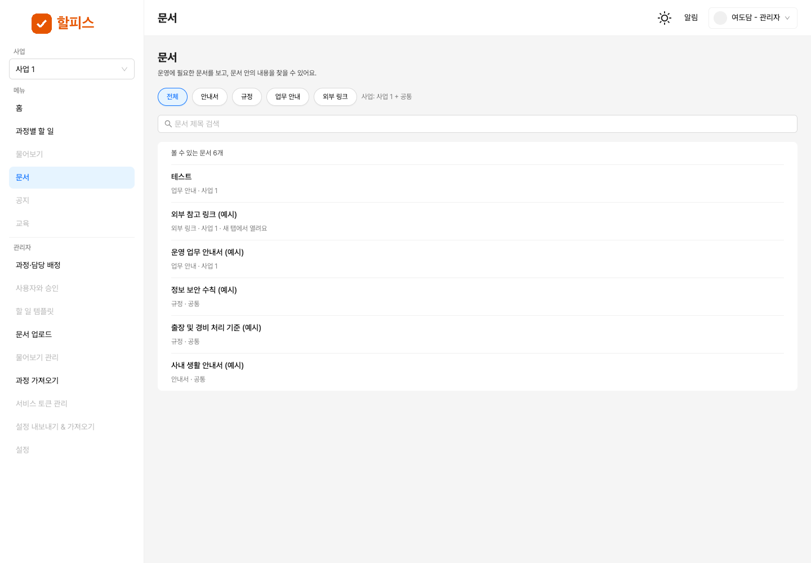
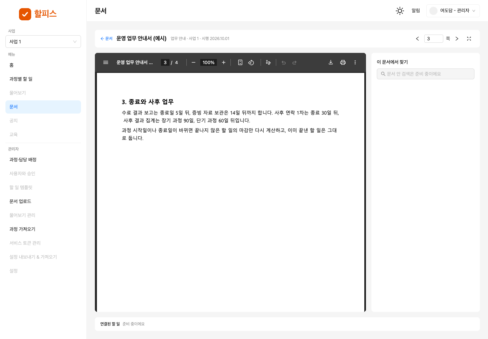
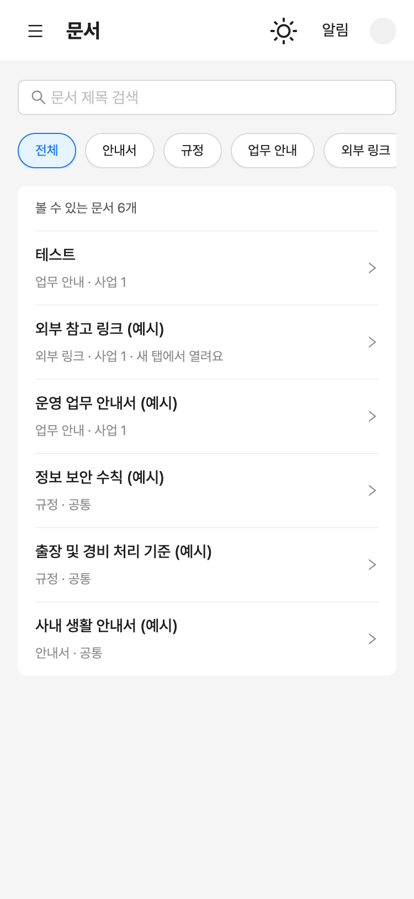
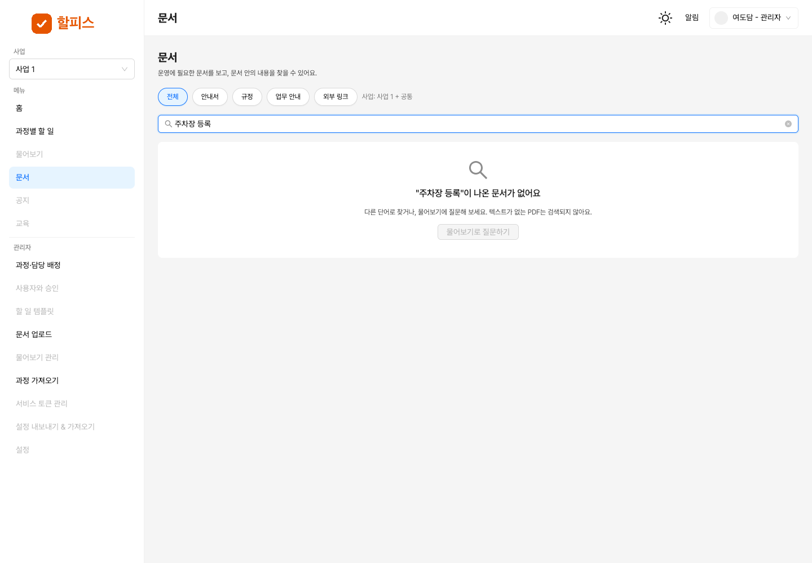
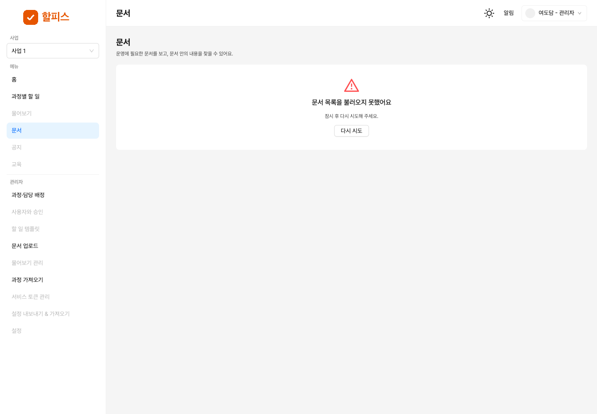
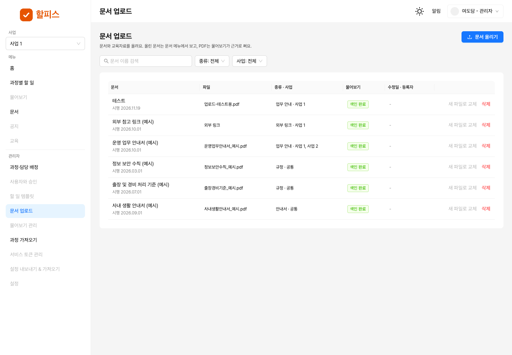
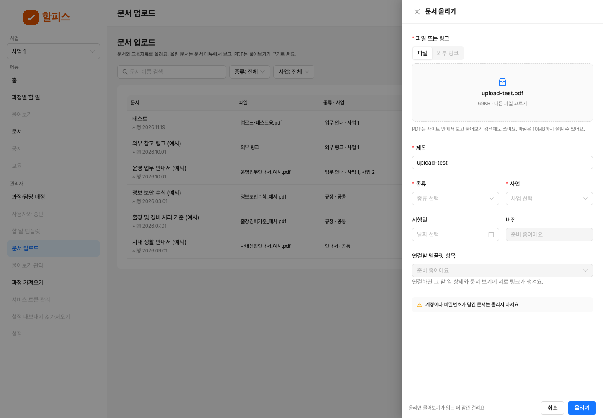
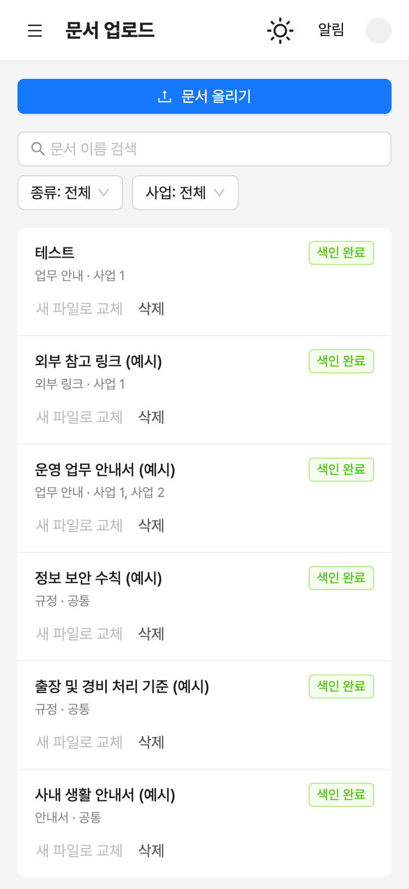

# #107 feat(front): 문서 및 문서 업로드 화면 구현 및 API 연동

- 생성 2026-11-16, 머지 2026-11-16
- 변경 +1263 -4, 파일 15개, 커밋 8개

## 본문

### 변경 내용

- 문서 목록과 종류 필터, 제목 검색, 앱 안 PDF 보기와 쪽 이동, 전체 화면 보기 구성 및 API 연결
- 관리자 문서 업로드 목록과 PDF 올리기, 삭제, 읽기 실패 시 다시 시도 연결
- 문서를 올린 뒤 읽기가 끝나면 알림으로 결과를 안내
- 사업 정보가 없는 담당자 안내와 없는 문서, 권한 없음 등 안내 카드를 하나로 통일
- 문서 업로드 모바일 화면을 카드 목록으로 구성하고 올리기 패널 문구를 모바일에 맞게 분리
- 목록과 보기, 업로드 화면의 로딩과 빈 상태, 오류, 모바일 화면 구성

### 검증 결과

- 6개 커밋 단계에서 `npm run build`, `npm run lint` 모두 경고 없이 통과
- 관리자 계정으로 실제 서버에서 목록 조회, PDF 보기와 쪽 이동, 업로드 201, 삭제 202, 읽기 완료 알림 동작 확인
- 목록 오류와 없는 문서, 빈 목록, 검색 결과 없음, 담당자 사업 정보 없음 화면 동작 확인
- PC 1440px과 모바일 375px에서 화면 확인

### 화면

|  | | 03- |  |
| --- | --- | --- | --- |
| PC 문서 목록 | PC 문서 보기 | 모바일 문서 목록 | 제목 검색 결과 없음 |

|  |  |  |  |
| --- | --- | --- | --- |
| 문서 목록 오류와 다시 시도 | PC 문서 업로드 목록 | PDF 올리기 패널 | 모바일 문서 업로드 목록 |

### 리뷰 요청 사항

관리자 계정으로 문서 화면과 문서 업로드를 확인 부탁드립니다. 사업 1에서 PDF 업로드, 읽기 완료 알림, 삭제 흐름 위주로 봐주시면 좋을 것 같습니다.

### 확인

- [x] 변경에 맞는 실행과 테스트 결과 또는 미실행 이유를 작성했습니다
- [x] API와 DB, 환경변수 변경이 있다면 관련 문서와 적용 방법을 작성했습니다
- [x] 비밀번호와 토큰 등 비밀값이 포함되지 않았습니다

## 커밋

- feat(front): 문서 화면 API 연동
- feat(front): 문서 화면 안내 카드와 공통 함수 추가
- feat(front): 문서 목록 화면 추가
- feat(front): 문서 보기 화면 추가
- feat(front): 문서 업로드 화면 추가
- docs(front): 문서 화면 README 수정
- Merge branch 'main' of (비공개 원 저장소 링크)
- fix(front): 문서 읽기 완료 알림 폴링 보완

## 리뷰

### PM(NLP) 팀원 · APPROVED

고생하셨습니다! 화면별 캡처와 확인한 흐름을 상태별로 정리해 주셔서 리뷰하기 편했습니다.

프론트에서 호출하는 API 경로·파라미터와 `DocumentItem` 필드를 백엔드 `DocumentController`·`DocumentResponse`와 대조해 봤는데 모두 일치했습니다. `NO_TEXT`가 `UNSUPPORTED`로 오는 처리도 `DocumentIndexService`와 맞는 것 확인했습니다.

화면들도 한눈에 잘 들어오고 잘 만들어주신 것 같습니다!!

요청해 주신 업로드 → 읽기 완료 알림 흐름에서 두 가지가 반영되면 좋을 것 같습니다.

**1. 일시 실패 시 알림이 먼저 뜨는 문제**
백엔드는 NLP 일시 장애(`indexError: 'RETRYABLE'`, 기동 중·타임아웃 등)도 상태를 `FAILED`로 저장하고 1·5·30·60초 뒤 자동으로 다시 읽습니다. 그런데 `AdminDocumentList`의 폴링은 `FAILED`를 보면 바로 "읽지 못했어요" 알림을 띄우고 멈춰서, NLP가 막 뜬 직후 업로드하면 실패 알림이 뜬 뒤 실제로는 `READY`가 되고 완료 알림은 오지 않습니다. `indexError === 'RETRYABLE'`일 때는 계속 기다리도록 하고, 목록 태그도 "읽는 중"으로 보여 주면 좋을 것 같습니다.

**2. 다시 시도 후 결과 알림**
`retry()`에서 `reload`만 하고 `indexing`에는 추가하지 않아서, 다시 시도한 문서는 읽기가 끝나도 알림이 오지 않습니다. 업로드 때처럼 `setIndexing((current) => ({ ...current, [item.id]: item.title }))`를 넣어 주시면 같은 흐름으로 안내될 것 같습니다.

아래는 병합을 막는 사항은 아니고, 함께 봐 주시면 좋을 것 같은 부분입니다.

- **폴링 타이머 재시작:** effect 의존성의 `documents`는 `useApiQuery`가 렌더마다 새로 만드는 객체라서, 검색어 입력 등으로 화면이 다시 그려질 때마다 3초 타이머가 처음부터 다시 시작됩니다. 계속 타이핑하면 확인이 계속 미뤄질 수 있습니다. 또 읽는 도중 삭제된 문서는 목록에서 사라져도 `indexing`에서 빠지지 않아 폴링이 끝나지 않는데, 의존성을 `documents.reload` 대신 안정된 값으로 바꾸고 목록에 없는 id는 `indexing`에서 빼 주시면 좋을 것 같습니다.
- **다음 쪽 상한:** 문서 보기의 다음 쪽 버튼에 끝이 없어서 마지막 쪽을 넘어서도 계속 넘어갑니다. PDF 쪽수를 알 수 없는 구조라면 지금은 알려진 한계로 README나 PR에 적어 두는 것으로 충분할 것 같은데, 의도하신 부분이 맞을까요?
- **수정일 · 등록자 열:** 백엔드 응답에 해당 필드가 없어서 관리자 목록에서 항상 `-`로 보입니다. 백엔드에 필드가 추가되기 전까지는 열을 숨기거나 "준비 중"으로 표시하면 덜 헷갈릴 것 같습니다.

모두 이번 PR이나 후속 PR 중 편하신 쪽으로 반영해 주시면 될 것 같습니다. 오늘 하루 수고하셨습니다!
