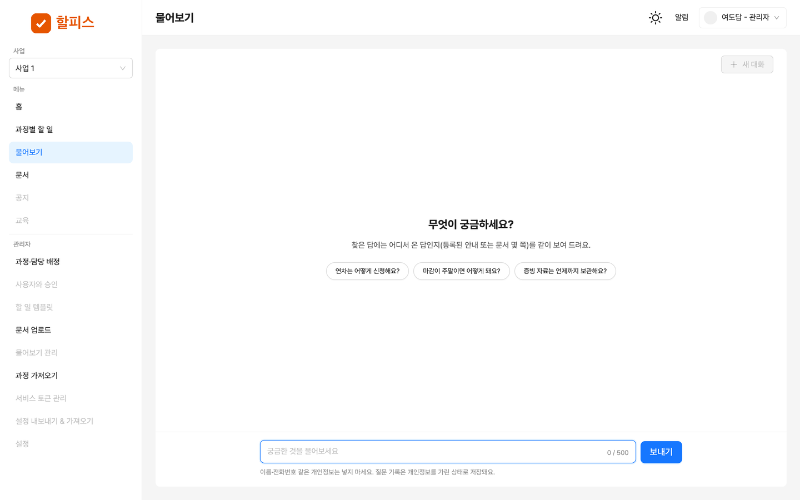
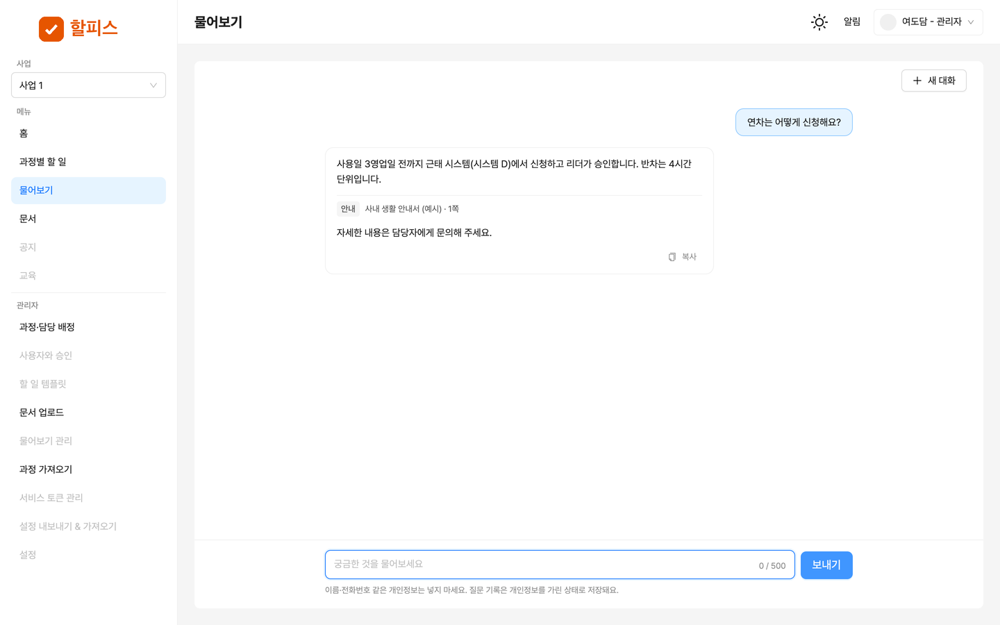
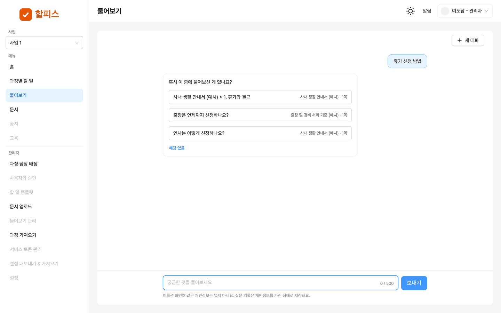
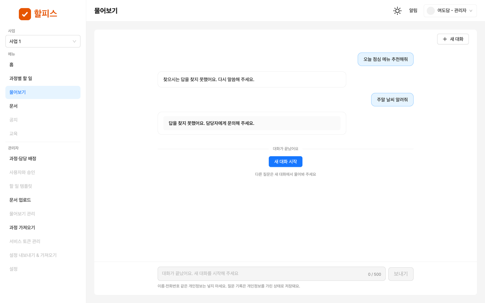
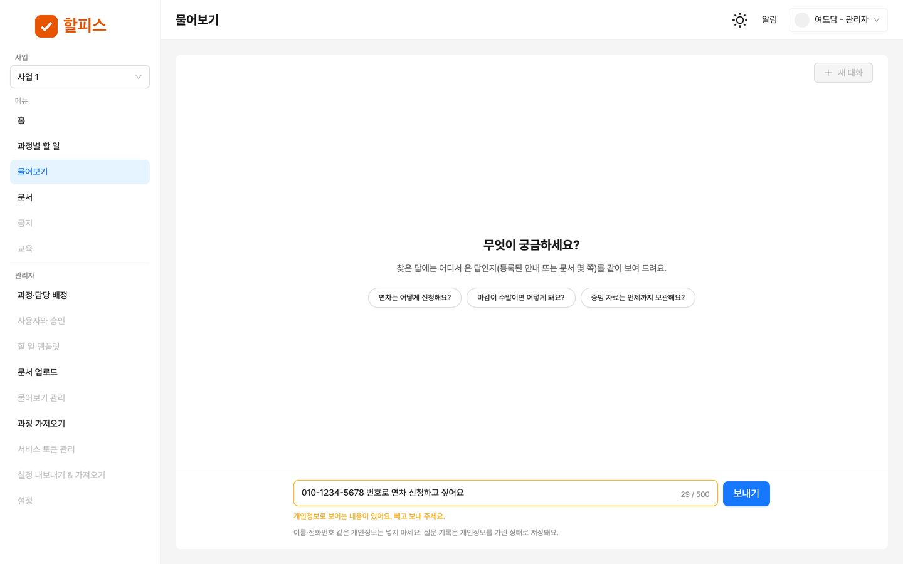
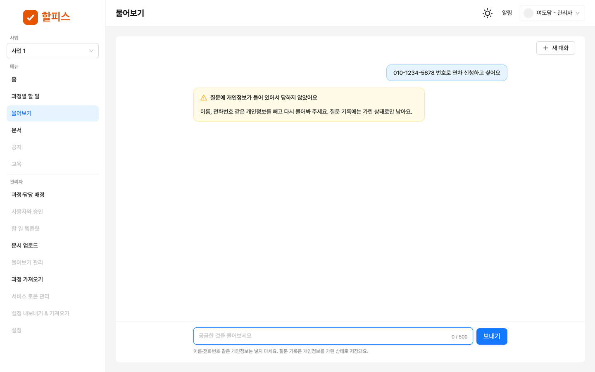
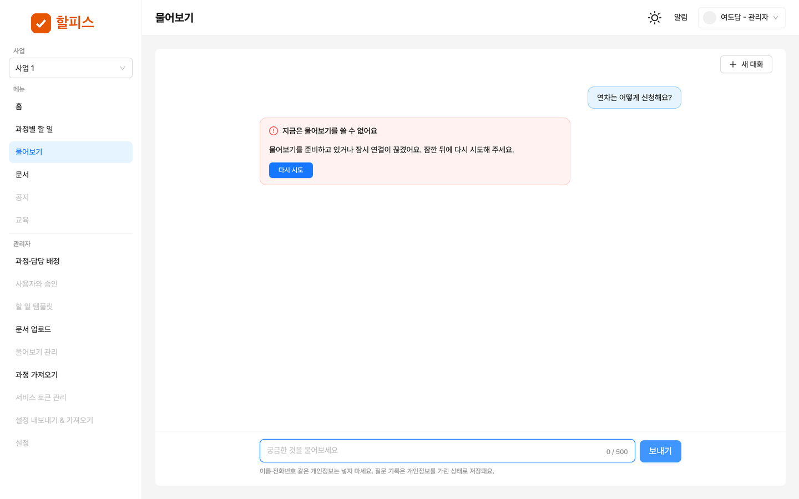
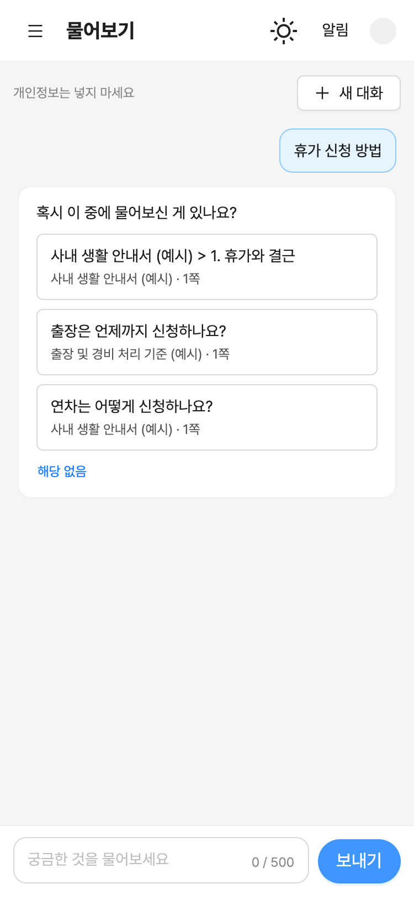

# #109 feat(front): 물어보기 화면 구현 및 API 연동

- 생성 2026-11-16, 머지 2026-11-17
- 변경 +894 -16, 파일 15개, 커밋 11개

## 본문

### 변경 내용

물어보기(S16) 화면을 구현하고 실제 질문 API와 연동했습니다.

- 질문 입력과 응답 상태별 말풍선 (`answered`, `clarify`, `no_answer`, `pii_warning`, 오류)
- 되묻기 후보 선택과 해당 없음, 담당자 안내 시 대화 종료와 새 대화 시작
- 근거 표시: 등록 안내와 문서 구절(출처 문서 보기로 이동), 관련 화면 열기
- 대화 유지: 다른 화면에 갔다 와도 대화와 입력 중인 글이 남고, 새 대화를 시작하거나 사업이 바뀌거나 로그인이 풀리면 초기화
- 사용성: 새 대화 버튼, 답을 기다리는 표시, 입력창 포커스, 답변 복사, 긴 대화 스크롤
- 레이아웃: 바깥 화면은 고정하고 채팅 영역만 스크롤, 상단 바와 중복되는 제목 영역 삭제, 모바일 개인정보 안내를 위쪽으로 이동
- 입력 중 개인정보 경고 (전화번호, 주민등록번호, 이메일 형식), 500자 제한
- 모든 활성 사용자가 사업 목록을 받아 선택한 사업 기준으로 질문 (선택할 수 있는 사업이 없으면 안내 카드 표시)
- 사이드바와 헤더 연결, README 갱신

### 검증 결과

- `npm run build`, `npm run lint` 통과
- 로컬 NLP 서버와 실제 `POST /api/questions`로 확인
  - 즉답, 되묻기와 후보 선택, 답 없음 두 번 후 대화 종료, 개인정보 경고, 오류 화면
  - 입력 중 개인정보 경고와 500자 초과 안내
  - 다른 화면에 갔다 온 뒤 대화와 입력 글 유지
  - 사업을 바꿨다 돌아오거나 세션 만료 후 재로그인하면 대화 초기화
  - 등록 안내와 문서 구절 근거에서 문서 열기를 누르면 `/documents/:id?page=` 로 이동
  - 긴 대화에서 바깥 화면은 고정되고 채팅 영역만 스크롤됨 (PC, 모바일)
- 관리자, 담당자, 리더, 열람 전용 계정으로 문서와 물어보기 화면이 열리는 것을 확인했습니다

### 화면

| |  |  |  |
| --- | --- | --- | --- |
| PC 처음 | PC 즉답 | PC 되묻기 | PC 대화 종료 |

|  |  | |  |
| --- | --- | --- | --- |
| PC 개인정보 입력 경고 | PC 개인정보 응답 | PC 오류 | 모바일 되묻기 |

### 리뷰 요청 사항

대화 상태를 `askSession.ts`에 두어 화면 이동 후에도 유지되게 했는데, 구조가 괜찮은지 봐 주세요. 화면 경로 근거는 `/my-tasks`를 `/tasks`로 바꿔 이동하도록 처리했습니다.

### 확인

- [x] 변경에 맞는 실행·테스트 결과 또는 미실행 이유를 작성했습니다
- [x] API·DB·환경변수 변경이 있다면 관련 문서와 적용 방법을 작성했습니다
- [x] 비밀번호·토큰 등 비밀값이 포함되지 않았습니다

## 커밋

- feat(front): 물어보기 화면 추가
- feat(front): 물어보기 API 연동
- feat(front): 물어보기 대화 유지 세션 추가
- feat(front): 물어보기 화면 디자인 개선
- docs(front): 물어보기 README 추가
- Merge branch 'main' of (비공개 원 저장소 링크)
- feat(front): 물어보기 문서 열기 링크 변경
- feat(front): 물어보기 화면 레이아웃 정리
- fix(front): 리뷰 사항 반영(물어보기 초기화 관련)
- fix(front): 모든 활성 사용자의 사업 목록 조회 연결
- fix(front): 물어보기 등록 안내의 출처 문서 열기 추가

## 리뷰

### 백엔드 팀원 · COMMENTED

고생하셨습니다!
질문·선택 알림의 요청 형식과 선택 근거 유지, 대화 종료 처리는 백엔드 계약과 맞는 것을 확인했습니다. 외부 저장소와 useSyncExternalStore로 화면 이동 중 대화를 유지하는 구조도 괜찮아 보입니다. /my-tasks → /tasks 변환도 현재 라우트 이름과 맞는 것을 확인했습니다.
다만, 초기화 동작과 관련하여 인라인으로 남겼으니 확인 부탁드립니다.

## 인라인 리뷰와 답변

### 백엔드 팀원 · `src/pages/ask/askSession.ts`

현재는 사용자·사업별 세션을 계속 보관하므로, 사업 A → B → A로 변경하면 이전 대화·입력 글·conversationId가 복원되는 것으로 보입니다. PR 설명에는 “사업이나 사용자 변경 시 초기화”라고 되어 있는데, 이전 사업으로 돌아왔을 때 대화를 복원하는 것이 의도된 동작일까요? 초기화가 의도라면 물어보기 밖에서 사업을 변경하는 경우도 함께 처리 부탁드립니다.

### 백엔드 팀원 · `src/providers/AuthProvider.tsx`

현재 초기화가 명시적 로그아웃 성공 시에만 실행됩니다. 세션 만료나 계정 비활성으로 인증이 해제된 뒤 같은 계정으로 재로그인하면 이전 대화가 복원될 수 있어, 해당 경로에서도 초기화하도록 부탁드립니다.

## 대화

### 나(프론트엔드)

확인 감사합니다! 사업별로 대화를 이어갈 수 있게끔 두면 되겠다고 생각했는데 서버의 대화 내용이 시간때문에 만료되면 서버 상태랑 화면 상태가 어긋날 수 있을 것 같아 사업이 바뀌어도 초기화하도록 수정하겠습니다. 초기화도 로그아웃만이 아니라 인증 상태 기준으로 두고 비활성 시점에 초기화하도록 수정해서 올리고 머지하겠습니다..!
