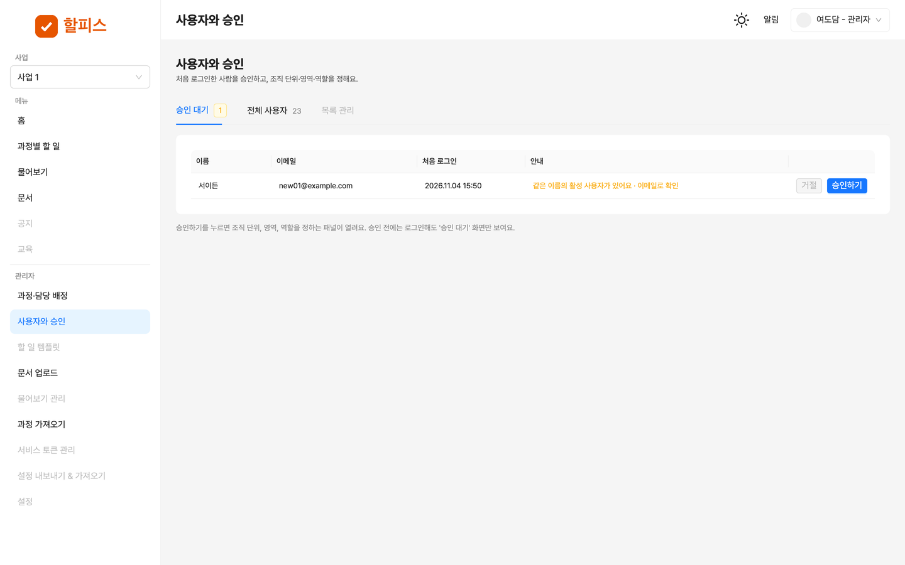
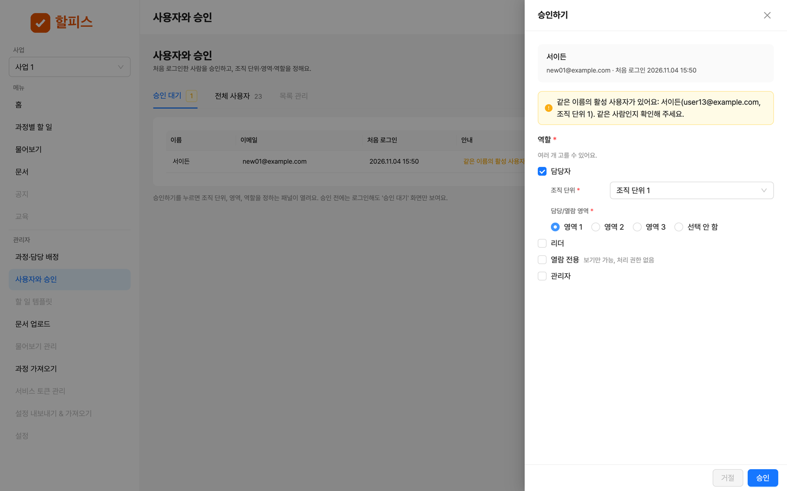
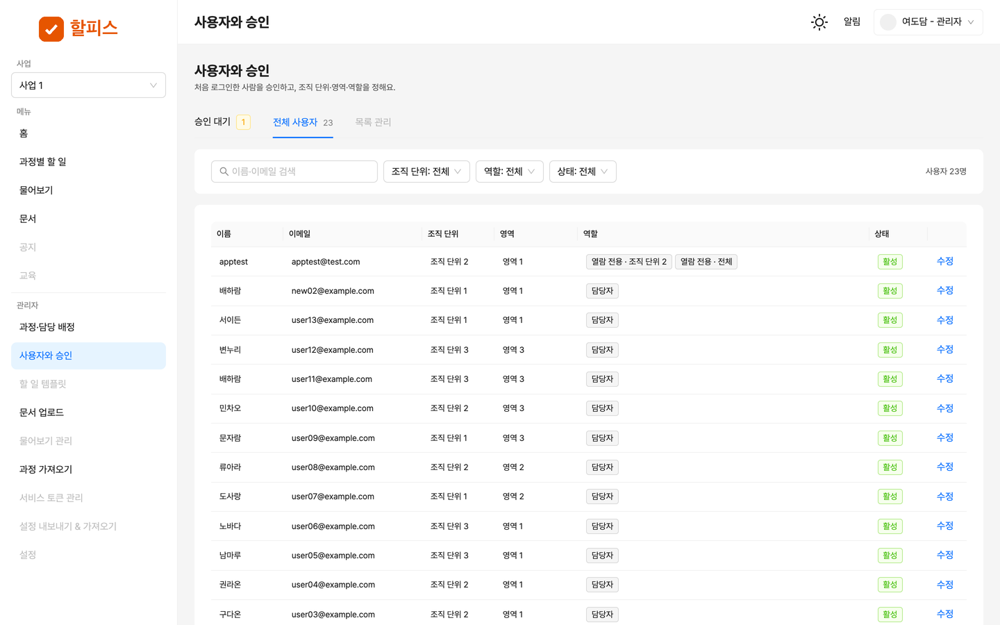
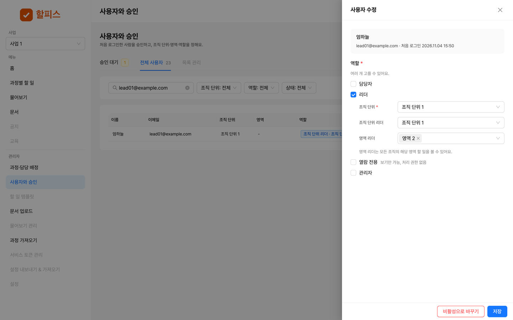
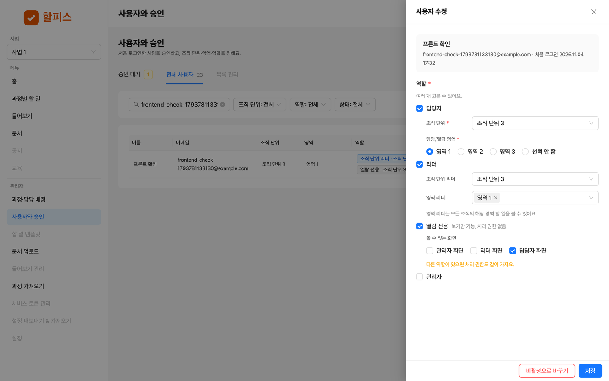
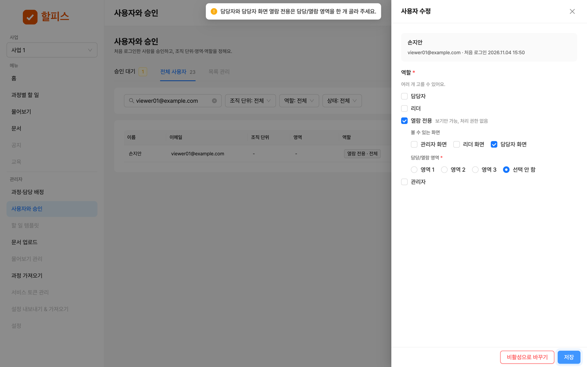
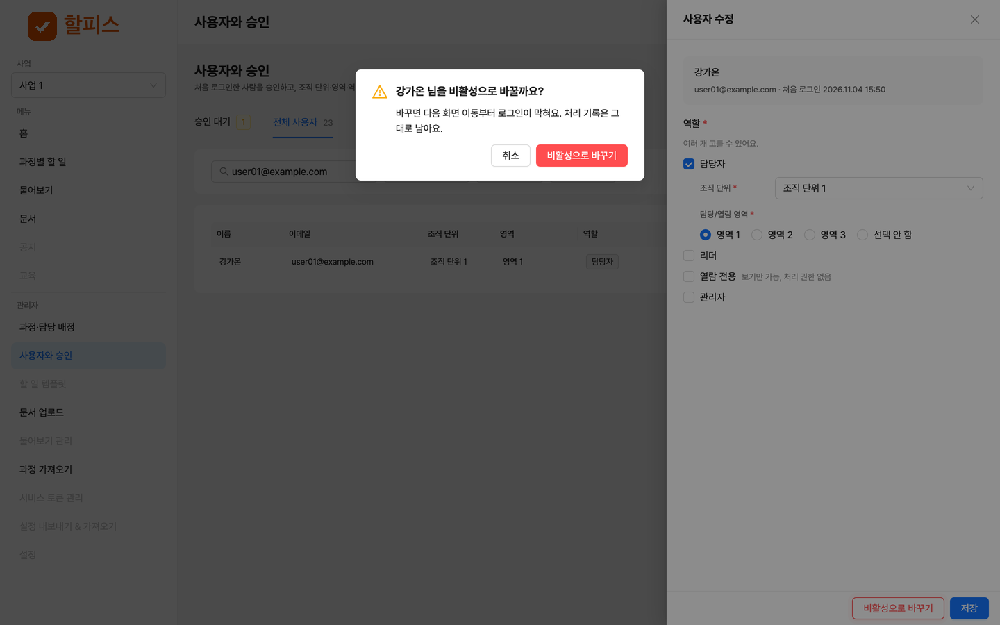
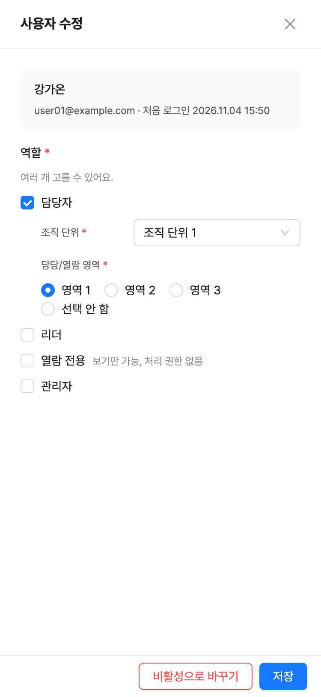

# #113 feat(front): 사용자와 승인 화면 구현 및 API 연동

- 생성 2026-11-17, 머지 2026-11-18
- 변경 +1538 -3, 파일 16개, 커밋 7개

## 본문

### 변경 내용

- 승인 대기 목록과 승인 패널 구성 및 API 연결, 같은 이름의 활성 사용자가 있으면 안내
- 전체 사용자 목록과 이름, 이메일 검색, 조직 단위와 역할, 상태 필터 구성
- 역할을 먼저 고르면 필요한 조직 단위와 영역 칸이 그 역할 아래에 나오도록 구성
- 담당자와 담당자 화면 열람 전용은 담당/열람 영역 한 곳에서 선택, 관리자만 고르면 조직과 영역 없이 저장
- 역할을 끄거나 칸이 숨겨져도 기존 값 유지
- 영역이 두 개인 기존 사용자는 한 개로 정리해야 저장
- 활성과 비활성 변경, 비활성은 확인 창 표시
- 조직 단위와 영역 목록을 불러오지 못하면 안내와 다시 시도 표시
- 리더는 소속 조직 사용자에게 담당자와 조직 단위 리더 역할 추가, 그 외 역할은 화면 접근 차단

- 조직 단위 리더는 승인 대기 탭에서 소속 조직으로 승인 (담당자와 조직 단위 리더만 지정, 다른 조직 소속 대기자는 승인 불가 안내)
- 영역 선택지는 사업과 관계없는 user-areas로 조회

### 검증 결과

- 3개 커밋 단계에서 `npm run build`, `npm run lint` 모두 경고 없이 통과
- 관리자 계정으로 실제 서버에서 승인 200, 사용자 수정 200, 비활성 후 다시 활성 동작 확인
- 리더, 담당자, 여러 역할 계정을 그대로 저장하거나 역할을 껐다 켜도 기존 역할과 조직, 영역 값이 유지됨
- 조직과 영역 없이 승인하거나 영역 없이 담당자 화면 열람 전용을 저장하면 안내 후 막힘
- PC 1440px과 모바일 375px에서 화면 확인

### 화면

|  |  |  |  |
| --- | --- | --- | --- |
| PC 승인 대기 | PC 승인 패널 | PC 전체 사용자 | PC 리더 수정 |

|  |  |  |  |
| --- | --- | --- | --- |
| PC 여러 역할 수정 | 입력 검사 안내 | 비활성 확인 | 모바일 사용자 수정 |

### 리뷰 요청 사항

관리자 계정으로 승인과 사용자 수정 확인 부탁드립니다. 역할을 꺼도 기존 조직과 영역 값은 지우지 않도록 했는데, 이 부분 괜찮은지도 봐주시면 감사하겠습니다.

### 확인

- [x] 변경에 맞는 실행과 테스트 결과 또는 미실행 이유를 작성했습니다
- [x] API와 DB, 환경변수 변경이 있다면 관련 문서와 적용 방법을 작성했습니다
- [x] 비밀번호와 토큰 등 비밀값이 포함되지 않았습니다

## 커밋

- feat(front): 사용자와 승인 API 연결
- feat(front): 사용자와 승인 화면 구현
- docs(front): 사용자와 승인 README 추가
- feat(front): 리더 사용자와 승인 화면 구현
- fix(front): 리뷰 사항 반영(사용자와 승인 기존 값 표시, 같은 이름 확인)
- Merge remote-tracking branch 'origin/main' into feat/front/user-manag…
- feat(front): 리더 승인 대기와 사용자 관리용 영역 목록 연결

## 리뷰

### 백엔드 팀원 · APPROVED

고생 많으셨습니다! 
요청 형식과 기존 조직·영역 값 유지 처리는 백엔드 계약과 맞는 것으로 확인했습니다.
방금 올린 백엔드 PR에 리더의 전체 승인 대기자 조회와 사용자 관리용 영역 목록이 추가되어 있습니다. 해당 PR 머지 후 리더의 가입 승인 흐름과 사업 선택에 종속되지 않는 사용자 관리 화면은 후속 작업으로 연결 부탁드립니다.
현재 작업에서는 추가로 머지를 막을만한 문제를 발견하진 못했습니다. 문제 없으면 머지하셔도 괜찮을 것 같습니다.

### PM(NLP) 팀원 · COMMENTED

수고하셨습니다! 승인부터 수정, 리더 역할 추가까지 한 화면에서 정리되어 있어서 흐름이 잘 보였습니다. 확인하면서 몇 가지 적어 둡니다.

**1. 영역 목록 출처**
지금 `UsersContent`가 `getCourseOptions(businessId)`로 `/options/areas?businessId=`를 불러오고 있어서, 선택된 사업이 없으면 사용자 관리 화면 전체가 "선택할 수 있는 사업이 없어요"로 막힙니다. #114에서 사업 ID 없이 쓰는 `GET /api/options/user-areas`가 추가되었으니, #114가 머지되면 영역은 이 API로 바꿔주시면 감사하겠습니다. 조직 단위는 아직 사업 ID가 필요한 API뿐이라 이번에는 그대로 두셔도 될 것 같습니다.

**2. 리더 승인 대기 (후속)**
#114에서 리더도 `GET /api/users?status=PENDING`으로 소속 없는 대기자를 보고 자기 조직으로 승인할 수 있게 됩니다. 지금 리더 화면은 역할 추가만 있어서, 후속으로 승인 대기 탭을 붙여주시면 감사하겠습니다. 리더가 승인할 수 있는 역할은 담당자와 조직 단위 리더로 제한되니 `LeaderRoleDrawer`처럼 선택지를 좁히면 될 것 같습니다. 이번 PR 범위 밖이면 이슈로만 남겨 두셔도 충분합니다.

**3. 리뷰 요청 주신 "역할을 꺼도 기존 조직과 영역 유지"**
저도 유지하는 쪽이 맞다고 봅니다. 조직 단위는 리더 관리 범위(자기 조직 사용자 판단)에도 쓰여서, 지우면 리더가 그 사용자를 못 보게 됩니다.
다만 기존 담당자를 관리자만 남기도록 바꾸면 조직과 영역 칸이 숨겨진 채 기존 값이 그대로 저장돼서, 관리자는 무엇이 저장되는지 화면에서 알기 어렵습니다. 칸이 숨겨질 때 "소속: OO · 영역: OO" 정도를 읽기 전용으로 보여주시면 감사하겠습니다.

**4. 같은 이름 확인 (급하지 않음)**
같은 이름 안내를 위해 `loadActive`가 활성 사용자 전체를 100명씩 끝까지 불러오고 있습니다. 지금 규모에서는 문제없지만 사용자가 늘면 화면을 열 때마다 요청이 늘어나니, 나중에 승인 패널을 열 때 대기자 이름으로 `q` 검색하고 결과에서 같은 이름만 거르는 방식도 고려해 주시면 좋겠습니다.

## 대화

### 나(프론트엔드)

#114 반영해서 올렸습니다!
- 영역 선택지를 /api/options/user-areas로 바꾸고 사업이 없어도 사용자 관리 화면이 열리도록 했습니다.
- 조직 단위 리더만 사용자와 승인 메뉴에 들어오도록 바꾸고 리더 화면에 승인 대기 탭을 추가했습니다. 담당자와 조직 단위 리더만 지정할 수 있고 다른 조직 소속으로 저장된 대기자는 승인 버튼을 막고 안내 문구 뜨도록 수정했습니다.
