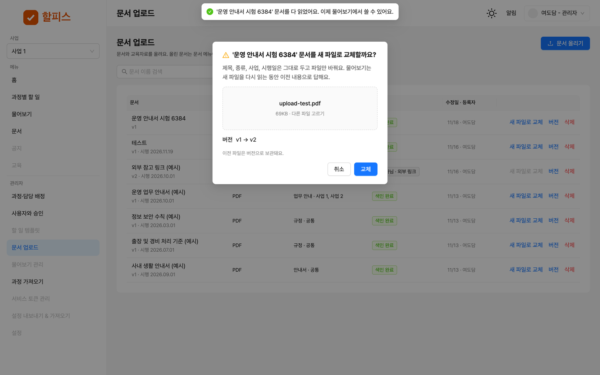
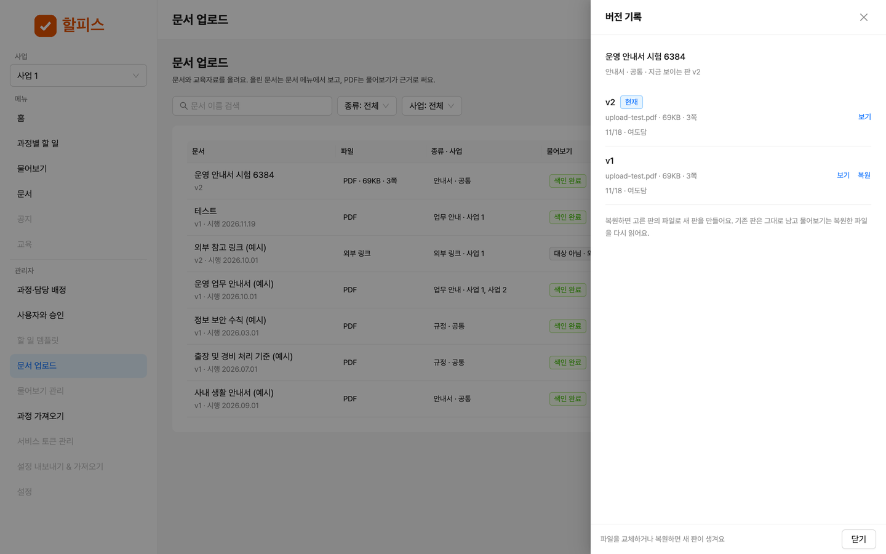
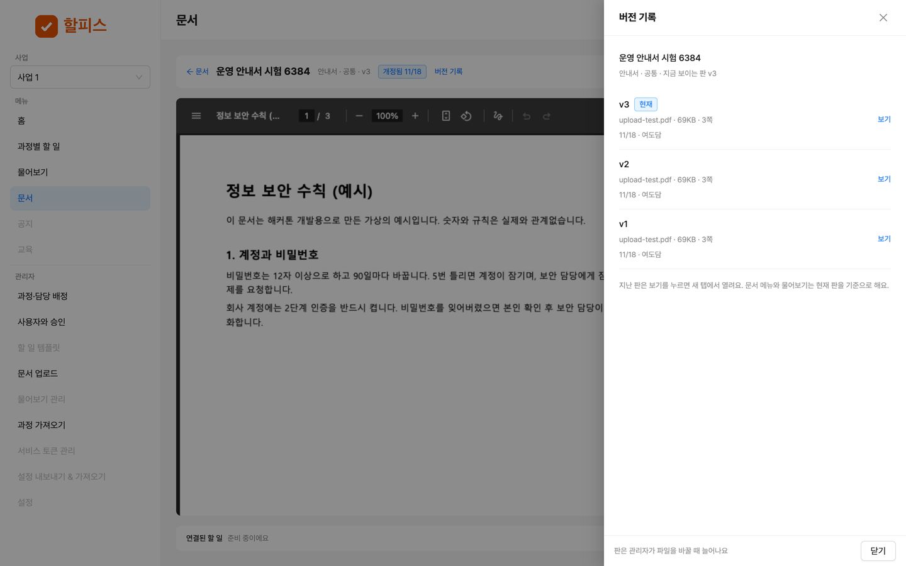
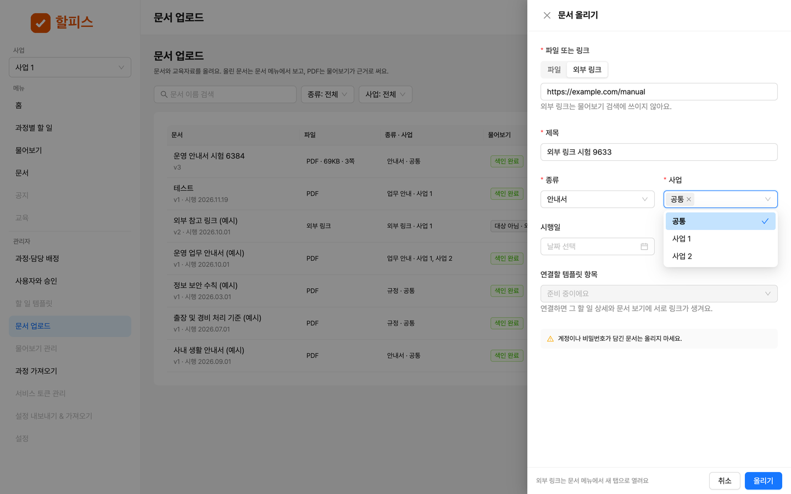

# #119 feat(front): 문서 교체와 버전 기록, 외부 링크 등록 기능 연동

- 생성 2026-11-18, 머지 2026-11-19
- 변경 +636 -96, 파일 9개, 커밋 5개

## 본문

### 변경 내용

- 관리자 문서 목록에 버전, 파일 정보, 수정일과 등록자 표시
- 새 파일로 교체 연결
- 버전 기록 열람과 관리자 복원 연결
- 문서 보기에 개정 표시와 전체 쪽수 추가
- 삭제 확인에 근거로 쓰는 Q&A 수 안내
- 외부 링크 등록 연결

### 검증 결과

- 4개 커밋 단계에서 `npm run build`, `npm run lint` 모두 경고 없이 통과
- 관리자 계정으로 실제 서버에서 PDF 등록, 교체 후 v2, 지난 판 열람 200, 복원 후 v3 생성 확인
- 사용자 문서 보기에서 버전 기록 열람과 지난 판 열람 200, 복원 버튼이 보이지 않는 것 확인
- 외부 링크 등록과 잘못된 주소 입력 안내, 삭제 확인의 Q&A 수 표시 확인
- 시험용 문서는 확인 후 삭제

### 화면

|  |  |  |  |
| --- | --- | --- | --- |
| 새 파일로 교체 | 관리자 버전 기록 | 사용자 버전 기록 | 외부 링크 등록 |

### 리뷰 요청 사항

관리자 계정으로 문서 교체와 버전 복원 확인 부탁드립니다. 사용자는 지난 판 보기만, 관리자는 복원까지 가능하도록 나눴는데 같이 봐주시면 감사하겠습니다.

### 확인

- [x] 변경에 맞는 실행과 테스트 결과 또는 미실행 이유를 작성했습니다
- [x] API와 DB, 환경변수 변경이 있다면 관련 문서와 적용 방법을 작성했습니다
- [x] 비밀번호와 토큰 등 비밀값이 포함되지 않았습니다

## 커밋

- feat(front): 문서 목록 정보와 삭제 확인 연결
- feat(front): 외부 링크 등록과 새 파일로 교체 연결
- feat(front): 문서 버전 기록과 복원 연결
- docs(front): 문서 README 작성
- fix(front): 리뷰 수정사항 적용(문서 판 충돌 에러 메시지, 불러오기 교체 안내 수정)

## 리뷰

### 백엔드 팀원 · COMMENTED

고생 많으셨습니다!
백엔드 계약과 대조하여 교체·복원 요청의 현재 판 전달, 사용자와 관리자의 버전 열람·복원 구분, 삭제 확인 정보 연동을 확인했습니다.
아래에 두 가지 수정 요청을 남겼으니 확인 부탁드립니다.

## 인라인 리뷰와 답변

### 백엔드 팀원 · `src/pages/documents/components/DocumentVersionsDrawer.tsx`

다른 관리자가 먼저 파일을 교체해 409가 발생하면, 버전 목록을 다시 조회해도 복원 요청에 사용하는 `item.contentRevision`은 이전 값으로 유지되는 것 같습니다. 교체 모달도 같은 상황으로 보입니다.
409일 때 현재 문서 정보까지 갱신하거나 패널을 닫고 최신 목록에서 다시 선택하도록 처리해 주시면 좋겠습니다. 최신 판을 확인한 뒤 다시 요청하는 흐름으로 확인 부탁드립니다.

### 백엔드 팀원 · `src/pages/admin/documents/components/DocumentReplaceModal.tsx`

현재 백엔드는 교체 후 PENDING인 문서를 NLP 검색 허용 목록에서 제외하므로, 재색인 중 이전 내용으로 답하는 동작은 아닙니다.
“새 파일을 읽는 동안 이 문서는 물어보기 검색에서 잠시 제외돼요.” 정도로 안내를 맞춰주시면 감사하겠습니다.

## 대화

### 나(프론트엔드)

> 고생 많으셨습니다!
> 백엔드 계약과 대조하여 교체·복원 요청의 현재 판 전달, 사용자와 관리자의 버전 열람·복원 구분, 삭제 확인 정보 연동을 확인했습니다.
> 아래에 두 가지 수정 요청을 남겼으니 확인 부탁드립니다.

확인했습니다 수정 후 머지하겠습니다 !
