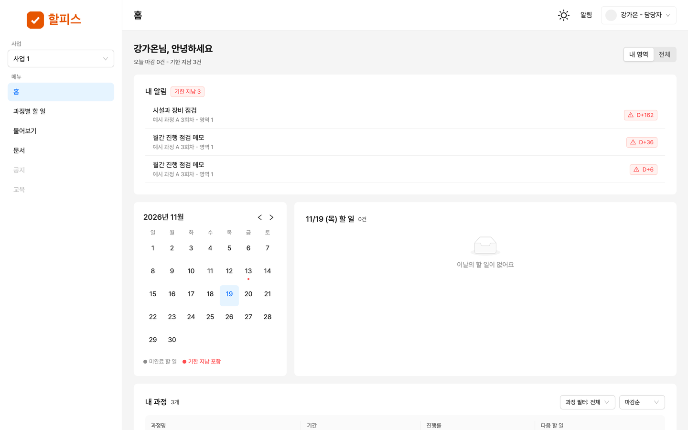
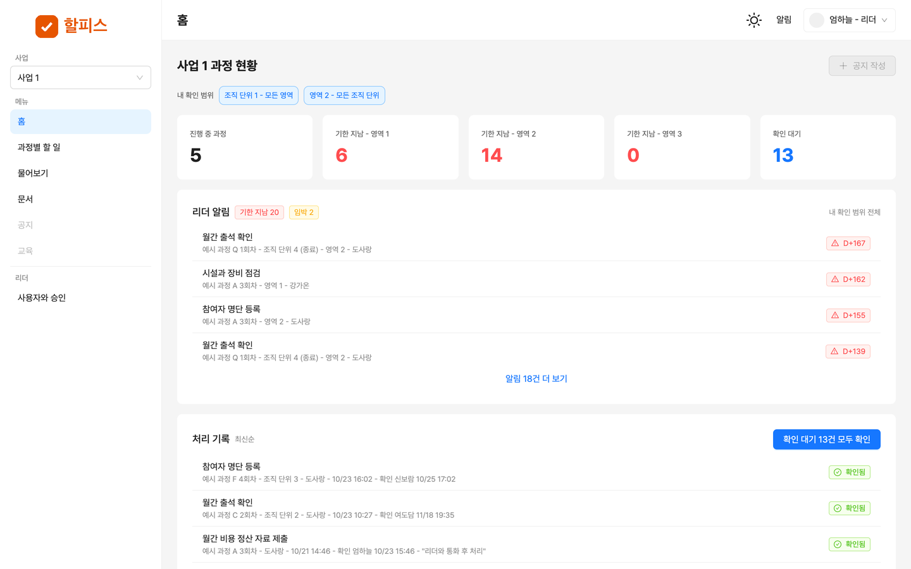
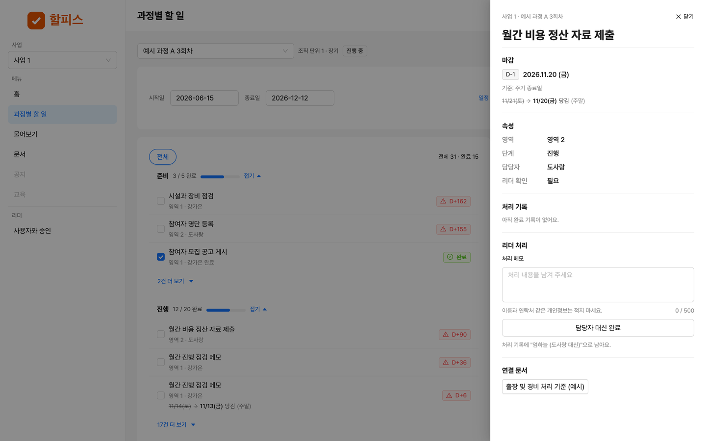
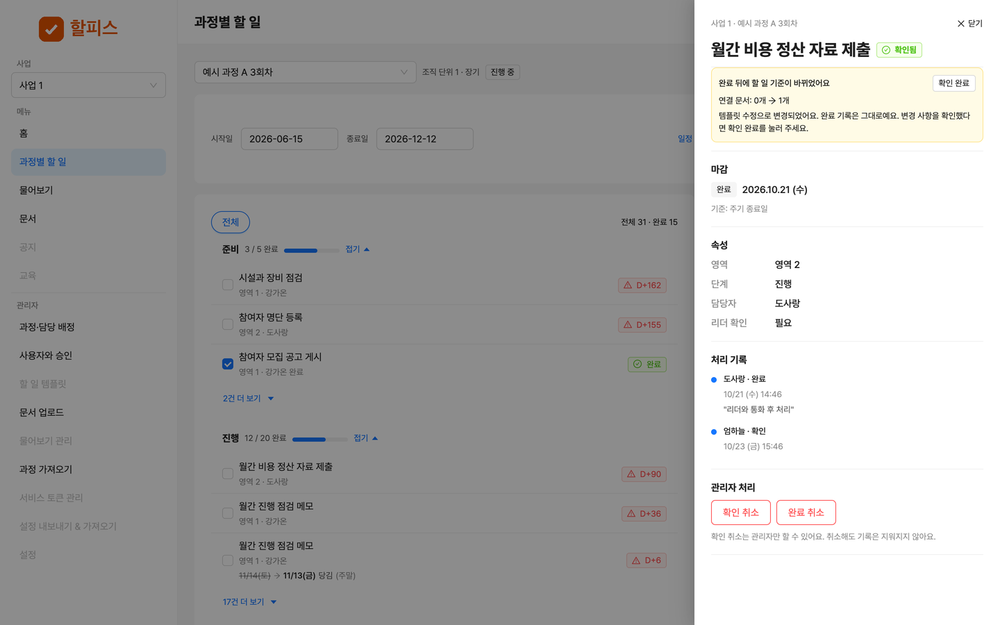

# #123 feat(front): 홈과 과정별 할 일 API 연동

- 생성 2026-11-19, 머지 2026-11-20
- 변경 +1088 -455, 파일 35개, 커밋 14개

## 본문

### 변경 내용

- 담당자 홈의 내 알림, 달력, 날짜별 할 일, 내 과정 진행률 API 연결
- 날짜별 할 일에서 체크박스로 완료 처리, 불러오지 못하면 안내와 다시 시도 표시
- 리더 홈의 요약, 리더 알림, 처리 기록, 과정별 진행률 API 연결
- 처리 기록에서 확인과 확인 대기 모두 확인 연결, 일부만 처리되면 처리한 건수 안내
- 과정별 할 일을 관리자, 리더, 담당자 모두 실제 데이터로 연결 (기존에는 목업때문에 화면이 다르게 나오던 상태였습니다)
- 과정을 고르지 않고 들어오면 진행 중인 첫 과정 표시
- 할 일 상세의 연결 문서를 누르면 문서 화면으로 이동, 모바일에서도 표시
- 완료 뒤에 일정이나 템플릿이 바뀐 할 일은 상세에서 바뀐 항목을 보여 주고, 리더와 관리자가 확인 완료로 처리
- 과정 시작일과 종료일은 수정 권한과 관계없이 같은 모양으로 표시
- 단계별 할 일은 처음 3건만, 월 주기는 지금 회차만 보이고 나머지는 더 보기로 표시
- 변경 이력에서 사유가 없는 기록의 "사유 없음" 문구 삭제
- 시연 영상 촬영 때문에 목업 할 일 화면을 `/tasks?source=mock`으로 남겨 두었습니다 (최종 제출 전에 삭제 예정)

### 검증 결과

- 10개 커밋 단계에서 `npm run build`, `npm run lint` 모두 경고 없이 통과
- 관리자, 리더, 담당자 계정으로 실제 서버에서 홈과 과정별 할 일 화면 확인
- 담당자 홈 완료 처리, 리더 홈 확인과 모두 확인, 할 일 상세 처리 동작 확인
- 연결 문서를 누르면 문서 화면으로 이동하는 것 확인
- 바뀐 항목 안내는 리더와 관리자에게만 보이고, 확인 완료 후 다시 열어도 보이지 않는 것 확인
- PC 1440px과 모바일 390px에서 화면 확인

### 화면

|  |  |  |  |
| --- | --- | --- | --- |
| 담당자 홈 | 리더 홈 | 할 일 상세 연결 문서 | 완료 뒤 바뀐 항목 확인 |

### 리뷰 요청 사항

리더와 담당자 계정으로 홈에서 할 일을 눌러 과정별 할 일로 이동하는 흐름 위주로 확인 부탁드립니다.

### 확인

- [x] 변경에 맞는 실행과 테스트 결과 또는 미실행 이유를 작성했습니다
- [x] API와 DB, 환경변수 변경이 있다면 관련 문서와 적용 방법을 작성했습니다
- [x] 비밀번호와 토큰 등 비밀값이 포함되지 않았습니다

## 커밋

- feat(front): 홈 API 요청 함수와 타입 추가
- feat(front): 담당자 홈 API 연동
- feat(front): 리더 홈 API 연동
- feat(front): 과정별 할 일 화면을 모든 역할 API로 연동
- feat(front): 할 일 상세 화면에서 연결 문서 API 적용
- fix(front): 과정 시작일과 종료일 표시 통일
- fix(front): 할 일 목록과 월 주기 처음 표시 개수 정리
- fix(front): 변경 기록 사유 없음 기록 통일
- docs(front): 홈과 할 일 README 작성
- Merge remote-tracking branch 'origin/main' into feat/front/home-api
- feat(front): 할 일 상세 화면에서 완료 업무 불일치 확인 연동
- Merge remote-tracking branch 'origin/main' into feat/front/home-api
- fix(front): 기준 전환 후 완료 취소 시 할 일 상세 갱신
- feat(front): 불일치 안내에 변경 표시

## 리뷰

### 백엔드 팀원 · COMMENTED

고생 많으셨습니다!
#122에서 템플릿 기준 전환 후 완료 취소 동작이 바뀌어서, 최신 main 반영해 주시면 홈에서 할 일 상세로 이동한 뒤 완료 취소 시 상세와 목록이 잘 갱신되는지 다시 확인할게요! 제가 어제 좀 늦은 시간에 머지를 해버려서... 확인하고 반영해 주시면 감사하겠습니다!

### 백엔드 팀원 · APPROVED

고생 많으셨습니다!
#122 반영과 완료 취소 후 상세·목록 갱신 로직 확인했습니다.
문제 없으면 머지하셔도 될 것 같습니다!
