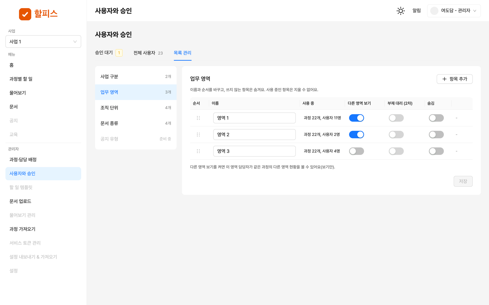
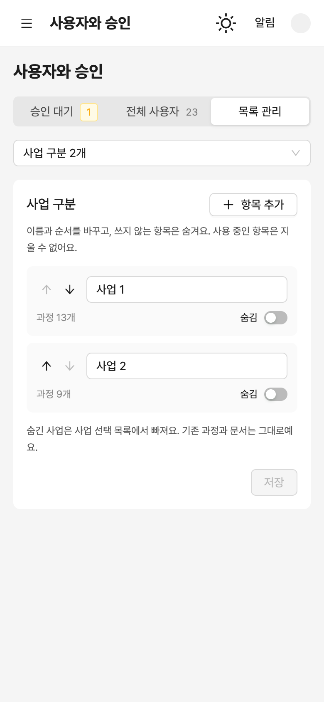
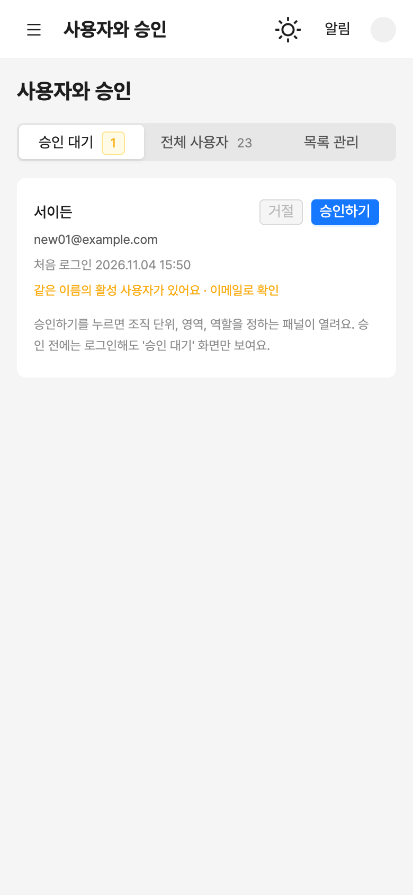
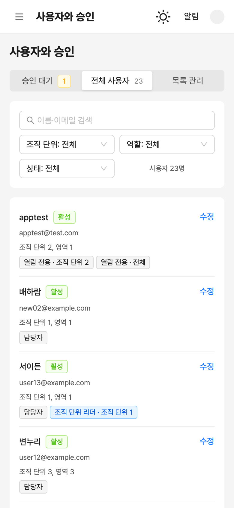

# #129 feat(front): 목록 관리 구현 및 API 연동, 사용자와 승인 반응형 정리

- 생성 2026-11-20, 머지 2026-11-20
- 변경 +762 -122, 파일 10개, 커밋 5개

## 본문

### 변경 내용

- 사용자와 승인에 목록 관리 탭 구성 및 API 연결 (사업, 업무 영역, 조직 단위, 문서 종류)
- 이름, 순서, 숨김 수정 후 저장, 고친 항목만 서버로 전송
- 업무 영역은 다른 영역 보기 설정, 조직 단위는 폐쇄 표시
- 사용 중인 항목은 삭제 대신 숨김만 가능, 사용하지 않는 항목은 확인 후 삭제
- 순서는 PC에서 끌어서 옮기거나 화살표 키로, 모바일에서는 화살표 버튼으로 변경
- 사업 목록을 저장하면 사이드바 사업 선택에 새로고침 없이 반영
- 승인 대기 안내 문구를 표 카드 안으로 이동

**반응형 작업**

- 승인 대기, 전체 사용자, 목록 관리를 모바일에서 표 대신 카드 목록으로 표시
- 모바일 탭을 칸이 나뉜 버튼 모양으로 변경
- PC 표에서 이름과 이메일, 조직과 영역을 한 칸으로 묶어 좁은 폭에서도 칸이 같이 줄어들도록 정리

### 검증 결과

- 4개 커밋 단계에서 `npm run build`, `npm run lint` 모두 경고 없이 통과
- 관리자 계정으로 실제 서버에서 문서 종류와 업무 영역 추가 201, 수정과 숨김 200, 삭제 200 확인 (시험 항목은 확인 후 삭제)
- 사업 이름 변경 후 사이드바 사업 선택에 바로 반영되는 것 확인 (확인 후 원래 이름으로 되돌림)
- 사용 중인 항목에는 삭제 버튼이 보이지 않는 것 확인
- PC 1440px, 1000px과 모바일 390px에서 화면 확인

### 화면

|  |  |  |  |
| --- | --- | --- | --- |
| PC 목록 관리 | 모바일 목록 관리 | 모바일 승인 대기 | 모바일 전체 사용자 |

### 리뷰 요청 사항

관리자 계정으로 목록 관리에서 항목 추가, 숨김, 삭제 흐름 위주로 확인 부탁드립니다.

### 확인

- [x] 변경에 맞는 실행과 테스트 결과 또는 미실행 이유를 작성했습니다
- [x] API와 DB, 환경변수 변경이 있다면 관련 문서와 적용 방법을 작성했습니다
- [x] 비밀번호와 토큰 등 비밀값이 포함되지 않았습니다

## 커밋

- feat(front): 목록 관리 API 요청 함수와 타입 추가
- fix(front): 사용자와 승인 모바일 화면과 표 반응형 정리
- feat(front): 사용자와 승인 목록 관리 탭 구현 및 API 연동
- docs(front): 목록 관리 README 작성
- fix(front): 목록 저장 충돌 시 저장하지 못한 입력 유지

## 리뷰

### 백엔드 팀원 · COMMENTED

고생 많으셨습니다! 
목록 관리의 추가·숨김·삭제 API 연동은 코드에서 확인했습니다.
여러 항목을 저장하다 중간에 409가 나면, 재조회하면서 저장에 실패한 항목과 아직 전송하지 않은 항목의 입력도 사라지는 것 같습니다. 최신 목록은 다시 받아오되, 저장되지 않은 입력은 화면에 남겨서 수정 후 재시도하는 방향으로 가능할까요?

## 대화

### 나(프론트엔드)

> 고생 많으셨습니다! 목록 관리의 추가·숨김·삭제 API 연동은 코드에서 확인했습니다. 여러 항목을 저장하다 중간에 409가 나면, 재조회하면서 저장에 실패한 항목과 아직 전송하지 않은 항목의 입력도 사라지는 것 같습니다. 최신 목록은 다시 받아오되, 저장되지 않은 입력은 화면에 남겨서 수정 후 재시도하는 방향으로 가능할까요?

넵 가능합니다! 최신 목록은 다시 불러오되 저장되지 않은 입력은 유지해서 재시도할 수 있도록 수정하겠습니다
반영해서 푸시하고 머지하겠습니다. 감사합니다!
