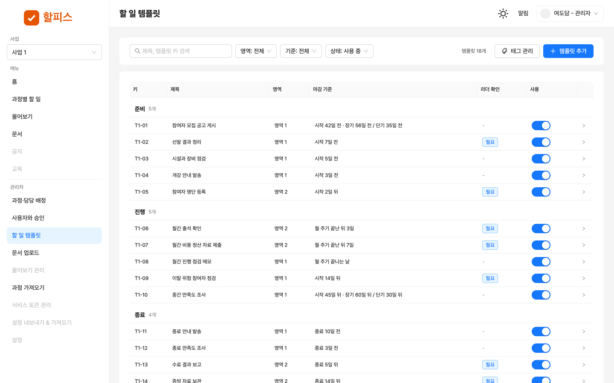
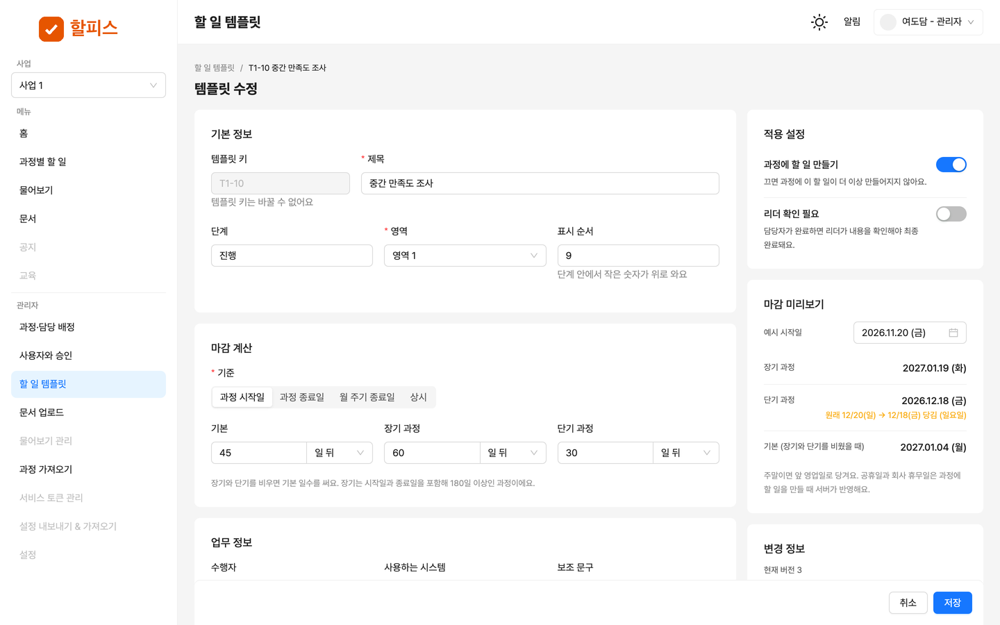
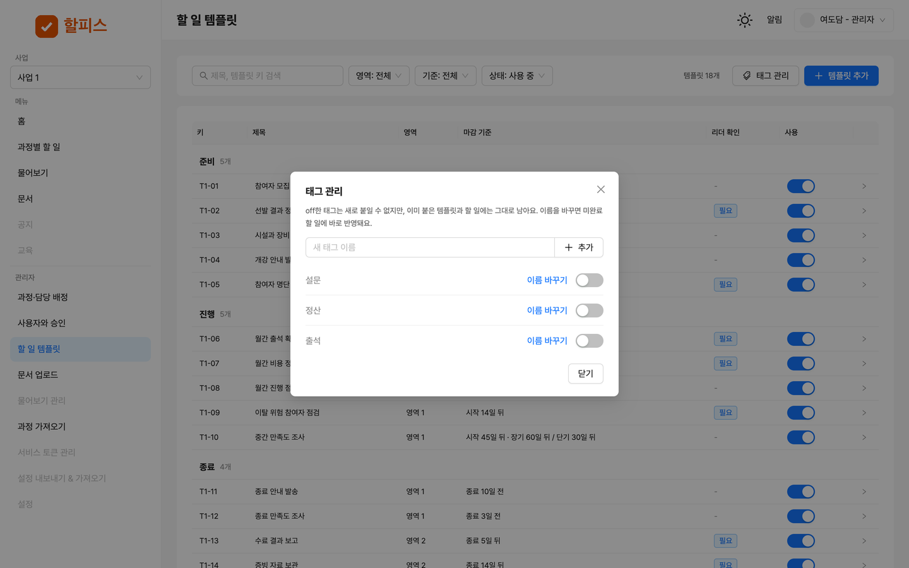
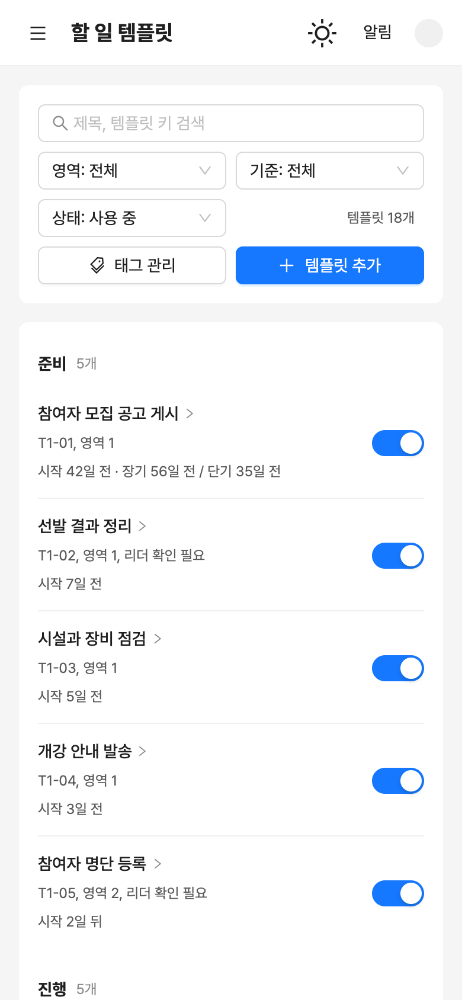

# #131 feat(front): 할 일 템플릿 목록과 수정 화면, 태그 관리 구현 및 API 연동

- 생성 2026-11-20, 머지 2026-11-22
- 변경 +1408 -2, 파일 11개, 커밋 4개

## 본문

### 변경 내용

- 할 일 템플릿 메뉴 활성화 및 목록, 추가, 수정 화면 API 연결
- 목록은 단계별로 묶어서 표시, 상시 할 일은 맨 아래에 표시
- 제목과 템플릿 키 검색, 영역과 기준, 상태 필터 추가, 수정 화면에 갔다 와도 필터 유지
- 목록에서 줄을 누르면 수정 화면으로 이동, 사용 스위치는 끌 때 확인 후 바로 저장
- 마감 기준은 과정 시작일, 종료일, 월 주기 종료일, 상시 중에서 고르고 기본과 장기, 단기 일수 입력
- 예시 날짜를 바꿔 보며 마감을 미리 확인, 주말이면 앞 평일로 당긴 날짜와 이유 표시
- 저장하면 바뀐 항목만 서버로 보내고, 진행 중인 과정에 반영된 건수를 안내
- 다른 사람이 먼저 수정했으면 최신 내용을 다시 불러오도록 안내, 템플릿 키가 겹치면 입력칸에 오류 표시
- 저장과 취소 버튼을 화면 아래에 고정
- 태그 관리 창에서 태그 추가, 이름 바꾸기, 켜고 끄기
- 템플릿 수정 화면에서 태그와 연결 문서 선택

### 검증 결과

- 3개 커밋 단계에서 `npm run build`, `npm run lint` 모두 경고 없이 통과
- 관리자 계정으로 실제 서버에서 템플릿 제목 수정 200, 반영 건수 안내 확인 (확인 후 원래 제목으로 되돌림)
- 바뀐 내용 없이 저장하면 요청을 보내지 않는 것 확인
- 필터 유지, 줄 클릭 이동, 저장 후 계속 수정 흐름 확인
- 태그 이름 바꾸기와 켜고 끄기는 서버 응답을 가짜로 바꿔 화면 흐름만 확인
- PC 1440px, 모바일 390px에서 화면 확인

### 화면

|  |  |  |  |
| --- | --- | --- | --- |
| PC 템플릿 목록 | PC 템플릿 수정 | PC 태그 관리 | 모바일 템플릿 목록 |

### 리뷰 요청 사항

관리자 계정으로 템플릿 수정 후 저장, 목록에서 사용 끄고 켜기, 태그 관리 흐름 위주로 확인 부탁드립니다.

### 확인

- [x] 변경에 맞는 실행과 테스트 결과 또는 미실행 이유를 작성했습니다
- [x] API와 DB, 환경변수 변경이 있다면 관련 문서와 적용 방법을 작성했습니다
- [x] 비밀번호와 토큰 등 비밀값이 포함되지 않았습니다

## 커밋

- feat(front): 할 일 템플릿 API 요청 함수와 타입 추가
- feat(front): 할 일 템플릿 목록과 수정 화면, 태그 관리 구현 및 API 연동
- docs(front): 할 일 템플릿 README 작성
- fix(front): 리뷰 사항 적용(장기 단기 일수 기본값 적용과 상시 템플릿 묶음 분리)

## 리뷰

### 백엔드 팀원 · COMMENTED

고생 많으셨습니다!
템플릿 저장, 사용 전환, 태그 관리 등의 흐름을 확인했습니다.
수정이 필요한 것 같은 부분을 아래에 작성했으니, 확인 부탁드립니다.

## 인라인 리뷰와 답변

### 백엔드 팀원 · `src/pages/admin/templates/templatesData.ts`

현재 화면은 장기·단기 일수가 모두 있어야 유형별 값을 표시하는데, 서버는 기본 일수와 장기·단기 중 한쪽만 입력하는 조합도 허용하고, 비어 있는 쪽에는 기본 일수를 적용해요. 목록과 `TemplateEditor.tsx`의 마감 미리보기도 이 규칙에 맞춰 주셔야 할 것 같습니다!

### 백엔드 팀원 · `src/pages/admin/templates/templatesData.ts`

날짜 기준 템플릿도 단계명을 상시로 입력하면 상시 업무 그룹에 섞입니다. 상시 그룹은 `referenceType === 'ALWAYS'`인 템플릿만 포함하도록 구분해 주셔야 할 것 같습니다.

## 대화

### 나(프론트엔드)

> 고생 많으셨습니다! 템플릿 저장, 사용 전환, 태그 관리 등의 흐름을 확인했습니다. 수정이 필요한 것 같은 부분을 아래에 작성했으니, 확인 부탁드립니다.

확인 감사합니다! 장기/단기 일수 중 비어 있는 쪽은 기본 일수를 적용하도록 목록과 마감 미리보기를 수정했고 상시 그룹에는 기준이 상시인 템플릿만 들어가게끔 반영해서 푸시했습니다 !
