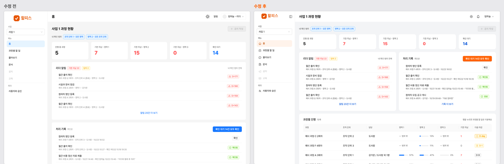
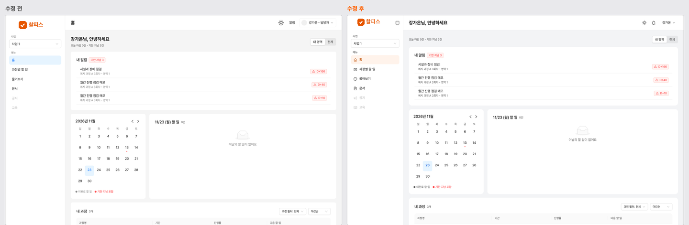
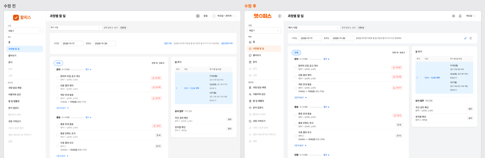
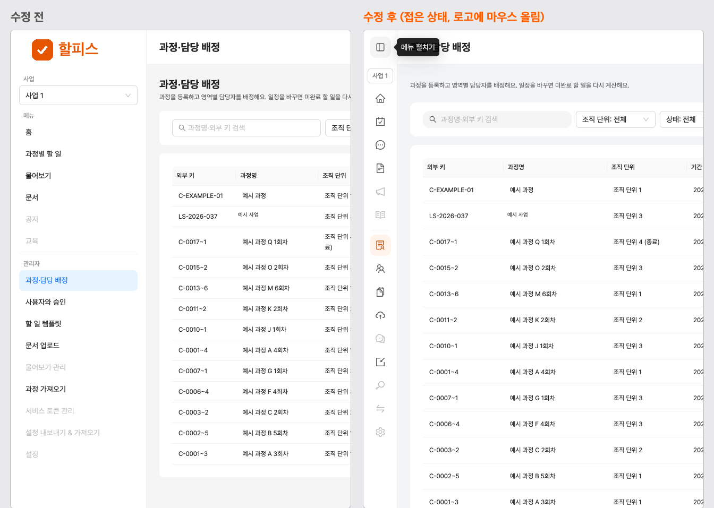
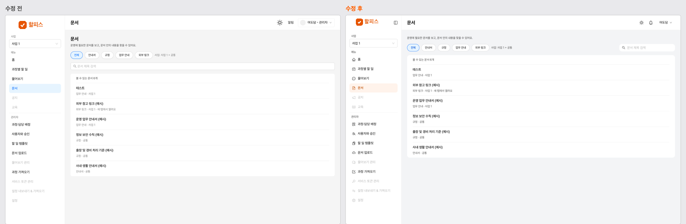
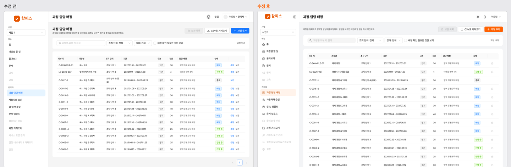
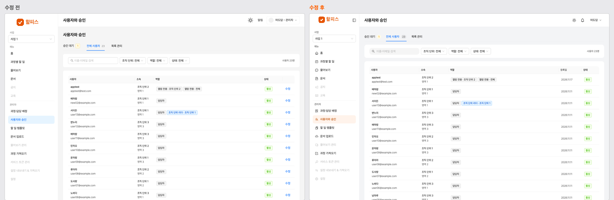
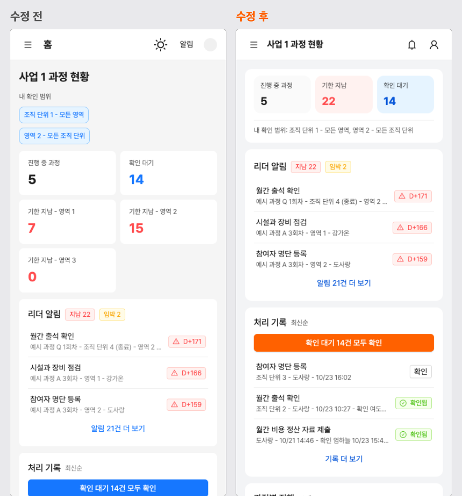

# #138 feat(front): 화면 디자인 정리와 사이드바 접기, 헤더 제목 표시

- 생성 2026-11-23, 머지 2026-11-24
- 변경 +1326 -731, 파일 69개, 커밋 7개

## 본문

### 변경 내용

- 테마 컬러 적용 (주요 버튼, 사이드바에서 선택한 메뉴), 그 외 선택 표시와 링크는 파랑 유지
- 화면 제목을 본문에서 헤더로 옮겨 겹치던 제목 정리 (데스크탑, 모바일 공통)
- 로고를 사이드바로 옮기고 사이드바를 화면 위까지 확장
- 데스크탑 사이드바 접기 추가, 접으면 아이콘만 표시하고 로고에 마우스를 올리면 펼치기 버튼 표시, 접은 상태는 새로고침해도 유지
- 메뉴에 아이콘 추가 (Ant Design 아이콘 위주로 사용하고 없는 것만 lucide-react 아이콘을 사용했습니다)
- 수정, 삭제, 버전 기록 같은 글자 버튼을 아이콘 버튼으로 바꾸고 마우스를 올리면 설명 표시
- 아이콘 버튼, 필터칩, 검색창을 공통 컴포넌트로 묶어 화면마다 같은 모양으로 표시
- 표와 목록은 줄 전체를 눌러 이동, 키보드 엔터로도 이동
- 리더 홈: 리더 알림과 처리 기록을 2칸으로 배치, 요약 숫자를 누르면 해당 목록으로 이동, 확인 처리 전 확인 창 표시, 처리 기록 메모는 한 줄로 줄임
- 사용자와 승인 목록 관리: 모바일에서 손잡이를 끌어 순서 변경 (키보드 위아래 키도 가능)
- 물어보기: 모바일 새 대화 버튼을 떠 있는 버튼으로 변경, 새 대화 전 확인 창, 개인정보 안내는 대화 맨 위에 한 번만 표시
- 문서 업로드: 링크 문서는 새 파일로 교체를 비활성화하고 이유 안내
- 다크 모드 글자 대비 보강, 테마를 바꿀 때와 첫 화면의 깜빡임 제거
- 모바일: 헤더 아이콘 정리 (테마 바꾸기는 사용자 메뉴로 이동), 필터와 버튼 높이 통일, 화면별 버튼 위치 정리
- 그 외 자잘한 스타일 수정

### 검증 결과

- 커밋 단계마다 타입 검사 통과, `npm run build`, `npm run lint` 경고 없이 통과
- 13개 화면 폭(375~2560px)에서 가로 넘침 없음
- 관리자, 리더, 담당자 계정으로 라이트, 다크 모드 화면 확인
- 키보드로 버튼과 목록 줄 이동 확인
- 확인 처리, 삭제 같은 저장 요청은 보내지 않고 화면 흐름만 확인

### 화면

|  |  |
| --- | --- |
| 리더 홈 | 담당자 홈 |
|  |  |
| 과정별 할 일 | 사이드바 접기 |
|  |  |
| 문서 | 과정·담당 배정 |
|  |  |
| 사용자와 승인 | 모바일 리더 홈 |

### 리뷰 요청 사항
- 전체 화면 스타일과 추가된 효과와 요소들 점검 부탁드립니다

- PR #137 머지 여부 확인 후 main을 합쳐 프론트 충돌을 정리하고 추가로 커밋 푸시할 예정입니다. 충돌 정리 전에는 메인에 머지하지 않을거지만 먼저 리뷰가 가능하시다면 부탁드립니다

### 확인

- [x] 변경에 맞는 실행과 테스트 결과 또는 미실행 이유를 작성했습니다
- [x] API와 DB, 환경변수 변경이 있다면 관련 문서와 적용 방법을 작성했습니다
- [x] 비밀번호와 토큰 등 비밀값이 포함되지 않았습니다

## 커밋

- feat(front): 공통 컴포넌트 추가와 테마 컬러 적용
- feat(front): 헤더 스타일 수정
- fix(front): 홈과 과정별 할 일 화면 정리
- fix(front): 물어보기, 문서, 문서 업로드 화면 정리
- fix(front): 과정·담당 배정, 사용자와 승인, 할 일 템플릿 화면 정리
- docs(front): README 공통 구조와 화면 규칙 갱신
- Merge remote-tracking branch 'origin/main' into feat/front/style

## 리뷰

### 백엔드 팀원 · APPROVED

고생 많으셨습니다!
공통 레이아웃, 사이드바 접기, 목록 이동과 리더 홈 확인 흐름을 코드로 확인했습니다.
추가 수정 요청은 없습니다. 예정하신 #137 병합 충돌 정리 후 머지해 주시면 될 것 같습니다!
