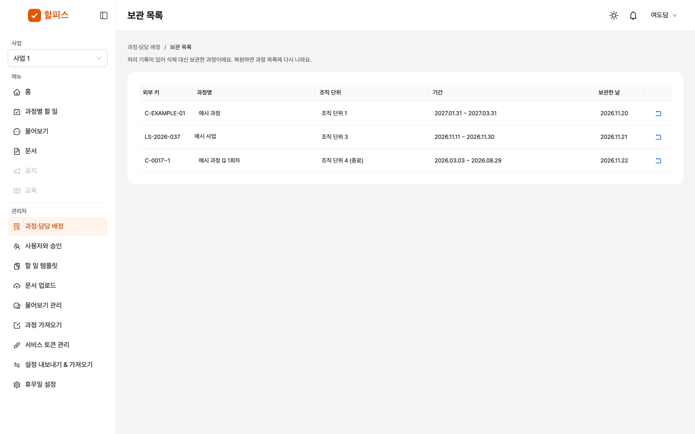
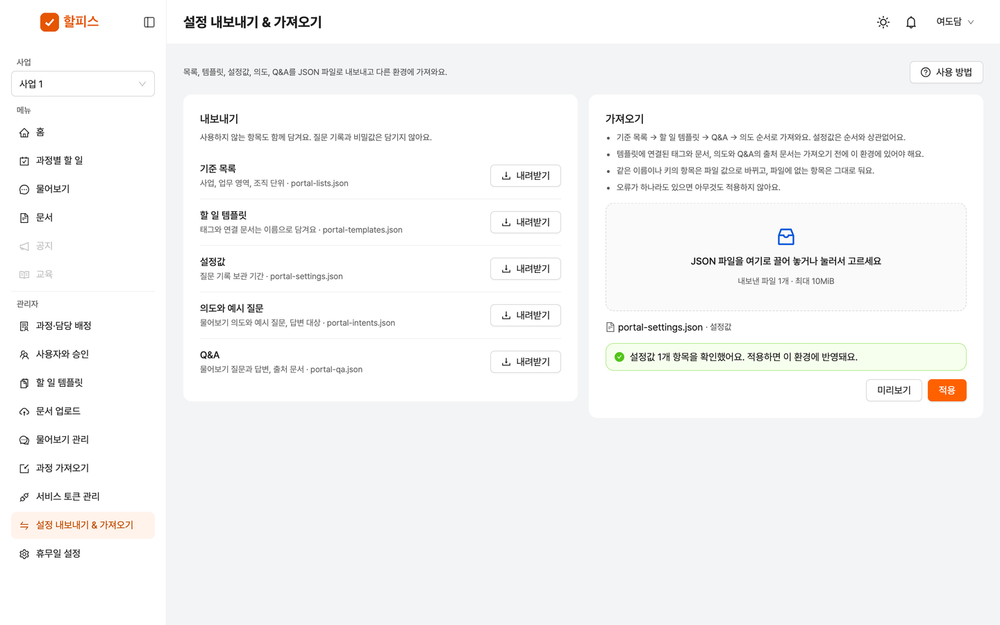
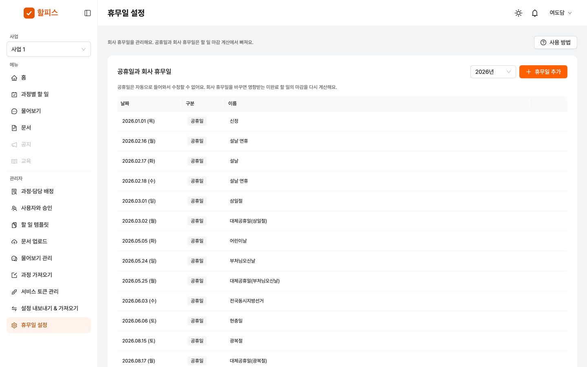
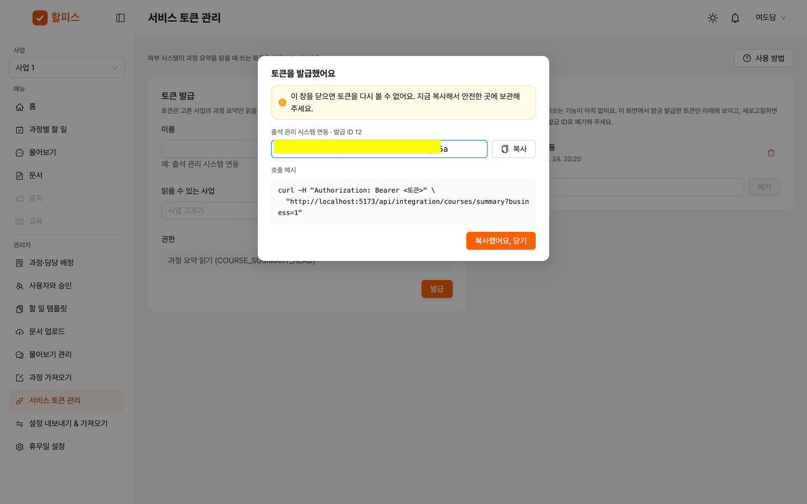

# #143 feat(front): 과정 보관과 복원, 설정 내보내기와 가져오기, 휴무일 설정, 서비스 토큰 화면 연동

- 생성 2026-11-24, 머지 2026-11-25
- 변경 +1462 -240, 파일 34개, 커밋 11개

## 본문

### 변경 내용

- 과정 삭제와 보관, 복원 연동
  - 과정 목록에서 삭제. 처리 기록이 있으면 서버가 보관하고, 없으면 삭제
  - 보관 목록 연결, 복원 후 과정 목록으로 이동
- 설정 내보내기와 가져오기 화면 추가 (/admin/config)
  - 종류별 JSON 내려받기
  - 가져오기는 미리보기로 확인한 뒤 적용
- 휴무일 설정 화면 추가 (/admin/settings)
  - 연도별 공휴일과 회사 휴무일 목록, 회사 휴무일 추가, 수정, 삭제
  - 저장 후 마감이 바뀐 할 일 건수 안내
- 서비스 토큰 관리 화면 추가 (/admin/service-tokens)
  - 토큰 발급과 폐기, 토큰 원문은 발급 직후 한 번만 표시
- 관리자 화면 4곳(물어보기 관리, 설정 내보내기와 가져오기, 휴무일 설정, 서비스 토큰 관리)에 사용 방법 창 추가
- 사이드바에 새 화면 메뉴 연결

### 검증 결과

- `npm run lint`, 타입 검사 통과
- 실제 서버로 과정 보관과 복원, 휴무일 추가, 수정, 삭제, 설정 내보내기와 미리보기 확인 (확인 뒤 데이터 원상태)
- 서비스 토큰 발급은 가짜 응답으로 화면 흐름 확인
- 데스크탑과 모바일, 라이트와 다크 모드 확인

### 화면

|  |  |  |  |
| --- | --- | --- | --- |
| 보관 목록 | 설정 내보내기와 가져오기 | 휴무일 설정 | 서비스 토큰 발급 |

### 리뷰 요청 사항

- 서비스 토큰 목록 조회 API가 없어 새로고침하면 발급한 토큰이 화면에서 사라집니다. 목록 API가 생기면 바로 연결하겠습니다
- 보관한 과정은 일정과 배정 정보 조회가 막혀 있어 상세 화면은 열 수 없게 두었습니다. 보관 중 내용을 볼 수 있게 하려면 서버에서 보관한 과정의 조회를 열어 주셔야 할 것 같습니다
- 확신 기준값 같은 물어보기 설정값은 MODO WORK 측 답변(질의응답)에 따라 따로 화면을 만들지 않았습니다. 임박 기준과 알림 발송 시각은 설정 API가 없어 화면을 만들지 않았습니다. 이 값들은 서버에서 env 값이나 환경변수로 작성해 주시면 좋을 것 같습니다

### 확인

- [x] 변경에 맞는 실행과 테스트 결과 또는 미실행 이유를 작성했습니다
- [x] API와 DB, 환경변수 변경이 있다면 관련 문서와 적용 방법을 작성했습니다
- [x] 비밀번호와 토큰 등 비밀값이 포함되지 않았습니다

## 커밋

- feat(front): 과정 삭제와 보관, 복원 연동
- feat(front): 사용 방법 창 추가와 물어보기 관리 버튼 정리
- feat(front): 설정 내보내기와 가져오기 화면 추가
- feat(front): 휴무일 설정 화면 추가
- feat(front): 서비스 토큰 관리 화면 추가
- feat(front): 관리자 메뉴와 새 화면 연결
- fix(front): 사용자 메뉴 이름 줄과 리더 홈 요약 칸 정리
- docs(front): README 관리자 화면 설명 갱신
- fix(front): 사이드바에서 공지와 교육 미구현 상태 제거
- fix(front): 설정 가져오기에서 미리 본 파일만 적용되게 수정
- fix(front): 리더 홈과 목록 관리에서 공지 미구현 상태 제거

## 리뷰

### 백엔드 팀원 · COMMENTED

고생 많으셨습니다!
과정 보관·복원, 휴무일 설정, 서비스 토큰 발급·폐기 흐름을 백엔드 API 계약과 대조했습니다.
설정 가져오기에서 미리 본 파일과 실제 적용하는 파일이 달라질 수 있는 경우를 인라인으로 남겼으니 확인 부탁드립니다.

## 인라인 리뷰와 답변

### 백엔드 팀원 · `src/pages/admin/config/components/SettingsImport.tsx`

새 파일을 읽는 동안 이전 `selected`가 남아 있어, 그 사이 미리보기를 누르면 이전 파일을 검사할 수 있습니다. 이후 새 파일이 `selected`로 바뀌면 이전 파일의 미리보기 결과로 새 파일을 적용할 수 있어요.
파일을 읽는 동안 미리보기를 막고, 적용할 때 미리보기 결과가 현재 선택된 파일의 것인지도 확인해 주실 수 있을까요?

### 나(프론트엔드) · `src/pages/admin/config/components/SettingsImport.tsx`

확인 감사합니다! 새 파일을 고르면 이전 선택을 먼저 비워서 읽는 동안 미리보기를 누를 수 없게 했고, 미리보기 결과에 검사한 파일을 함께 저장해서 지금 선택한 파일과 같을 때만 적용할 수 있게 수정했습니다. 파일을 읽는 중 미리보기, 미리본 뒤 다른 파일로 바꾸는 경우 모두 확인했습니다! (015d207)

## 대화

### 나(프론트엔드)

> 고생 많으셨습니다! 과정 보관·복원, 휴무일 설정, 서비스 토큰 발급·폐기 흐름을 백엔드 API 계약과 대조했습니다. 설정 가져오기에서 미리 본 파일과 실제 적용하는 파일이 달라질 수 있는 경우를 인라인으로 남겼으니 확인 부탁드립니다.

확인 감사합니다 ! 수정완료했습니다
