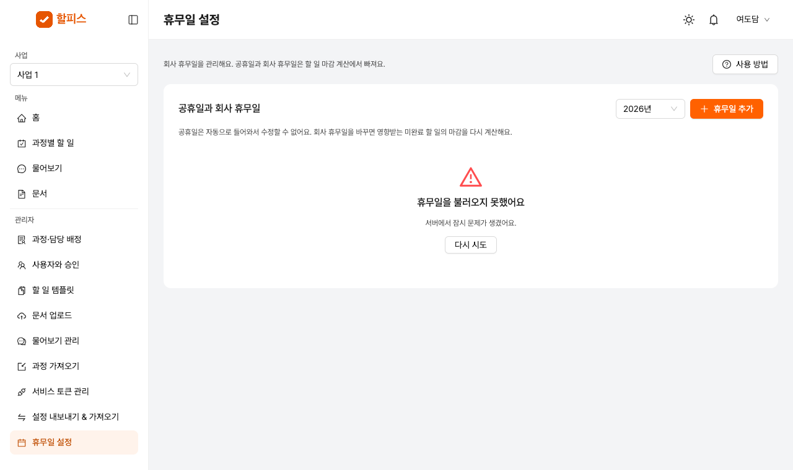
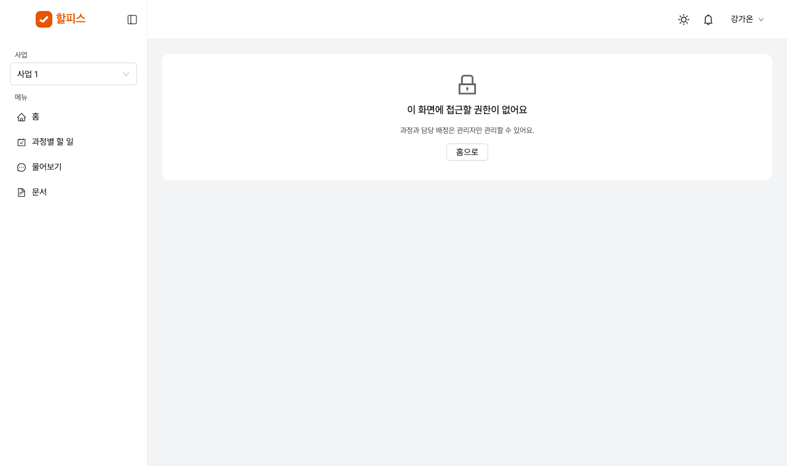
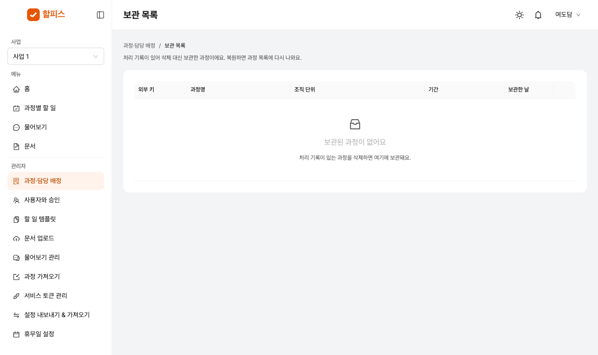
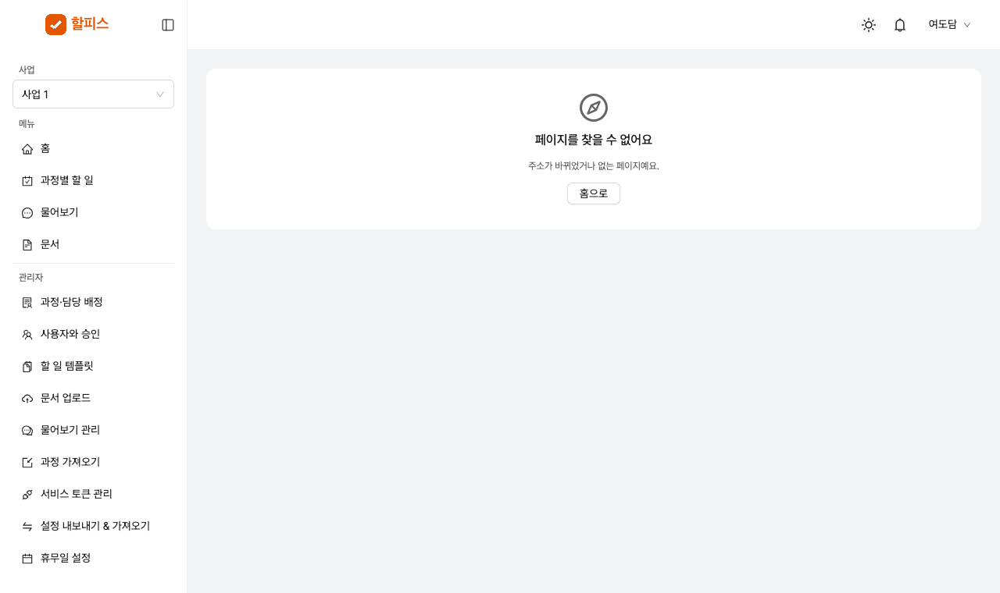

# #150 refactor(front): 오류와 빈 화면, 반복 코드 공용화

- 생성 2026-11-25, 머지 2026-11-25
- 변경 +961 -1140, 파일 95개, 커밋 7개

## 본문

### 변경 내용

- 오류, 빈 화면, 권한 없음, 없는 페이지 표시를 공용 컴포넌트(LoadingError, NoPermission, PageNotFound, EmptyData, NoSearchResult)로 통일
- 화면마다 4가지로 섞여 있던 모양(antd Result, 직접 만든 카드, 글자와 버튼, 홈 전용 카드)을 하나로 맞춤
- 오류와 권한 없음은 화면 읽기 프로그램에 알림으로 전달
- API 오류 처리를 useApiErrorHandler(showError, checkLogin)와 isConflict로 공용화
- 관리자 확인, 본문 카드, 작은 표 모양, 한 쪽 개수를 isAdmin, ContentCard, smallTableStyle, PAGE_SIZE로 공용화
- 날짜 함수를 utils/date.ts 한 파일로 모으고 같은 일을 하던 함수 정리
- 서비스 토큰 발급 시각을 다른 화면과 같은 형식(2026.11.24 20:20)으로 표시

### 검증 결과

- `npm run lint`, 타입 검사 통과
- 날짜 함수의 예전과 새 결과 46건을 비교해 모두 같은 것 확인
- 관리자, 리더, 담당자 화면 56개를 데스크탑과 모바일로 자동 점검해 오류와 가로 넘침 없음 확인
- 서버 오류를 일부러 만들어 불러오기 실패, 권한 없음, 빈 목록, 없는 페이지 화면 확인
- 배포 빌드 JS 599.6KB에서 585.7KB로 감소(gzip, 2.3%)

### 화면

|  |  |  |  |
| --- | --- | --- | --- |
| 불러오기 실패 | 권한 없음 | 빈 목록 | 없는 페이지 |

### 리뷰 요청 사항

- 기능 변경 없이 코드 구조만 정리했고, 상태 화면 모양만 통일됐습니다
- 새 공용 컴포넌트와 함수는 README 공통 구조에 정리했습니다

### 확인

- [x] 변경에 맞는 실행과 테스트 결과 또는 미실행 이유를 작성했습니다
- [x] API와 DB, 환경변수 변경이 있다면 관련 문서와 적용 방법을 작성했습니다
- [x] 비밀번호와 토큰 등 비밀값이 포함되지 않았습니다

## 커밋

- refactor(front): 상태 화면과 오류 처리 공용 부품 추가
- refactor(front): 화면에 공용 부품 적용하고 날짜 함수 정리
- docs(front): README 공통 구조 갱신
- Merge remote-tracking branch 'origin/main' into refactor/front/states
- fix(front): 로그인 확인 오류 카드 폭 수정
- feat(front): 서비스 토큰 목록 연결
- feat(front): 보관 과정 상세 보기 연결

## 리뷰

### 백엔드 팀원 · APPROVED

고생 많으셨습니다!
공용 상태 화면과 API 오류 처리 흐름을 확인했습니다. 기존 로그인 상태 재확인이 유지되고, 설정 가져오기도 미리보기한 파일에만 적용되는 것을 확인했습니다.
문제 없다면 머지하셔도 될 것 같습니다.
