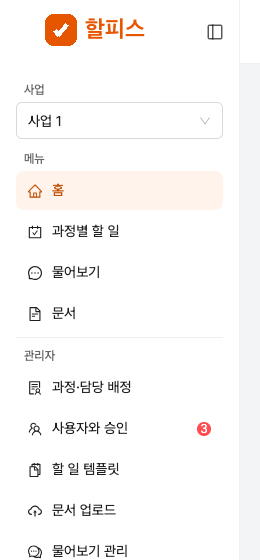
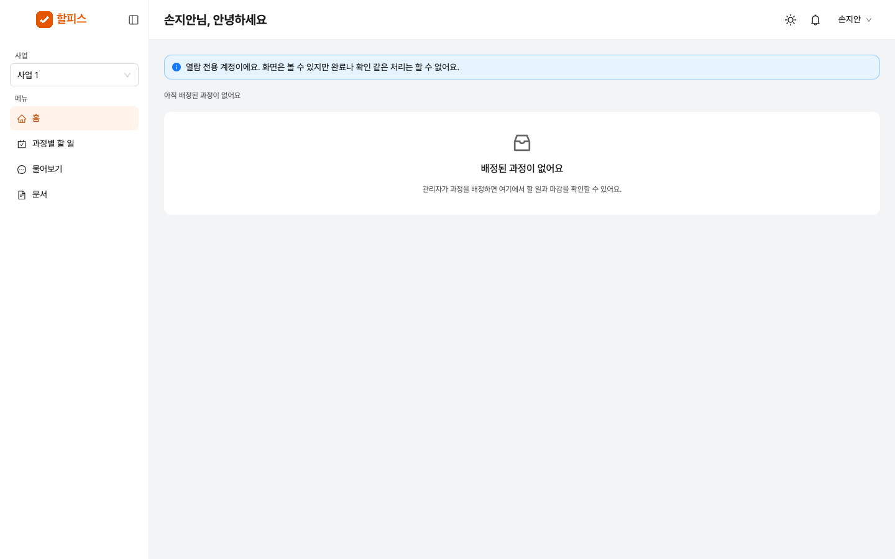
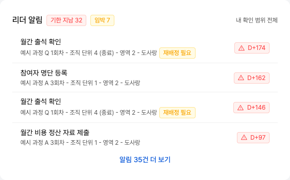

# #158 feat(front): 목록 필터 주소 저장과 레이아웃 안내 보완

- 생성 2026-11-25, 머지 2026-11-26
- 변경 +172 -81, 파일 13개, 커밋 2개

## 본문

### 변경 내용

- 문서, 문서 업로드, 과정, 사용자 목록의 검색어와 필터, 쪽 번호를 주소에 저장, 새로고침이나 링크 공유 후에도 같은 목록 표시
- 사업을 바꾸면 주소의 검색어와 필터 초기화
- 주소의 쪽 번호가 전체 쪽 수보다 크면 마지막 쪽으로 이동
- 선택한 사업을 브라우저에 저장해 새로고침 후에도 유지
- 열람 전용 계정이면 화면 위에 처리할 수 없다는 안내 표시
- 사이드바 사용자와 승인 메뉴에 승인 대기 건수 배지 표시 (관리자, 조직 리더)
- 리더 홈 알림에서 담당자가 비활성이면 이름 옆에 "재배정 필요" 표시
- 모바일 할 일 상세에서도 표기 문구 표시
- 주소 필터용 공용 훅 3개 추가 (`useUrlFilters`, `useSearchDraft`, `usePageInRange`)

### 검증 결과

- `npm run lint`, 타입 검사 통과
- 과정, 사용자, 문서 업로드, 문서 목록에서 검색어와 필터를 건 뒤 새로고침해도 유지되는 것 확인
- 검색어를 넣은 상태에서 사업을 바꾸면 검색어와 필터가 비워지는 것 확인
- 없는 쪽 번호로 열면 마지막 쪽으로 옮겨지는 것 확인
- 사업을 바꾸고 새로고침해도 바꾼 사업이 유지되는 것 확인
- 열람 전용 계정으로 PC 1440px과 모바일 400px에서 안내 확인
- 승인 대기 배지, 재배정 필요, 모바일 표기 문구는 해당 데이터가 없어 응답을 바꿔서 확인
- 다크 모드로 13개 화면을 열어 흰 배경이 남은 곳이 없는 것 확인

### 화면

|  |  | |
| --- | --- | --- |
| 승인 대기 배지 | 열람 전용 안내 | 재배정 필요 |

### 리뷰 요청 사항

#157과 같은 파일(AppLayout, 리더 홈)을 고쳤지만 다른 줄이라 어느 쪽이 먼저 머지돼도 충돌하지 않습니다. 목록 화면에서 필터를 건 뒤 새로고침, 사업 변경 흐름 위주로 확인 부탁드립니다.

### 확인

- [x] 변경에 맞는 실행과 테스트 결과 또는 미실행 이유를 작성했습니다
- [x] API와 DB, 환경변수 변경이 있다면 관련 문서와 적용 방법을 작성했습니다
- [x] 비밀번호와 토큰 등 비밀값이 포함되지 않았습니다

## 커밋

- feat(front): 목록 필터 주소 저장과 레이아웃 안내 보완
- fix(front): 사업 변경 시 목록 필터 초기화 범위 리뷰 반영

## 리뷰

### 백엔드 팀원 · APPROVED

고생 많으셨습니다!
검색·필터 상태를 URL에 저장하는 흐름 확인했습니다!
사업을 바꿀 때 일부 필터가 유지되는 동작이 의도된 것인지 인라인에 남겼습니다. 그 부분만 확인 부탁드립니다.

## 인라인 리뷰와 답변

### 백엔드 팀원 · `src/layouts/AppLayout.tsx`

사업을 바꿀 때 이 목록에 없는 필터는 주소에 남습니다. 문서 업로드에서 쓰는 kind·business와 사용자 목록의 role도 초기화 대상인지 확인 부탁드립니다. 의도와 맞는 동작이면 수정하지 않으셔도 괜찮을 것 같습니다.
