# 프로젝트 보고서 · 프론트엔드

담당: 방효진

MODO WORK 웹은 교육 과정 운영자(담당자, 리더, 관리자)가 매일 쓰는 업무 화면이다. 과정을 등록하면 할 일과 마감이 자동으로 생기고, 담당자는 할 일을 처리하고, 리더는 처리 결과를 확인하고, 관리자는 개발자 없이 템플릿, 문서, 물어보기 지식, 휴무일을 화면에서 바꾼다. 프론트엔드는 이 흐름이 역할마다 끊기지 않고 이어지도록 화면을 만들고 백엔드 API와 연결했다.

## 구현 범위와 구성

프론트엔드는 React 19, TypeScript, Vite, Ant Design 6, Tailwind CSS 4로 구성했다. 이 저장소에는 프론트엔드 코드만 담았다. 모든 데이터는 Spring API를 통해 주고받고, 권한 판단은 서버가 한다. 화면은 역할에 맞는 메뉴와 버튼만 보여 주되, 서버가 거절한 요청은 오류 안내로 처리한다.

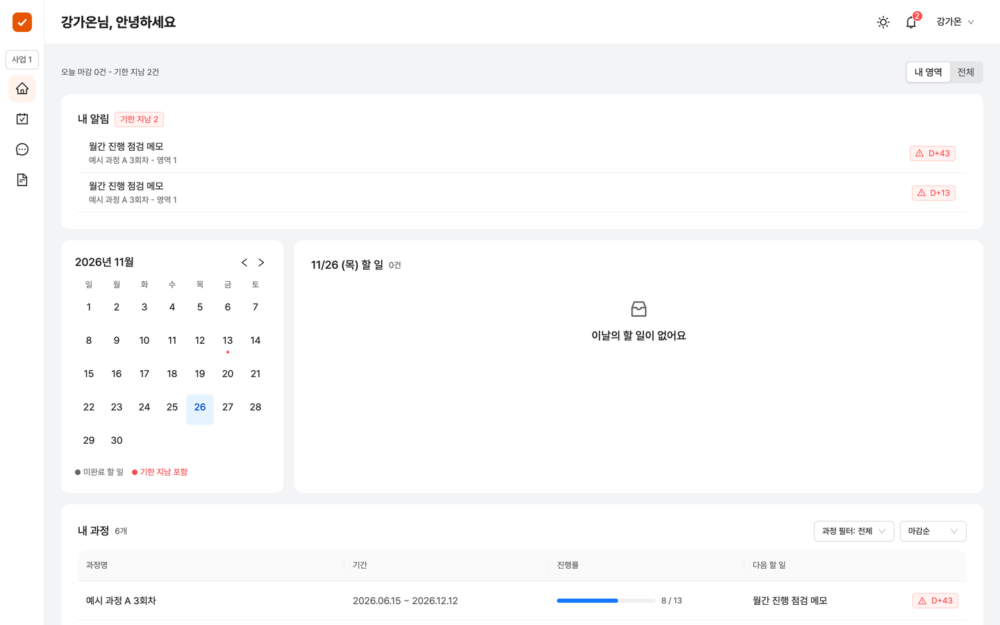

*그림 1. 담당자 홈. 기한 지남과 임박 알림, 달력, 날짜별 할 일, 내 과정 진행률을 한 화면에서 본다*

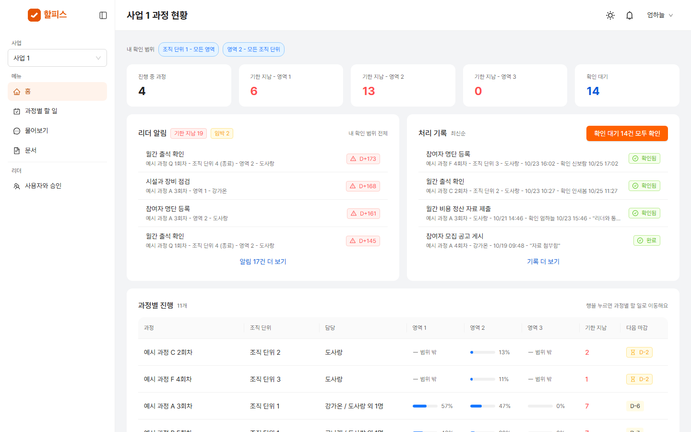

*그림 2. 리더 홈. 영역별 기한 지남 요약, 알림, 처리 기록과 확인 대기, 과정별 진행률을 본다*

| 영역 | 구현 내용 |
| --- | --- |
| 공통 기반 | 헤더와 사이드바 레이아웃, 사이드바 접기, PC와 모바일 반응형, 라이트와 다크 테마, 사업 선택과 저장, 헤더 알림(기한 지남, 임박) |
| 로그인과 권한 | 시험 로그인, 승인 대기와 사용 중지 안내, 로그인 만료 시 로그인 화면 이동, 권한 없음과 없는 페이지 화면, 열람 전용 안내 |
| 홈 | 담당자 홈(알림, 달력, 날짜별 할 일 완료, 과정 진행률), 리더 홈(요약, 확인 대기와 일괄 확인, 처리 기록, 과정별 진행률) |
| 과정별 할 일 | 단계별 목록과 태그 필터, 상세 패널, 완료와 메모, 완료 취소, 리더 확인, 일정 수정과 변경 이력, 월 주기와 상시 업무, 마감 당김 사유 표시, 비활성 담당자 교체 |
| 과정 관리 | 과정 등록과 수정, 공동 담당 배정, 종료 과정 정정, 삭제와 보관, 복원, CSV 미리보기와 적용 |
| 문서와 물어보기 | 문서 목록과 PDF 보기, 제목과 본문 검색, 버전 기록, 업로드와 교체, 읽기 상태 표시, 물어보기(근거 표시, 되묻기, 대화 유지, 개인정보 경고) |
| 관리자 화면 | 사용자와 승인(관리자, 조직 리더), 목록 관리, 할 일 템플릿과 태그, 물어보기 관리(답 없음 질문, 의도와 Q&A, 통계, 평가), 휴무일, 서비스 토큰, 설정 내보내기와 가져오기 |

| 구분 | 기술 | 쓴 곳 |
| --- | --- | --- |
| 화면 | React 19 | 전체 화면, 화면별 코드 분할(React.lazy, Suspense) |
| 언어 | TypeScript 6 | API 요청과 응답 타입, 빌드 전 타입 검사 |
| 빌드 | Vite 8 | 개발 서버와 API 프록시, `BASE_PATH`로 하위 경로 빌드 |
| UI | Ant Design 6 | 표, 폼, 서랍, 모달, 달력 등 대부분의 컴포넌트, 한국어 설정 |
| 스타일 | Tailwind CSS 4 | 배치, 여백, 반응형. 디자인 토큰을 클래스로 사용 |
| 라우팅 | React Router 8 | 화면 주소, 로그인 확인, 주소 쿼리로 선택 상태 유지 |
| 날짜 | Day.js | 날짜 선택, 과정 일정, 휴무일 |
| 코드 검사 | ESLint, typescript-eslint | 린트와 React Hooks 규칙 검사 |

## 실행과 확인 방법

1. 백엔드를 팀 배포 가이드에 따라 먼저 실행한다. 로컬에서는 Vite 개발 서버가 `/api` 요청을 `http://localhost:8080`으로 넘긴다.
2. 저장소 루트에서 `npm ci` 후 `npm run dev`를 실행하고 `http://localhost:5173`에 접속한다.
3. 시험 로그인 화면에서 시드 계정 `admin01@example.com`(관리자), `lead01@example.com`(리더), `user01@example.com`(담당자)으로 역할별 화면을 확인한다. 비밀번호는 백엔드의 `TEST_LOGIN_PASSWORD`다.
4. 배포 빌드는 `npm run build`다. TypeScript 검사를 함께 한다. Docker 배포에서는 nginx가 빌드 결과를 서빙하고 `/api`를 백엔드로 넘긴다.

주소 앞에 경로를 붙여야 하면 빌드 전에 `BASE_PATH`를 지정한다. 예를 들어 `BASE_PATH=/portal npm run build`로 빌드하면 화면 주소, 정적 파일, API(`/portal/api`), PDF 주소가 모두 이 경로 아래로 바뀐다. Docker 빌드에서는 `--build-arg BASE_PATH=/portal`로 넘긴다. 웹에는 별도 비밀값이 없다.

### 화면 목록

로그인한 역할에 따라 첫 화면이 달라진다. 담당자는 할 일 중심 홈, 리더와 관리자는 확인 대기 중심 홈을 본다.

| 화면 | 주소 | 사용자 | 하는 일 |
| --- | --- | --- | --- |
| 로그인 | `/login` | 전체 | 시험 로그인, 승인 대기와 사용 중지 안내 |
| 담당자 홈 | `/` | 담당자 | 알림, 달력, 날짜별 할 일 완료, 과정 진행률 |
| 리더 홈 | `/` | 리더, 관리자 | 요약, 확인 대기, 처리 기록, 과정별 진행률 |
| 과정별 할 일 | `/tasks` | 전체 | 단계별 할 일, 상세, 완료와 메모, 일정과 월 주기 |
| 물어보기 | `/ask` | 전체 | 질문, 되묻기 후보 선택, 근거 원문 표시 |
| 문서 | `/documents` | 전체 | 목록, 종류 필터, 제목과 본문 검색, PDF 보기, 버전 기록 |
| 과정과 담당 배정 | `/admin/courses` | 관리자 | 목록, 등록, 수정, 삭제와 보관, 복원 |
| CSV 가져오기 | `/admin/courses/import` | 관리자 | 미리보기, 적용, 취소 |
| 사용자와 승인 | `/admin/users` | 관리자, 조직 리더 | 승인 대기, 사용자 목록, 역할 수정, 목록 관리 |
| 할 일 템플릿 | `/admin/task-templates` | 관리자 | 목록, 추가와 수정, 사용 켜고 끄기, 태그 관리 |
| 문서 업로드 | `/admin/documents` | 관리자 | PDF와 링크 등록, 파일 교체, 버전 복원, 삭제 |
| 물어보기 관리 | `/admin/questions` | 관리자 | 답 없음 질문, 의도와 Q&A, 통계, 평가 |
| 휴무일 설정 | `/admin/settings` | 관리자 | 공휴일 조회, 회사 휴무일 추가와 수정 |
| 서비스 토큰 | `/admin/service-tokens` | 관리자 | 토큰 발급, 목록, 폐기 |
| 설정 내보내기와 가져오기 | `/admin/config` | 관리자 | 종류별 파일 내려받기, 미리보기, 적용 |

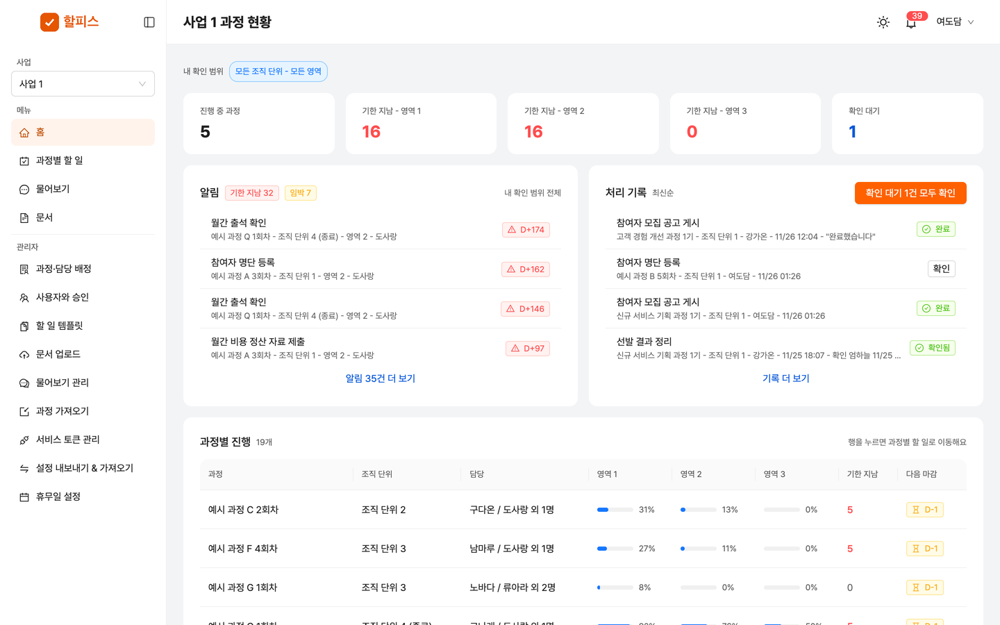

*그림 3. 관리자 화면. 사이드바에 업무 메뉴와 관리자 메뉴가 나뉘어 보이고, 접으면 아이콘만 남는다*

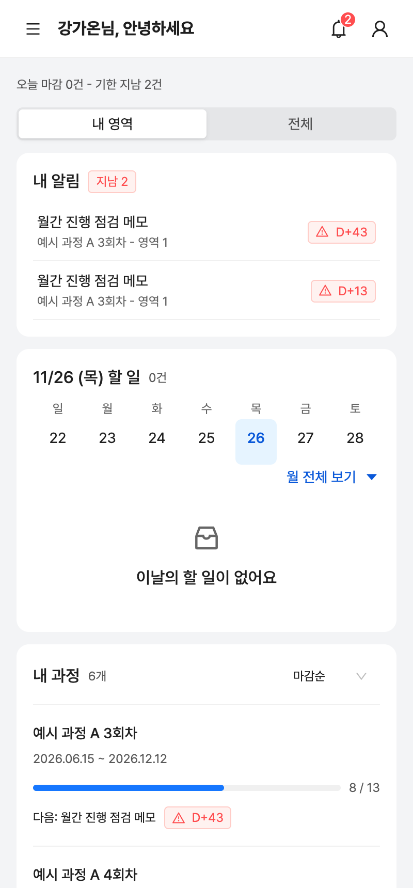

*그림 4. 모바일 화면(400px). 메뉴는 서랍으로 열고, 목록은 한 번에 보이는 개수를 줄여 더 보기로 펼친다*

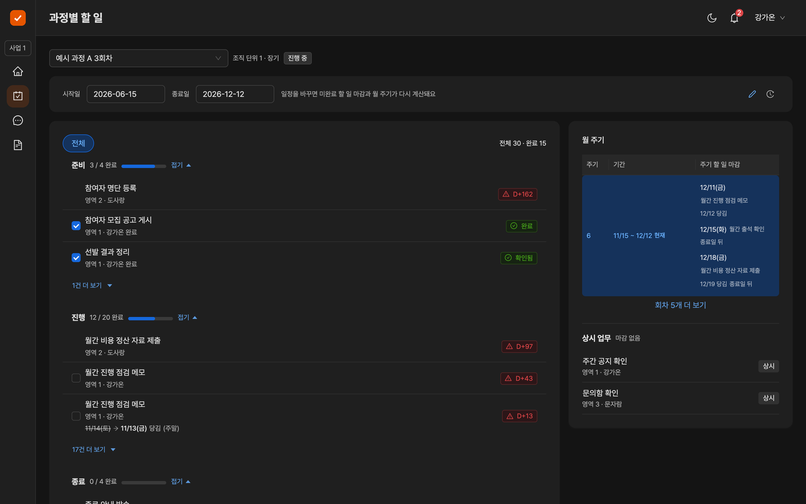

*그림 5. 다크 모드. 같은 디자인 토큰으로 라이트와 다크를 함께 맞췄다*

화면별 연동 상태와 폴더 구조, 공통 규칙은 [docs](./) 폴더에 정리했다.

### 과정 가져오기부터 리더 확인까지 (화면 기준)

| 순서 | 사용자와 화면 | 성공 확인 |
| --- | --- | --- |
| 1. CSV 미리보기 | 관리자. 과정과 담당 배정 → CSV로 가져오기에서 파일 선택 | 행별 결과(신규, 변경, 오류)와 경고가 표시됨. 오류가 하나라도 있으면 "오류가 있어 전체를 적용할 수 없어요" 안내와 함께 적용 버튼이 막힘 |
| 2. 과정 적용 | 관리자. 경고를 확인하고 전체 적용 | 적용 결과에 생성된 할 일 수가 표시되고, 과정 목록에 새 과정이 보임 |
| 3. 할 일 확인 | 담당자. 과정별 할 일에서 새 과정 선택 | 단계별 할 일과 마감일이 자동으로 생성되어 있음. 주말이나 공휴일이면 "→ 당김 (주말)" 표시 |
| 4. 할 일 완료 | 담당자. 할 일 상세에서 메모를 남기고 완료로 기록 | 완료로 바뀌고 처리 기록에 완료자와 시각이 남음 |
| 5. 리더 확인 | 리더. 리더 홈의 확인 대기에서 확인 처리 | 확인됨으로 바뀌고 처리 기록에 확인 기록이 추가됨 |

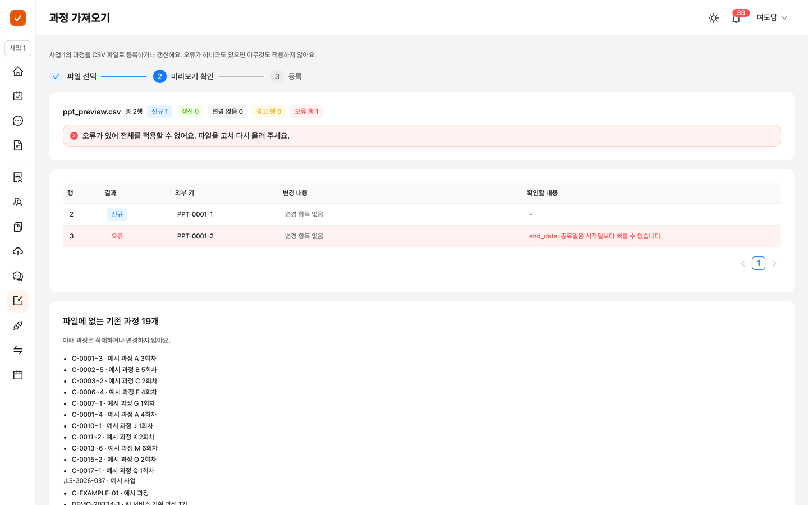

*그림 6. CSV 미리보기. 오류 행이 하나라도 있으면 사유를 표시하고 전체 적용을 막는다*

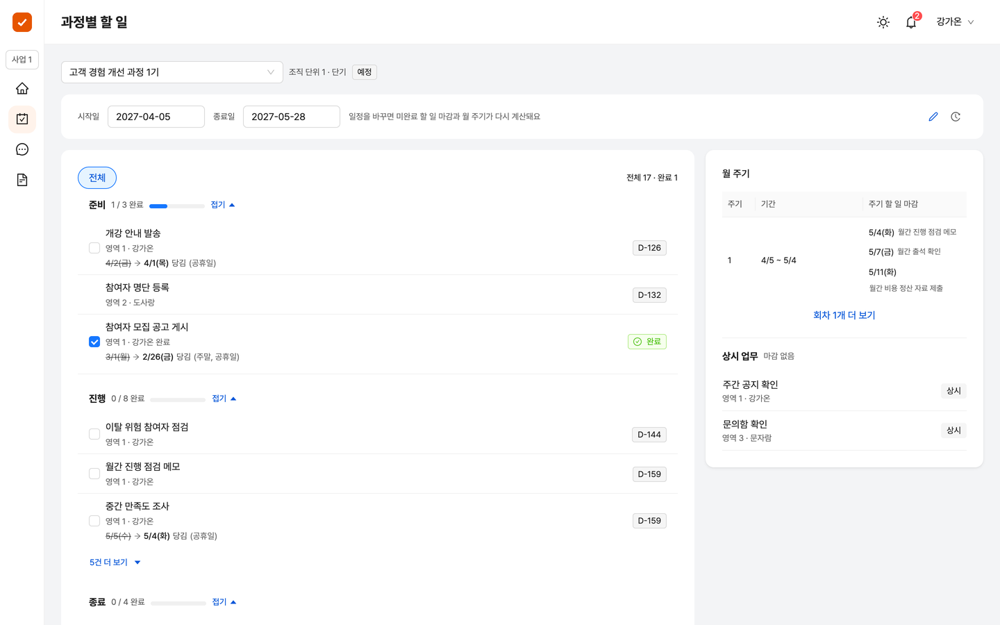

*그림 7. 과정별 할 일. 과정을 등록하면 템플릿대로 할 일과 마감일이 생기고, 마감이 쉬는 날이면 앞 영업일로 당긴 사유를 함께 보여 준다*

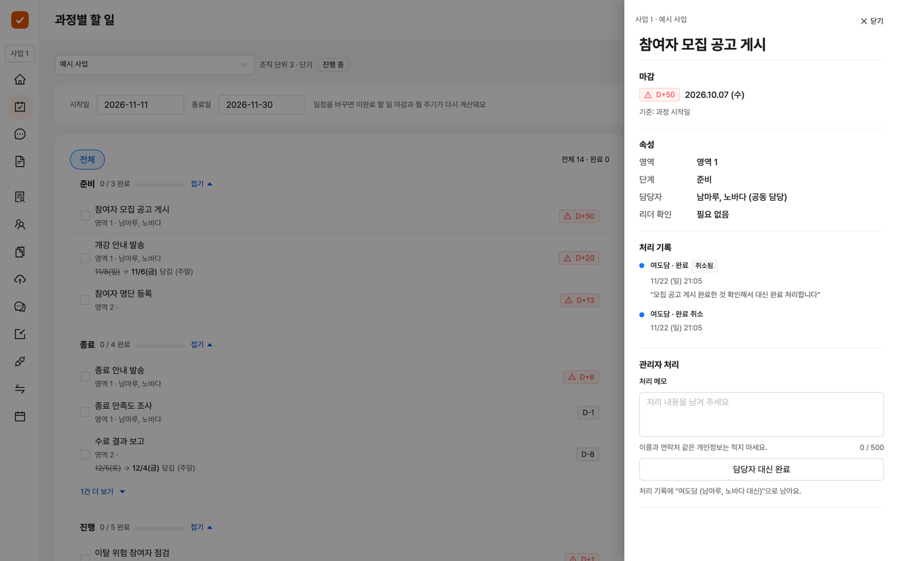

*그림 8. 할 일 상세. 처리 기록은 지우지 않고 쌓이며, 취소된 기록에는 "취소됨"이 표시된다*

### 문서와 물어보기

문서는 제목과 PDF 본문을 함께 검색하고, 찾은 구절을 누르면 그 쪽이 열린다. 물어보기는 등록된 Q&A나 문서 구절을 근거로 답하고, 근거가 애매하면 후보를 보여 주고, 없으면 없다고 답한다.

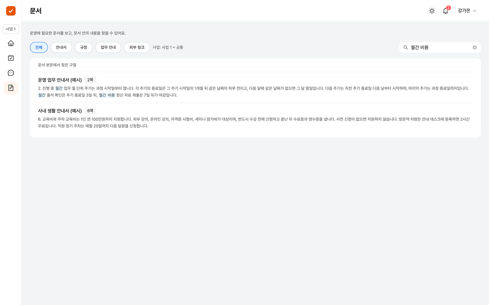

*그림 9. 문서 본문 검색. 제목과 함께 PDF 본문에서 찾은 구절을 쪽수, 검색어 강조와 함께 보여 준다*

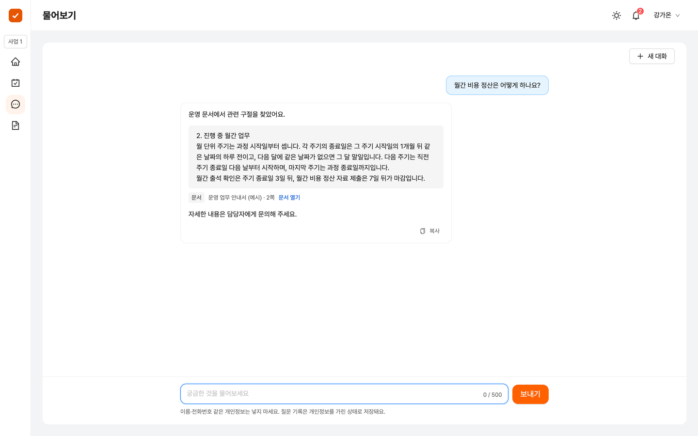

*그림 10. 물어보기. 답을 지어내지 않고 근거 원문과 문서, 쪽을 함께 보여 준다*

## 주요 구현 내용

| 기술 | 내용 |
| --- | --- |
| 공용 API 요청 함수 | 쿠키 로그인, 30초 시간 제한, 화면을 나가면 요청 취소, 서버 오류를 하나의 형식(`ApiError`)으로 통일 |
| 조회 훅 (`useApiQuery`) | 조건이 바뀌면 이전 요청을 취소하고 다시 불러온다. 로그인이 풀린 오류면 사용자 정보를 다시 확인한다 |
| 버전 충돌(409) 처리 | 수정할 때 `version`을 함께 보내 다른 사람이 먼저 고쳤으면 덮어쓰지 않고 안내한다. 저장하지 못한 입력은 화면에 남긴다 |
| 처리 요청 중복 방지 | 완료, 확인 같은 처리마다 `requestId`를 보내고 처리 중에는 버튼을 막아 연타해도 한 번만 처리된다 |
| 문서 읽기 상태 확인 | 3초마다 읽기 상태를 확인한다. 서버가 다시 읽는 중인 실패는 끝난 것으로 보지 않고 계속 확인한다 |
| 물어보기 대화 유지 | 다른 화면에 다녀와도 대화와 입력 중인 글이 남는다. 사업을 바꾸거나 로그아웃하면 초기화한다 |
| 주소에 상태 저장 | 선택한 과정과 할 일, 목록의 검색어와 필터, 쪽 번호를 주소에 저장한다. 새로고침이나 링크 공유 후에도 같은 화면이 열린다 |
| 테마 | Ant Design 토큰, CSS 변수, Tailwind를 같은 값으로 맞춰 라이트와 다크, 브랜드 주황을 적용했다 |
| 반응형 | 992px 기준으로 모바일은 메뉴 서랍, PC는 사이드바를 쓴다. 사이드바 접기 상태는 브라우저에 저장한다 |
| 공용 컴포넌트 | 오류, 빈 화면, 권한 없음, 없는 페이지, 검색 결과 없음 표시를 컴포넌트 5개로 통일했다 |
| 하위 경로 배포 | `BASE_PATH` 하나로 Vite base, 라우터, API와 PDF 주소를 함께 맞춘다 |

## 요구사항 구현 현황

설계서 요구사항, 백엔드 계약서, 질의응답을 기준으로 만든 대조표에서 화면 관련 항목을 현재 코드와 다시 맞춰 봤다. 백엔드 답변으로 요구사항에서 빠진 기능(공지, 교육)과 API가 없어 하지 않기로 한 기능(부재 대리, 확인 현황 CSV, 알림 설정 화면 등)은 제외했다.

그 결과 화면 관련 항목 **164개를 모두 구현**했다.

마무리 기간에 대조표에서 빠진 기능을 찾아 보완했다. 헤더 알림(#157), 목록 필터 주소 저장과 선택한 사업 저장, 열람 전용 안내, 승인 대기 건수 표시(#158), 리더의 비활성 담당자 교체(#161)다.

## 검증

### 프론트 테스트 케이스

2026년 11월 25일 로컬 통합 환경(Spring, PostgreSQL, NLP)에서 테스트 케이스 **54건 모두 통과**를 확인했다. 화면에서 직접 확인하기 어려운 연타, 두 탭 동시 수정, 서버 오류는 Playwright 스크립트로 재현했다. 버튼을 숨기는 것뿐 아니라 서버에서 막히는지도 API를 직접 호출해 확인했다.

| 분류 | 건수 | 예 | 결과 |
| --- | ---: | --- | --- |
| 로그인과 권한 | 7 | 담당자가 관리자 주소를 열면 권한 없음, 담당자 세션으로 관리자 API 호출 시 403 | 통과 |
| 연타와 동시 수정 | 9 | 완료 버튼을 같은 순간 3번 눌러도 기록 1건, 두 탭에서 같은 과정을 고치면 뒤 탭에 안내 | 통과 |
| 입력과 보안 | 14 | 입력 길이 제한, 스크립트 입력이 실행되지 않음, 개인정보 입력 경고 | 통과 |
| 화면 흐름 | 17 | CSV 미리보기에서 적용, 템플릿 수정 후 할 일 반영, 물어보기 되묻기 | 통과 |
| 오류 상태와 반응형 | 7 | 서버 오류 시 다시 시도 안내, 모바일 400px에서 가로 넘침 없음 | 통과 |

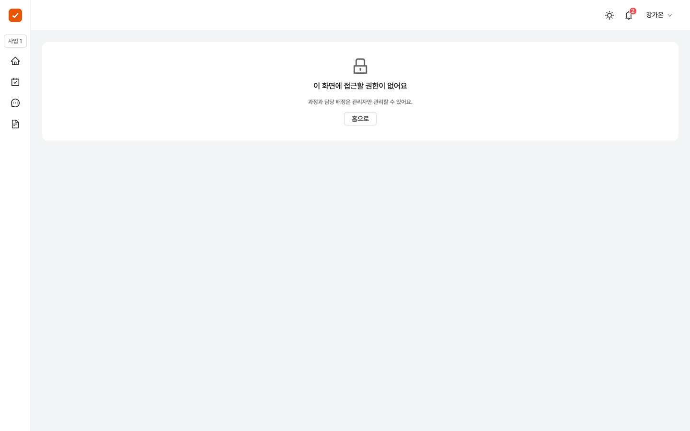

*그림 11. 권한 확인. 담당자가 관리자 주소를 직접 열면 권한 없음 화면이 나오고, API를 직접 호출해도 서버가 403으로 막는다*

전체 테스트 케이스와 결과는 [qa.md](qa.md)에 있다.

### 화면 자동 점검

- 역할 3개, 56개 화면을 PC와 모바일 폭으로 자동으로 열어 화면 오류 0건, 가로 넘침 0건을 확인했다. 공용화 작업 전후로 같은 점검을 돌려 결과가 바뀌지 않는 것도 확인했다.
- 주요 화면 13개를 다크 모드로 열어 흰 배경이 남은 곳이 없는 것을 확인했다.
- PR마다 `npm run lint`와 타입 검사를 통과한 뒤 올렸다.

### 공용화와 코드 정리 (#150)

11월 25일 화면마다 따로 만든 같은 기능을 공용 컴포넌트와 함수로 모았다. 아래 수치는 같은 브랜치에서 작업 전후를 비교한 값이다.

| 항목 | 전 | 후 |
| --- | --- | --- |
| 오류, 빈 화면, 권한 없음, 없는 페이지 표시 방식 | 4가지 혼재 | 1가지 (공용 컴포넌트 5개) |
| Ant Design 기본 결과 화면(Result, Empty) 사용 | 26곳 | 0곳 |
| API 오류 안내와 로그인 재확인 코드 | 30곳에 복사 | 4곳 (공용 훅과 인증 코드) |
| 날짜 표시 함수 | 6개 파일에 흩어짐 | 1개 파일 |
| 표 모양, 카드 여백, 한 쪽 개수 상수 | 각각 13곳, 20곳, 19곳 | 각각 1곳 |
| 코드 줄 수 | 18,495줄 | 18,287줄 (208줄 감소) |
| 배포 JS 크기 (gzip) | 599.6KB | 585.7KB (2.3% 감소) |

날짜 함수는 예전과 새 함수의 결과 46건을 비교해 모두 같은 것을 확인했다. 작업 전후로 56개 화면 자동 점검 결과(오류 0건, 가로 넘침 0건)가 그대로인 것도 확인했다.

## 트러블슈팅

### 대표 사례 · 문서 읽기가 끝났는데 실패 알림이 먼저 뜬 문제 (#107)

| 구분 | 내용 |
| --- | --- |
| 상황 | 관리자가 PDF를 올리면 화면이 3초마다 읽기 상태를 확인해 끝나면 알림을 띄운다 |
| 문제 | 실제로는 읽기가 끝났는데 "읽지 못했어요"가 먼저 뜨고 완료 알림은 오지 않았다 |
| 원인 | 서버는 NLP 일시 장애도 실패(`FAILED`)로 저장하고 재시도 표시(`RETRYABLE`)를 붙여 자동으로 다시 읽는다. 화면은 실패를 최종 결과로 보고 감시를 멈췄다 |
| 해결 | 재시도 중인 실패를 "읽는 중"으로 보는 함수(`isIndexRetrying`)를 만들어 계속 감시하게 했다. 같은 조건으로 "다시 시도" 버튼도 숨겼다 |
| 확인 | 백엔드 재시도 코드와 상태값을 대조하고, 재시도 중인 문서에 실패 알림과 다시 시도 버튼이 나오지 않는 것을 확인했다 |

### 대표 사례 · 목록 저장 중간에 충돌이 나면 입력이 사라진 문제 (#129)

| 구분 | 내용 |
| --- | --- |
| 상황 | 목록 관리에서 이름과 순서를 여러 개 고친 뒤 저장하면 한 줄씩 차례로 서버에 보낸다 |
| 문제 | 중간에 409(다른 사람이 먼저 수정)가 나면 저장 못 한 입력과 새로 추가한 항목까지 모두 지워졌다 |
| 원인 | 저장이 실패해도 끝에서 목록을 다시 불러와 화면 값을 서버 값으로 덮어썼다 |
| 해결 | 못 보낸 줄을 따로 기억해 두고, 새 목록이 오면 그 입력만 다시 얹었다. 다시 저장하면 남은 줄만 보낸다 |
| 확인 | 두 번째 저장만 일부러 409로 막아 첫 줄은 저장되고 나머지 입력은 남는지, 다시 저장하면 남은 줄만 가는지 확인했다 |

### 그 밖의 사례

| 문제 | 원인 | 해결 | PR |
| --- | --- | --- | --- |
| 문서 읽기 상태 확인이 검색어를 칠 때마다 다시 시작됨 | 렌더마다 바뀌는 값을 effect 의존성에 넣어 타이머가 계속 초기화됨 | `useEffectEvent`로 재조회를 의존성에서 빼고, 삭제된 문서는 감시 대상에서 제거 | #107 |
| 물어보기 긴 대화에서 입력창이 화면 밖으로 밀림 | 공통 레이아웃 본문이 내용만큼 늘어나 채팅 영역의 높이 제한이 적용되지 않음 | 물어보기 바깥 박스만 남은 공간을 쓰도록 수정하고 높이 값을 측정해 확인 | #109 |
| 바뀐 명세로 사용자 영역 저장이 거절됨 | 백엔드가 영역을 1개로 제한했는데 화면은 여러 개를 고르게 되어 있었음 | 영역을 하나만 고르게 바꾸고 영역이 여러 개인 기존 사용자는 정리 안내 | #113 |
| 조직 리더가 사용자와 승인 화면에 들어가지 못함 | 일부 목록이 안 보인다는 이유로 화면 전체를 관리자에게만 열어 둠 | 역할별로 화면을 나눠 리더에게는 자기 조직 승인과 역할 추가만 제공 | #113 |
| 하위 경로 시험에서 로그인만 403 | 경로가 아니라 백엔드가 허용한 출처(포트)가 아니었음 | Origin만 바꿔 요청해 원인을 확인하고, 경로 설정을 `BASE_PATH` 하나로 통일 | #117 |
| 설정 가져오기에서 종류를 잘못 고르면 알 수 없는 오류 | 파일 안에 종류가 이미 있는데 사용자가 한 번 더 고르게 함 | 종류 선택을 없애고 파일 안의 종류를 읽어 사용 | #143 |
| 화면마다 오류와 빈 화면 모양이 제각각 | 화면을 따로 만들며 표시 방식과 오류 처리 코드를 각자 작성 | 공용 컴포넌트 5개와 오류 처리 훅 하나로 통일 | #150 |
| 문서 본문 검색에 관련 없는 구절이 나옴 | 검색 API가 점수가 낮은 구절도 돌려줌 | 검색어 10개로 점수를 재서 0.5 미만은 숨기고 근거를 문서에 기록 | #155 |

## 남은 검증

- 실제 운영 Mac에서 전체 서비스와 함께 화면 속도와 동작을 확인한다. 현재 결과는 로컬 통합 환경 기준이다.
- 리더 화면에서 비활성 담당자 안내부터 교체까지 이어지는 흐름은 실제 비활성 담당자가 있는 데이터로 최종 확인한다. 현재는 응답을 바꿔 화면과 요청 내용을 확인했다.
- 속도 개선 후보(목록 여러 쪽을 동시에 받기, 화면 재방문 시 이전 결과 먼저 표시, 글꼴 용량 줄이기)는 측정 후 반영한다.
- AI 활용 사례는 [README의 AI 활용](../README.md#ai-활용)에 정리했다.
